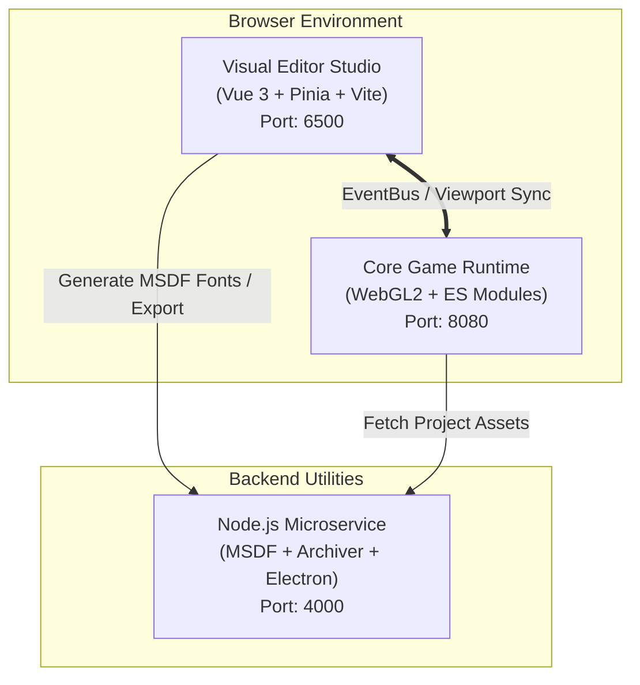

# 🐺 Lupis Engine

<p align="center">
  
</p>

<p align="center">
  <b>A modern, web-first 2D/2.5D game engine and visual creation studio powered by WebGL, Vue 3, and Node.js.</b>
</p>

<p align="center">
  <a href="https://github.com/haikaladnan/lupis-engine/actions/workflows/ci.yml">
    
  </a>
  <a href="./LICENSE">
    
  </a>
  <a href="https://nodejs.org/">
    
  </a>
  <a href="https://vuejs.org/">
    
  </a>
  <a href="https://www.khronos.org/webgl/">
    
  </a>
  <a href="https://playwright.dev/">
    
  </a>
</p>

---

## 🌟 Overview

**Lupis Engine** is an open-source game development environment running entirely in the browser. It combines a rich visual studio editor, an extensible node-based visual scripting system (Blueprints), and a high-performance WebGL runtime engine with hardware-accelerated batching, 2D rigid-body physics, and spatial audio.

Whether you are crafting 2D platformers, top-down RPGs, or 2.5D isometric worlds, Lupis Engine provides a modern, frictionless workflow from initial prototype to final export.

---

## ✨ Key Features

- 🎨 **Modern Visual Studio Editor**: Built with Vue 3, Vite, and Tailwind CSS. Features intuitive Hierarchy, Inspector, Asset, and Node Graph panels.
- ⚡ **High-Performance WebGL Engine**: Hardware-accelerated batch rendering for sprites, vector shapes (rectangles, circles, custom polygons), and Multi-channel Signed Distance Field (MSDF) typography.
- 🔀 **Visual Scripting (Blueprints)**: Complete node-graph visual programming language with execution flow control, pure data evaluation, and runtime debugging.
- 💥 **Physics & Kinematics**: Rigid bodies with gravity, velocity clamping, atmospheric drag, and smooth kinematic `MoveAndSlide` obstacle navigation.
- 🎧 **Web Audio System**: Low-latency audio playback featuring master gain control, dynamic pitch modification, volume fade-ins, and 3D spatial HRTF panning.
- 📦 **Asset & Export Pipeline**: Micro-backend service providing on-the-fly MSDF font generation, project compression, and desktop Electron packaging.
- 🧪 **Enterprise-Grade Testing**: Fully verified with 780+ Vitest unit tests and Playwright End-to-End (E2E) automated test suites.
- 🐳 **Turnkey Docker Setup**: Launch the entire ecosystem (editor, engine runtime, and service) with a single command.

---

## 🏗️ Architecture



---

## 🚀 Quickstart

### Option 1: Docker Compose (Recommended)

Run all engine services inside isolated, synchronized containers:

```bash
# 1. Clone the repository
git clone https://github.com/haikaladnan/lupis-engine.git
cd lupis-engine

# 2. Start the stack
docker compose -f start.yml up
```

Once ready, visit:
- **Visual Editor**: [http://localhost:6500](http://localhost:6500)
- **Core Engine Standalone**: [http://localhost:8080](http://localhost:8080)
- **Backend Service**: [http://localhost:4000](http://localhost:4000)

### Option 2: Local Native Setup (Without Docker)

You can run individual services locally using Node.js:

```bash
# 1. Start the backend service
cd service
npm install
npm run dev

# 2. In a new terminal, launch the Visual Editor
cd ../editor
npm install
npm run dev

# 3. Serve the core engine statically (optional for standalone)
cd ../core
npx serve -l 8080 .
```

---

## 📁 Repository Structure

```text
├── .github/
│   ├── workflows/             # GitHub Actions CI & Docker workflows
│   ├── ISSUE_TEMPLATE/        # Issue forms for Bug Reports & Feature Requests
│   └── PULL_REQUEST_TEMPLATE.md
├── core/                      # WebGL runtime engine, ECS, and subsystems
├── docs/                      # In-depth technical architecture & API docs
├── editor/                    # Vue 3 visual studio editor application
├── examples/                  # Standalone minimal feature demos
│   ├── 01-2d-features/        # 2D shapes, player movement, camera follow
│   ├── 02-physics-and-collision/ # Dynamic rigid bodies & MoveAndSlide
│   ├── 03-audio-system/       # Web Audio SFX, BGM, and pitch control
│   └── 04-pseudo-3d-and-depth/# 2.5D isometric perspective & Y-sorting
├── service/                   # Micro-backend service (MSDF font generator, exporter)
├── tests/                     # Playwright E2E test suite & static standard checks
├── CHANGELOG.md               # Version release notes (SemVer)
├── CONTRIBUTING.md            # Contribution guidelines & development setup
├── LICENSE                    # MIT License
├── README.md                  # Project landing page & quickstart
└── start.yml                  # Docker Compose configuration
```

---

## 📖 Documentation

Explore the complete documentation in [`docs/`](file:///D:/Project/Lupis%20Engine/docs/):

- [Architecture Overview](file:///D:/Project/Lupis%20Engine/docs/architecture.md)
- [Getting Started Guide](file:///D:/Project/Lupis%20Engine/docs/getting-started.md)
- [Core Engine API Reference](file:///D:/Project/Lupis%20Engine/docs/core-api.md)
- [Visual Scripting & Blueprint Guide](file:///D:/Project/Lupis%20Engine/docs/visual-scripting.md)
- [Visual Editor Guide](file:///D:/Project/Lupis%20Engine/docs/editor-guide.md)

---

## 🎮 Runnable Examples

Explore minimal code demos in the [`examples/`](file:///D:/Project/Lupis%20Engine/examples/) directory:

- [2D Movement & Rendering](file:///D:/Project/Lupis%20Engine/examples/01-2d-features/)
- [2D Physics & Collisions](file:///D:/Project/Lupis%20Engine/examples/02-physics-and-collision/)
- [Web Audio Synthesizer & BGM](file:///D:/Project/Lupis%20Engine/examples/03-audio-system/)
- [2.5D Pseudo-3D & Depth Sorting](file:///D:/Project/Lupis%20Engine/examples/04-pseudo-3d-and-depth/)

To run the examples locally:
```bash
npx serve .
# Open http://localhost:3000/examples/01-2d-features/index.html
```

---

## 🧪 Running Tests

Lupis Engine enforces high testing standards:

```bash
# 1. Run editor unit tests (Vitest)
cd editor && npm run test:run

# 2. Run E2E static standard verification
node tests/scripts/check-standard.mjs

# 3. Run Playwright E2E browser tests
cd tests && npm test
```

---

## 🤝 Contributing

Contributions are warmly welcomed! Please read our [CONTRIBUTING.md](file:///D:/Project/Lupis%20Engine/CONTRIBUTING.md) guide before opening issues or submitting pull requests.

---

## 📄 License

Lupis Engine is licensed under the [MIT License](file:///D:/Project/Lupis%20Engine/LICENSE).
© 2026 Haikal Adnan and contributors.
