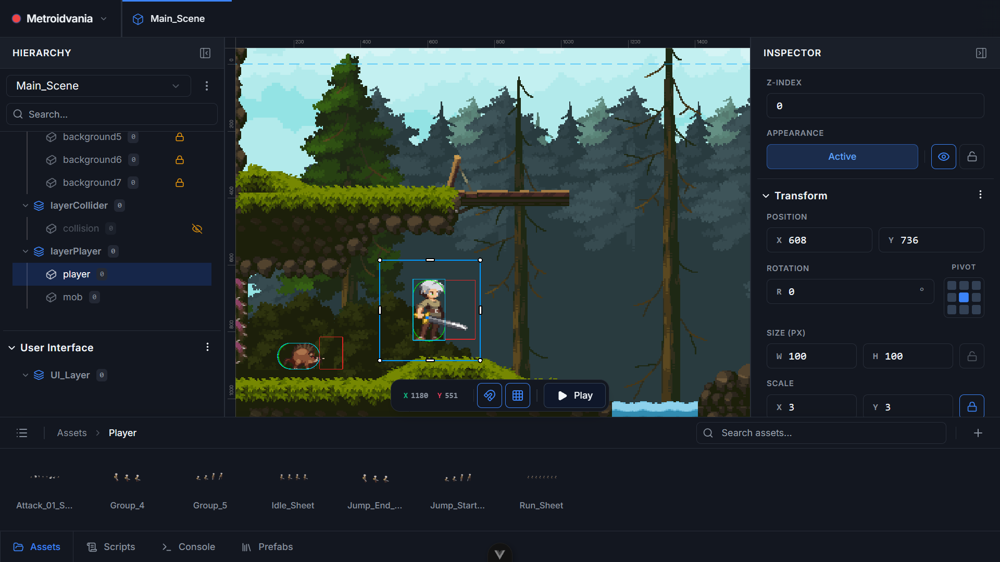
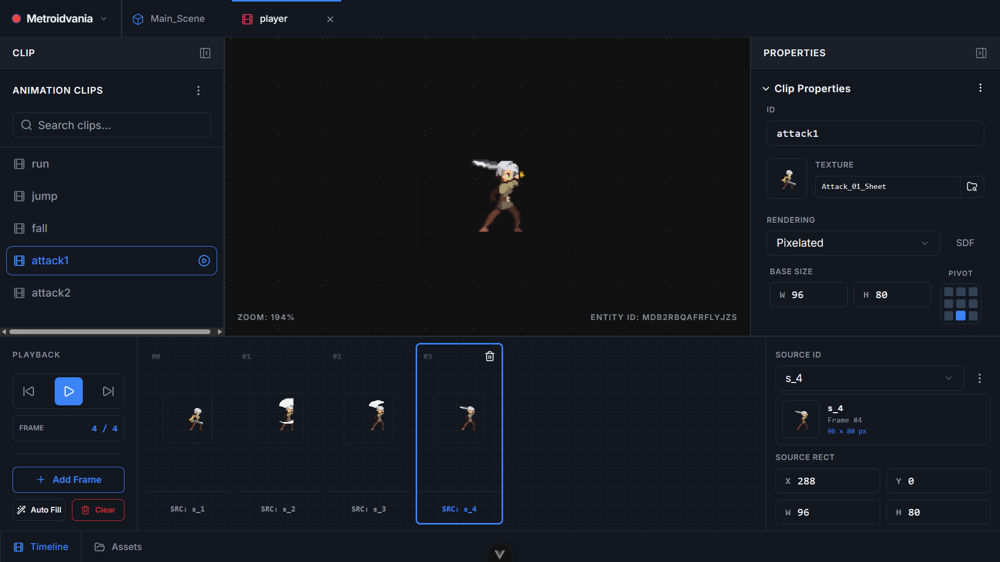
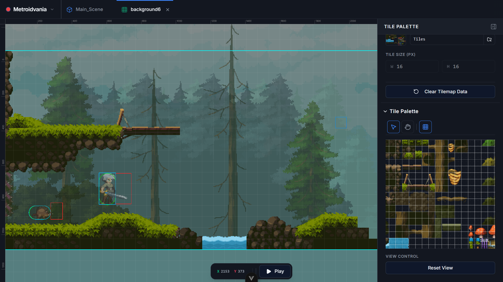
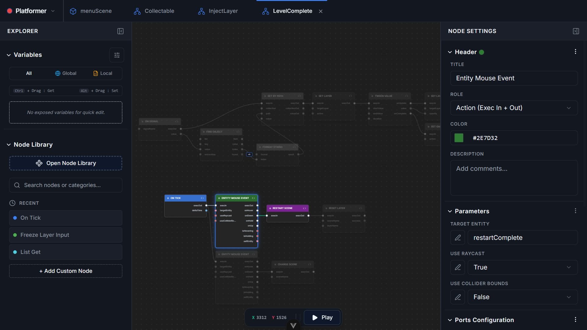
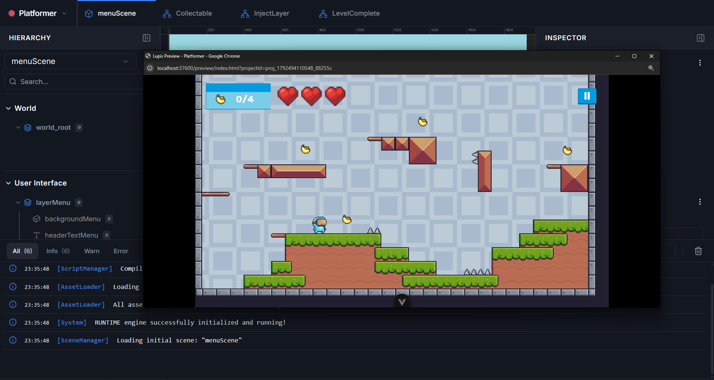

<div align="center">


# Lupis Engine

**An open-source 2D game engine for the web, built on WebGL and native JavaScript, with a node-based visual editor.**

[-orange)](./CHANGELOG.md)
[](./LICENSE)
[](https://github.com/haikal-adnan/lupis-engine/actions/workflows/ci.yml)
[](https://haikal-adnan.github.io/lupis-engine-link?go=discord)

[Web Editor](https://haikal-adnan.github.io/lupis-engine-link?go=web) · [Documentation](https://haikal-adnan.github.io/lupis-engine-link?go=docs-en) · [Examples](https://haikal-adnan.github.io/lupis-engine-link?go=example) · [Discord](https://haikal-adnan.github.io/lupis-engine-link?go=discord)

</div>

> **Early Release.** Version 0.1.0 is the first public release. The public API and the project file format may change before 1.0. See [Project Status](#project-status) for details.

## Table of Contents

- [Overview](#overview)
- [Features](#features)
- [Getting Started](#getting-started)
- [Documentation](#documentation)
- [Repository Structure](#repository-structure)
- [Project Status](#project-status)
- [Security and Scripting Limitations](#security-and-scripting-limitations)
- [Contributing](#contributing)
- [Community and Support](#community-and-support)
- [License](#license)

---

## Overview

Lupis Engine is a 2D game engine and visual editor that runs entirely in the browser. The runtime renders exclusively through WebGL (2.0, with a 1.0 fallback). The editor is built with Vue 3 and lets you create complete games using a scene editor, an animator, a tilemap editor, and Blueprint-style visual scripting, with in-editor JavaScript available for custom logic.

Lupis Engine is local-first. Projects can be created in the hosted Web Editor or run on your own machine, and finished games can be exported as ZIP archives or packaged as desktop applications with Electron.

---

## Features

### Editor

#### Scene Editor
Author scenes visually with multi-layer hierarchies, real-time transform gizmos, responsive canvas viewports, and property inspectors.



#### Animator Editor
Design frame-by-frame 2D sprite animations with category trees, clip timing, configurable loop modes, and real-time playback previews.



#### Tilemap Editor
Paint tilemaps directly into your scenes with tile brushes, layer management, and automatic solid collision generation.



#### Visual Node Scripting
Build game logic without writing code using more than 100 production-ready Blueprint nodes across 10 modular domains, with live data wires and support for custom nodes.



#### Preview Game
Run your game in the editor with a single click, inspect entity transforms, and apply live changes without restarting.



### Engine

- **WebGL rendering.** All rendering uses WebGL 2.0 with a WebGL 1.0 fallback. 
- **MSDF text rendering.** Text remains sharp at any size and does not depend on the Canvas 2D text API.
- **Built-in 2D systems.** Collision physics, tilemaps, geometry shapes, and animation are included out of the box.
- **Dual scripting model.** Combine Blueprint visual scripting with JavaScript written directly in the editor.

### Workflow

- **Browser-based editor.** Built with Vue 3, with a hierarchy, inspector, and asset browser.
- **Local-first.** Run the full stack with a single `docker compose` command or `npm run dev`.
- **Export and packaging.** Export projects as ZIP archives or package them as desktop applications with Electron.

---

## Getting Started

### Try Online

Launch the **[Web Editor](https://haikal-adnan.github.io/lupis-engine-link?go=web)** in your browser with no installation. Projects and assets are stored locally using the Origin Private File System (OPFS).

### Prerequisites

- **Node.js** `^20.19` or `>=22.12`
- **Docker and Docker Compose** (optional, for single-command setup)

### Run with Docker (Recommended)

```bash
git clone https://github.com/haikal-adnan/lupis-engine.git
cd lupis-engine
docker compose -f start.yml up
```

Open **http://localhost:37600** to start using the editor.

### Run without Docker

```bash
git clone https://github.com/haikal-adnan/lupis-engine.git
cd lupis-engine

# Terminal 1: backend service
cd service && npm install && npm run dev

# Terminal 2: editor
cd editor && npm install && npm run dev
```

Open **http://localhost:37600**, then load one of the sample projects from the [`examples/`](./examples) folder, or explore them online at [Examples](https://haikal-adnan.github.io/lupis-engine-link?go=example).

---

## Documentation

The full documentation is available [online](https://haikal-adnan.github.io/lupis-engine-link?go=docs-en) and inside the editor as a built-in bilingual help panel (English and Bahasa Indonesia). It can also be read directly from the Markdown files in [`editor/public/docs/en/`](./editor/public/docs/en) and [`editor/public/docs/id/`](./editor/public/docs/id).

> **Note**  
> Most of this documentation was generated with the assistance of AI due to the developer's limitations in manual technical writing. If you would like to contribute by improving or writing new documentation, contributions are very welcome! Please check our [Contributing](#contributing) section.

### For Game Developers

| Category | Contents |
| --- | --- |
| [Getting Started](./editor/public/docs/en/getting_started) | Installation, introduction, quick start, projects, and export |
| [Interface](./editor/public/docs/en/interface) | Editor overview, viewport, hierarchy, inspector, and shortcuts |
| [Components](./editor/public/docs/en/components) | Transform, renderers, physics body, audio, animator, and more |
| [Visual Scripting](./editor/public/docs/en/visual_scripting) | Graph concepts, context system, variables, and custom nodes |
| [Behaviour](./editor/public/docs/en/behaviour) | Movement, physics and collision, and UI patterns |

### For Contributors

| Document | Description |
| --- | --- |
| [`CONTRIBUTING.md`](./CONTRIBUTING.md) | Development setup, code style, testing guidelines, and pull request workflow |
| [`CHANGELOG.md`](./CHANGELOG.md) | Release history |
| [`SECURITY.md`](./SECURITY.md) | Security policy and vulnerability reporting |
| [`THIRD_PARTY.md`](./THIRD_PARTY.md) | Third-party notices and open source licenses |

---

## Repository Structure

```
lupis-engine/
├── core/        # Engine runtime: WebGL renderer, physics, audio, ECS, scripting
├── editor/      # Visual editor (Vue 3, Pinia, Vite), served on port 37600
├── electron/    # Desktop shell (Electron) and desktop installer packaging 
├── service/     # Node.js backend: Electron packaging
├── tests/       # End-to-end and integration tests (Playwright)
├── examples/    # Ready-to-run sample projects
└── .github/     # CI workflows and issue templates
```

---

## Project Status

Lupis Engine v0.1.0 is an early release. The core renderer, the editor, and visual scripting are covered by automated tests, but coverage is not yet complete across all features.

- The editor and desktop tooling are currently tested only on **Windows**, so running on other operating systems may lead to instability. Broader cross-platform support and testing are planned for future releases.
- The public API and project file format may change before 1.0. If you build on top of the engine, pin your dependencies to a specific version.
- Expect rough edges and breaking changes.

Bug reports and feedback are highly appreciated. To contribute, see the [Contributing](#contributing) section.

---

## Security and Scripting Limitations

User scripts (JavaScript and Blueprint) run in the context of the local editor in the browser, **without process or iframe sandboxing**. This is acceptable for local use, but note the following:

- **Do not host the editor on a public URL** where untrusted users can load projects. User scripts have full access to the page.
- Exported games contain user code that runs in the player's browser.

For full details and instructions on reporting vulnerabilities, see [`SECURITY.md`](./SECURITY.md).

---

## Contributing

Contributions are welcome, including bug reports, feedback on the engine and editor, and documentation improvements. For larger features, please open an issue to discuss the proposal first. At this early stage, we aim to keep the architecture stable.

See [`CONTRIBUTING.md`](./CONTRIBUTING.md) for the complete guide.

---

## Community and Support

- **Discord:** [Join the community](https://haikal-adnan.github.io/lupis-engine-link?go=discord) to ask questions, share projects, and discuss ideas.
- **GitHub Discussions:** [Start or join a discussion](https://github.com/haikal-adnan/lupis-engine/discussions)
- **Issue Tracker:** [Report a bug or request a feature](https://github.com/haikal-adnan/lupis-engine/issues)
- **Sample Projects:** [Lupis Engine Examples](https://haikal-adnan.github.io/lupis-engine-link?go=example)
- **Web Editor:** [Lupis Engine Web Editor](https://haikal-adnan.github.io/lupis-engine-link?go=web)

---

## License

Released under the [MIT License](./LICENSE). Copyright © 2026 Haikal Adnan and contributors.

For third-party software and font licenses, see [`THIRD_PARTY.md`](./THIRD_PARTY.md).
