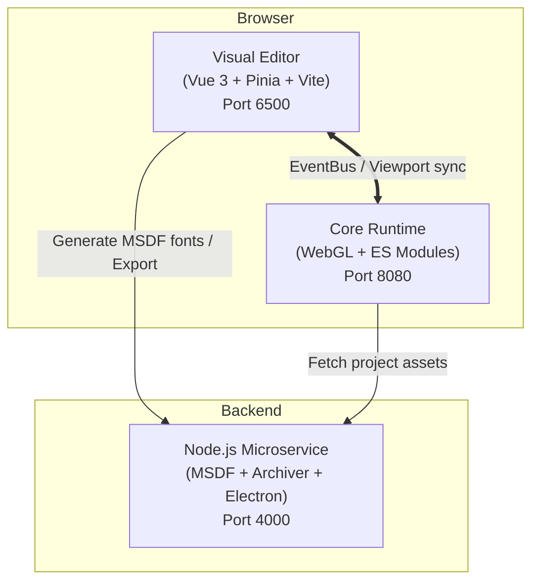

<div align="center">


# Lupis Engine

**A web-first 2D/2.5D game engine and visual creation studio, built on WebGL, Vue 3, and Node.js.**

[](https://github.com/haikal-adnan/lupis-engine/actions/workflows/ci.yml)
[](./LICENSE)
[](https://nodejs.org/)
[](https://vuejs.org/)
[](https://www.khronos.org/webgl/)
[](https://playwright.dev/)

[Quickstart](#quickstart) ·
[Documentation](#documentation) ·
[Examples](#examples) ·
[Contributing](#contributing)

</div>

---

## Table of Contents

- [Overview](#overview)
- [Project Status](#project-status)
- [Features](#features)
- [Architecture](#architecture)
- [Quickstart](#quickstart)
- [Repository Structure](#repository-structure)
- [Documentation](#documentation)
- [Examples](#examples)
- [Testing](#testing)
- [Contributing](#contributing)
- [License](#license)

---

## Overview

Lupis Engine is an open-source game development environment that runs entirely in the browser. It combines three parts:

- a **visual studio editor** for building scenes and managing assets,
- a **node-based visual scripting system (Blueprints)** for authoring game logic,
- a **WebGL runtime** with batched rendering, 2D rigid-body physics, and spatial audio.

It targets 2D platformers, top-down RPGs, and 2.5D isometric worlds, with a single workflow from prototype to export.

## Project Status

Lupis Engine is under active development and is working toward its first tagged release, **v0.1.0**. Until then:

- Public APIs and project file formats may change between releases.
- Development priorities are architecture, clear module contracts, a readable execution flow, and maintainability. Performance tuning comes after these.
- Bug reports and feedback are very welcome. See [Contributing](#contributing).

See [`CHANGELOG.md`](./CHANGELOG.md) for release notes.

## Features

| Area | Capabilities |
| --- | --- |
| **Visual Editor** | Hierarchy, Inspector, Asset, and Node Graph panels. Built with Vue 3, Pinia, Vite, and Tailwind CSS. |
| **Rendering** | WebGL batch rendering for sprites and vector shapes (rectangles, circles, custom polygons). Text rendered with Multi-channel Signed Distance Field (MSDF) fonts, without relying on the Canvas 2D context. |
| **Visual Scripting** | Consolidated 10-domain architecture with 128 production nodes and dual-tier Context System, supporting ~80% of 2D game mechanics out-of-the-box without touching code. |
| **Physics** | Rigid bodies with gravity, velocity clamping, and drag, plus kinematic `MoveAndSlide` movement. |
| **Audio** | Web Audio playback with master gain, pitch control, fade-ins, and 3D spatial (HRTF) panning. |
| **Asset & Export** | Node.js microservice for MSDF font generation, project compression, and desktop (Electron) packaging. |
| **Quality** | Unit, integration, and UI tests with Vitest, plus end-to-end tests with Playwright. |
| **Deployment** | Docker Compose setup that starts the editor, runtime, and service with one command. |

## Architecture



| Component | Directory | Responsibility |
| --- | --- | --- |
| Editor | [`editor/`](./editor) | Authoring UI, scene and asset management, Blueprint editor. |
| Core | [`core/`](./core) | Runtime engine: ECS, rendering, physics, audio. |
| Service | [`service/`](./service) | Font generation, project export, desktop packaging. |

For a deeper walkthrough, see [`docs/architecture.md`](./docs/architecture.md).

## Quickstart

### Prerequisites

- Node.js `^20.19` or `>=22.12`
- Docker and Docker Compose (only for Option 1)

### Option 1: Docker Compose (recommended)

```bash
git clone https://github.com/haikal-adnan/lupis-engine.git
cd lupis-engine
docker compose -f start.yml up
```

Once the containers are running:

| Service | URL |
| --- | --- |
| Visual Editor | <http://localhost:6500> |
| Core Engine (standalone) | <http://localhost:8080> |
| Backend Service | <http://localhost:4000> |

### Option 2: Local setup (without Docker)

Run each service in its own terminal.

```bash
# 1. Backend service
cd service
npm install
npm run dev
```

```bash
# 2. Visual editor
cd editor
npm install
npm run dev
```

```bash
# 3. Core engine, served statically (optional, for standalone use)
cd core
npx serve -l 8080 .
```

## Repository Structure

```text
.
├── .github/
│   ├── workflows/               # CI and Docker workflows
│   ├── ISSUE_TEMPLATE/          # Bug report and feature request forms
│   └── PULL_REQUEST_TEMPLATE.md
├── core/                        # WebGL runtime, ECS, and subsystems
├── docs/                        # Architecture and API documentation
├── editor/                      # Vue 3 visual studio editor
├── examples/                    # Minimal, standalone feature demos
│   ├── 01-2d-features/
│   ├── 02-physics-and-collision/
│   ├── 03-audio-system/
│   └── 04-pseudo-3d-and-depth/
├── service/                     # Backend microservice (MSDF, export)
├── tests/                       # Playwright E2E suite and static checks
├── CHANGELOG.md
├── CONTRIBUTING.md
├── LICENSE
├── README.md
└── start.yml                    # Docker Compose configuration
```

## Documentation

| Guide | Description |
| --- | --- |
| [Getting Started](./docs/getting-started.md) | Installation and first project walkthrough. |
| [Architecture Overview](./docs/architecture.md) | System design, runtime lifecycle, and inter-process communication. |
| [Core Engine API](./docs/core-api.md) | Complete runtime API and subsystem reference. |
| [Visual Scripting Guide](./docs/visual-scripting.md) | 10 Blueprint domains, 128 production nodes, and port contracts. |
| [Context System Reference](./docs/context-system.md) | Full contract for the 15 runtime execution facades. |
| [Visual Editor Guide](./docs/editor-guide.md) | Editor panels, inspectors, hotkeys, and authoring workflows. |
| [Editor Reference](./docs/editor-reference.md) | Detailed feature inventory, menu specifications, and schema definitions. |
| [Schema Contract](./docs/schema-contract.md) | Formal JSON specifications for projects, scenes, entities, and nodes. |

## Examples

Each example is a small, self-contained demo of one feature area:

| Example | Demonstrates |
| --- | --- |
| [`01-2d-features`](./examples/01-2d-features) | 2D shapes, player movement, camera follow. |
| [`02-physics-and-collision`](./examples/02-physics-and-collision) | Dynamic rigid bodies and `MoveAndSlide`. |
| [`03-audio-system`](./examples/03-audio-system) | Sound effects, background music, pitch control. |
| [`04-pseudo-3d-and-depth`](./examples/04-pseudo-3d-and-depth) | 2.5D isometric perspective and Y-sorting. |

To run them locally, serve the repository root and open an example:

```bash
npx serve .
# Then open http://localhost:3000/examples/01-2d-features/index.html
```

## Testing

```bash
# Editor unit, integration, and UI tests (Vitest)
cd editor && npm run test:run

# Static standard checks
node tests/scripts/check-standard.mjs

# End-to-end browser tests (Playwright)
cd tests && npm test

# Blueprint runtime testing pyramid (Playwright)
cd tests && npm run test:blueprint
```

## Contributing

Contributions are welcome. Please read [`CONTRIBUTING.md`](./CONTRIBUTING.md) for development setup and guidelines before opening an issue or pull request.

## License

Released under the [MIT License](./LICENSE).

Copyright © 2026 Haikal Adnan and contributors.
