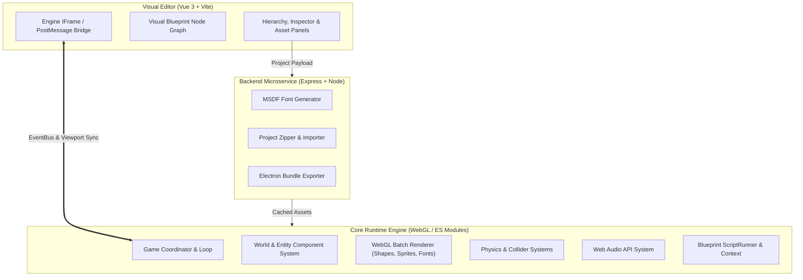

# 📚 Lupis Engine Documentation

Welcome to the official technical documentation for **Lupis Engine**, a modern web-based 2D/2.5D game engine and visual creation suite powered by WebGL, Vue 3, and Node.js.

---

## 🧭 Documentation Sitemap

| Document | Description |
| :--- | :--- |
| [Architecture Overview](file:///D:/Project/Lupis%20Engine/docs/architecture.md) | High-level system architecture, engine topology, and subsystem interaction diagrams. |
| [Getting Started](file:///D:/Project/Lupis%20Engine/docs/getting-started.md) | Prerequisites, local installation, Docker Compose setup, and dev environment workflow. |
| [Core Engine API Reference](file:///D:/Project/Lupis%20Engine/docs/core-api.md) | Technical reference for `Game`, `World`, `Entity`, ECS components, physics, and renderers. |
| [Visual Scripting & Blueprints](file:///D:/Project/Lupis%20Engine/docs/visual-scripting.md) | Node-graph architecture, data flow execution, custom nodes, and script contracts. |
| [Visual Editor Guide](file:///D:/Project/Lupis%20Engine/docs/editor-guide.md) | Editor UI walkthrough, hierarchy, inspector, viewport tools, asset pipeline, and preview mode. |

---

## ⚡ High-Level Overview

Lupis Engine is engineered with a modular, service-oriented architecture:



---

## 🛠️ Quick Commands

```bash
# Start all services with Docker Compose
docker compose -f start.yml up

# Or run editor locally
cd editor && npm install && npm run dev

# Run editor unit tests
cd editor && npm run test:run

# Run E2E test standard check
node tests/scripts/check-standard.mjs
```
