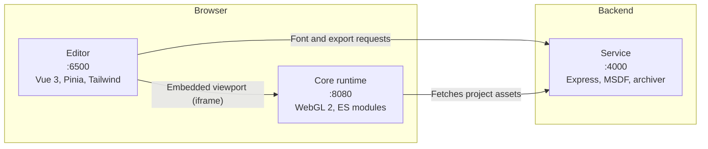
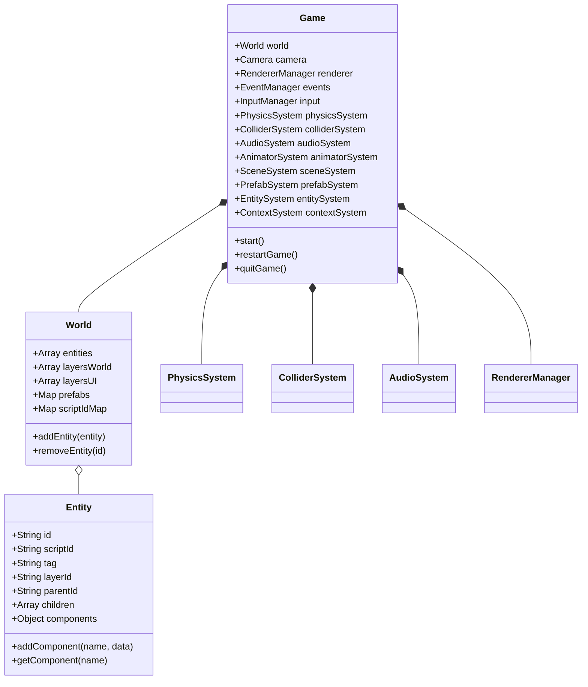
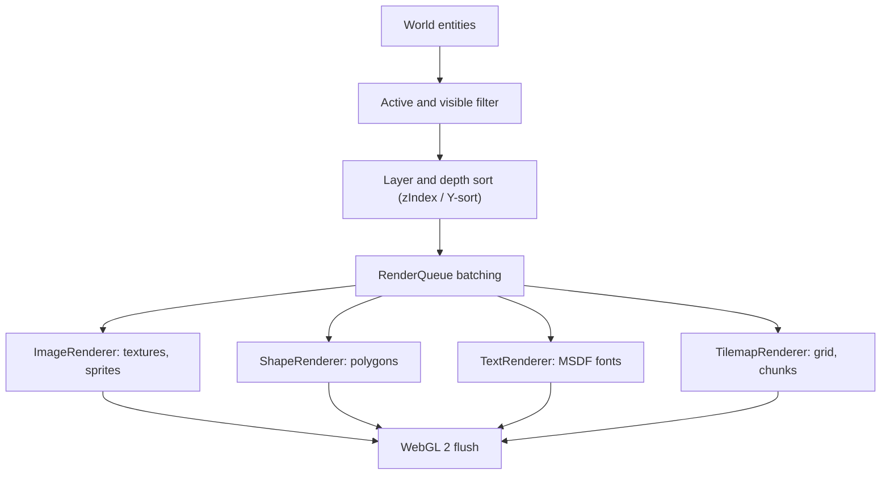

# Architecture

Lupis Engine has three components that communicate over standard web protocols.

| Component | Directory | Responsibility |
| :--- | :--- | :--- |
| Core runtime | `core/` | Game loop, entity-component data, physics, audio, rendering, script execution. No framework dependencies. |
| Editor | `editor/` | Scene editing, inspector, asset management, sprite animation, blueprint graph editing. |
| Service | `service/` | CPU-heavy work: MSDF font generation, project bundling, desktop (Electron) packaging. |

## Core runtime

A single `Game` instance owns and coordinates the subsystems.

Entities are addressed two ways: by `id` (UUID, used internally) and by `scriptId` (slug, used by scripts). `World.scriptIdMap` gives O(1) lookup by `scriptId`. See the [identity model](schema-contract.md#identity-model).

### Game loop

`GameLoop.js` runs on `requestAnimationFrame`. Physics uses a fixed-timestep accumulator; everything else uses variable delta time. Each frame runs these steps in order:

1. **Input.** `InputManager` dispatches mouse, touch, and keyboard events.
2. **Physics.** `PhysicsSystem.update(dt)` applies gravity, drag, and velocity clamping, then calls `ColliderSystem.moveAndSlide(entity, dx, dy)`.
3. **Animation.** `AnimatorSystem.update(dt)` advances sprite clips.
4. **Scripting.** `ScriptSystem` runs active blueprint graphs and event callbacks.
5. **Render.** `RendererManager.render()` sorts visible entities by layer (`layersWorld`, then `layersUI`), `zIndex`, and `orderIndex`, then flushes batched vertices to the GPU.

## Rendering

Renderer classes are named in the diagram; the matching component schemas are `SpriteRenderer`, `ShapeRenderer`, `TextRenderer`, and `Tilemap` ([schema-contract §5](schema-contract.md#5-ecs-component-schemas-componentschema)).

| Renderer | Notes |
| :--- | :--- |
| Shape | Vertex-color batching, up to 60,000 vertices per draw call. Anti-aliased borders and fill blending. |
| Image | Texture batching with UV transform, tint, and flipping. |
| Text | MSDF shader. Stays sharp at any zoom. Fonts are converted offline by the service. |
| Tilemap | Grid and chunked tile rendering. |

## Physics and collision

- **Colliders** are boxes defined by offset, size, and rotation. An entity can have several, each with an optional `scriptId` for hitbox targeting (`"head"`, `"body"`).
- **Solid** colliders block movement and resolve penetration. **Trigger** colliders emit enter/exit events and do not push.
- **`moveAndSlide`** moves an entity as a kinematic body: it stops at solid obstacles and slides along walls.

## Visual scripting

Blueprint graphs are authored in the visual editor, compiled into deterministic graph definitions, and executed within the runtime:

- **10 Domain Modules & 128 Nodes**: The node library is organized into 10 cohesive domain modules (`Flow`, `Input`, `Entity`, `Physics`, `Renderer`, `Animation`, `Collections`, `Math`, `Lifecycle`, `System`), providing 128 production nodes.
- **Dual-Tier Architecture**: Novice creators can build ~80% of 2D game genres entirely through node graph logic without touching code panels. Advanced developers can leverage custom code panels and raw context facades for complex, low-level mechanics.
- **Execution & Data Evaluation**: Execution ports carry imperative control flow with re-entrancy protection and step caps. Data ports are strictly evaluated on demand adhering to the T-001 port naming standard.
- **Context System**: Graphs execute against `ContextSystem`, exposing 15 isolated runtime facades (`context.audio`, `context.scenes`, `context.transform`, `context.variables`, etc.) with zero direct game mutation and zero defensive null checks.

See [Visual Scripting Guide](visual-scripting.md) and [Context System Reference](context-system.md) for full contracts.

## Editor-to-runtime bridge

In the editor, the runtime runs in an isolated iframe or embedded canvas. Scene changes (entity creation, property edits, camera moves) are mirrored to the runtime through `SyncComponent` and an EventBus over `postMessage`, so the scene does not reload on each edit. Gizmos (`TransformTool`, `ShapeTool`, `TilemapTool`, rulers, grid) are drawn above the game canvas.

Channel list and payloads: [schema-contract §10](schema-contract.md#10-eventbus-bridge-contract).
