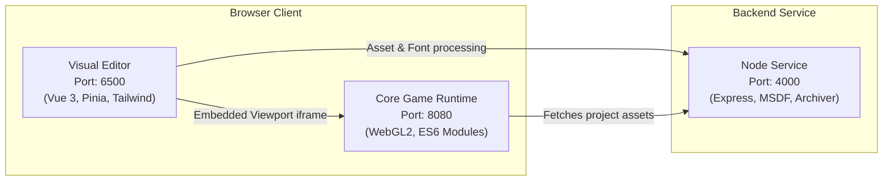
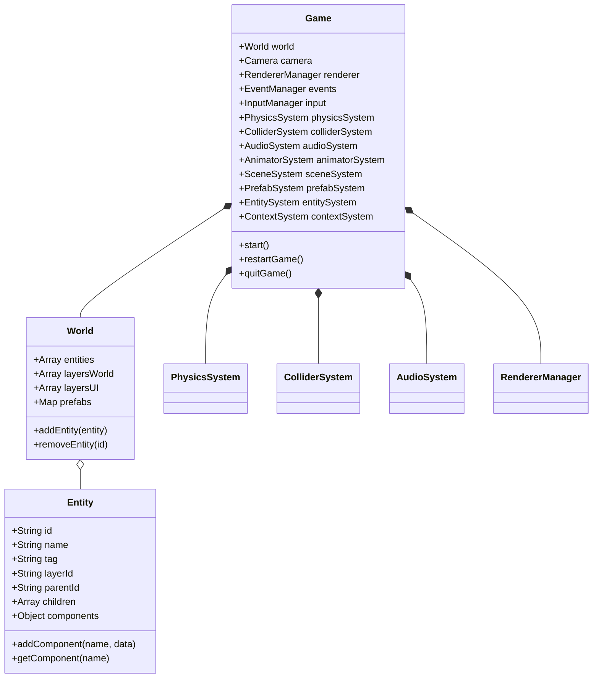
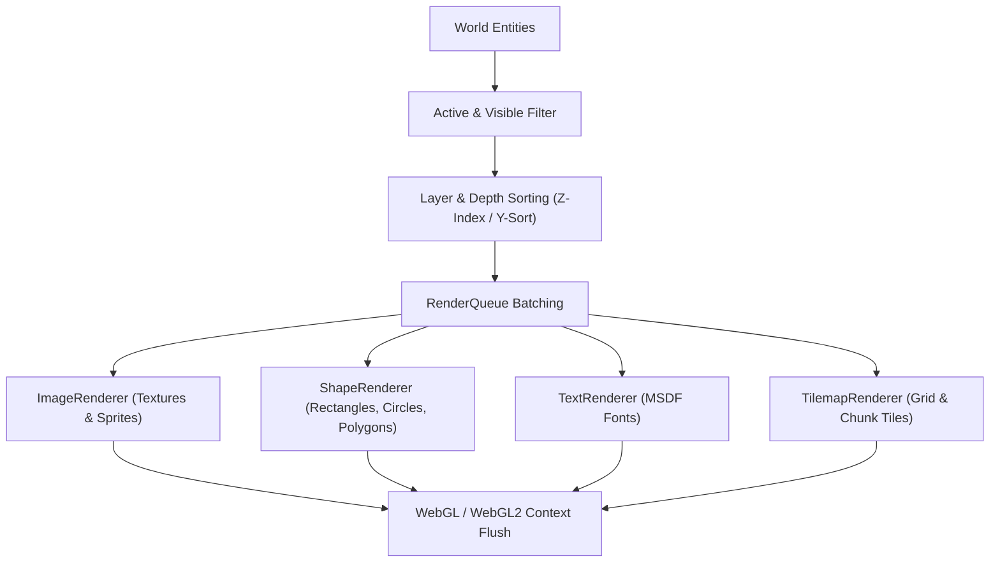

# 🏗️ Lupis Engine Architecture

This document describes the internal architecture, subsystems, and runtime data flow of **Lupis Engine**.

---

## 1. System Topology

Lupis Engine is split into three decoupled components that communicate via standard web protocols:

- **`core/` (Core Runtime Engine)**: Zero-framework vanilla ES Module engine running on WebGL (with WebGL1 fallback). Responsible for frame updates, entity-component data, physics calculations, Web Audio, and rendering.
- **`editor/` (Visual Studio / Editor)**: Vue 3 single-page application providing scene layout manipulation, inspector property binding, timeline animation, asset management, and visual node-graph editing.
- **`service/` (Micro-Backend Service)**: Node.js Express server handling CPU-heavy tasks such as Multi-channel Signed Distance Field (MSDF) font generation, asset bundling into zip files, and desktop Electron packaging.

---

## 2. Core Runtime Architecture

The engine runtime is built around a centralized `Game` instance coordinating specialized subsystems:

### 2.1 The Game Loop (`GameLoop.js`)
The engine uses `requestAnimationFrame` with a fixed-timestep accumulator for physics and a variable delta-time for visual interpolation:
1. **Input Polling**: Mouse, touch, keyboard events are dispatched from `InputManager`.
2. **Physics Step**: `PhysicsSystem.update(dt)` applies gravity, drag, velocity clamp, and invokes `ColliderSystem.moveAndSlide(entity, dx, dy)`.
3. **Animation Step**: `AnimatorSystem.update(dt)` advances sprite keyframes.
4. **Scripting Step**: `ScriptSystem` executes active Blueprint nodes and event callbacks.
5. **Render Step**: `RendererManager.render()` sorts visible entities by layer (`layersWorld`, `layersUI`), `zIndex`, and `orderIndex`, flushing batched vertices to the GPU via WebGL shaders.

---

## 3. Rendering Pipeline

The rendering system supports hardware-accelerated 2D and 2.5D pseudo-isometric rendering with batching:

### 3.1 Custom Shaders
- **ShapeRenderer**: Vertex color batch shader buffering up to 60,000 vertices per draw call, supporting anti-aliased borders and fill blending.
- **ImageRenderer**: Texture batch shader supporting UV transform, tinting, and sprite flipping.
- **TextRenderer**: Multi-channel Signed Distance Field (MSDF) shader rendering crisp fonts at arbitrary zoom scales without blur or pixelation.

---

## 4. Physics & Collision Subsystem

- **AABB & Circle Colliders**: Fast broadphase and narrowphase intersection testing.
- **Solid vs. Trigger**:
  - `isSolid: true`: Blocks physical movement and resolves penetration vectors.
  - `isTrigger: true`: Emits trigger collision events (`onTriggerEnter`, `onTriggerExit`) without physical pushback.
- **Layer Masks**: Entities and colliders are partitioned by collision layers to ignore unwanted collision checks (e.g. Player projectiles vs Player body).
- **MoveAndSlide**: Emulates kinematic character movement against arbitrary solid obstacles, handling diagonal sliding along walls.

---

## 5. Visual Scripting & Blueprint System

Lupis Engine features a node-graph visual scripting runtime:
- **Node Contract**: Every node defines input pins, output pins, execution flow triggers, and pure evaluation functions.
- **ContextSystem**: Executes node graphs with an isolated local variable state and access to global game variables.
- **Execution vs Pure Pins**:
  - White execution pins control step-by-step logic (`OnStart`, `OnUpdate`, `Branch`, `Sequence`).
  - Colored data pins evaluate math, vector operations, and entity lookups on demand.

---

## 6. Editor-to-Engine Bridge

When running inside the editor:
- The engine runs inside an isolated `<iframe>` or embedded canvas element.
- The `SyncComponent` and `PostMessage` / `EventBus` bridge mirror scene updates (entity additions, property adjustments, camera panning) without full page reloads.
- The Viewport overlays interactive Gizmos (`TransformTool`, `ShapeTool`, `TilemapTool`, `Rulers`, `Grid`) rendered directly above the game canvas.
