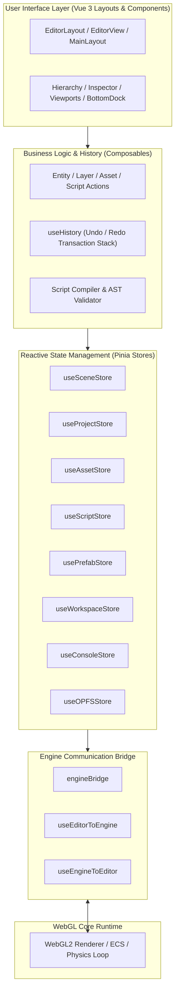
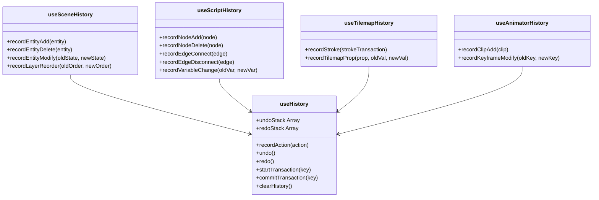

# Lupis Visual Studio Editor Technical Reference

This document provides an exhaustive developer reference for the **Lupis Studio Editor** codebase (`editor/`). It details the internal architecture, state stores, composables, schemas, compilers, utilities, and lifecycle hooks across every feature module.

---

## 1. Architectural Overview

The Lupis Studio Editor is a reactive Single Page Application (SPA) built with **Vue 3 (Composition API)**, **Pinia**, **Tailwind CSS**, and **Vite**.



---

## 2. Directory Structure Map

```text
editor/src/
├── app/
│   ├── main.js                  # Application entry point, Pinia & Router registration
│   └── router.js                # Vue Router definition (routes: /dashboard, /editor/:idProject, /docs, /settings)
├── features/
│   ├── animators/               # 2D Sprite keyframe sequencer and clip management
│   ├── assets/                  # Media asset ingestion, directory tree, and OPFS storage
│   ├── builders/                # Interactive shape drawing and tilemap level composition
│   ├── consoles/                # Runtime log stream, severity filters, and debug telemetry
│   ├── dashboards/              # Project launcher, template picker, and recent project index
│   ├── docs/                    # In-app interactive documentation viewer
│   ├── engines/                 # EventBus bridge and state sync with WebGL core runtime
│   ├── folders/                 # Nested folder structure for asset organization
│   ├── historys/                # Transactional undo/redo engine
│   ├── inspectors/              # Entity Component System (ECS) property bindings
│   ├── nodes/                   # Visual scripting (Blueprints) node graph and 27 node categories
│   ├── opfs/                    # Origin Private File System storage driver
│   ├── prefabs/                 # Reusable entity-component templates and instances
│   ├── projects/                # Project manifest serialization, persistence, and watchers
│   ├── scenes/                  # Scene hierarchy, layer management, and entity ECS schemas
│   ├── scripts/                 # Visual script compilation, normalization, and AST validation
│   ├── settings/                # Project, physics, grid, debug, and engine preferences
│   ├── viewports/               # Interactive WebGL canvas, transform gizmos, and header tabs
│   └── workspaces/              # Workspace layout manager and active document tabs
├── layouts/                     # High-level shell layouts and dock containers
└── utils/                       # Binary project codecs, math helpers, and UUID generators
```

---

## 3. Reactive State Stores (Pinia)

### 3.1 `useSceneStore` (`@scenes/useSceneStore.js`)
Central store maintaining active scenes, layers, entities, and component states.

- **State**:
  - `scenes`: Array of scene records conforming to `sceneSchema`.
  - `activeSceneId`: UUID of the currently active scene.
  - `selectedEntityId`: UUID of the currently focused entity.
  - `selectedLayerId`: UUID of the currently active layer.
  - `clipboard`: Buffered entity or layer payload for copy/paste operations.
- **Getters**:
  - `activeScene`: Returns the full scene object matching `activeSceneId`.
  - `layers`: Retrieves the layers array of the active scene.
  - `entities`: Flattened array of all entities within the active scene.
  - `selectedEntity`: Returns the entity object matching `selectedEntityId`.
  - `worldLayers` / `uiLayers`: Partitions layers into world-space and screen-space UI domains.
- **Actions**:
  - `setActiveScene(sceneId)`: Switches the active scene context and notifies the engine bridge.
  - `addEntity(layerId, entityData, parentId)`: Instantiates a new entity conforming to `entitySchema`.
  - `updateEntity(entityId, partialData)`: Mutates entity properties and marks project state dirty.
  - `deleteEntity(entityId)`: Recursively disposes an entity and its descendants.
  - `syncTransformFromEngine(entityId, transform)`: Fast-path transformation updater invoked by WebGL gizmo movements.

### 3.2 `useProjectStore` (`@projects/useProjectStore.js`)
Orchestrates overall project metadata, save/sync states, and persistence flags.

- **State**:
  - `currentProject`: Project manifest object conforming to `projectSchema`.
  - `isDirty`: Boolean indicating unsaved local modifications.
  - `isSyncing`: Boolean indicating active server synchronization.
- **Actions**:
  - `setProject(projectData)`: Initializes or loads a project into the workspace.
  - `updateProjectSettings(settings)`: Mutates global project configuration (resolutions, background colors).
  - `markDirty(state)`: Sets the dirty flag to trigger synchronization warnings.

### 3.3 `useAssetStore` (`@assets/useAssetStore.js`)
Tracks binary media assets, texture references, and directory paths.

- **State**:
  - `assets`: Array of asset descriptors conforming to `assetSchema`.
  - `selectedAssetId`: UUID of the currently selected asset.
- **Actions**:
  - `addAsset(assetData)`: Ingests a new asset record and caches binary buffers in OPFS.
  - `deleteAsset(assetId)`: Removes asset record and cleans up associated memory handles.
  - `getAssetById(assetId)`: Resolves full asset metadata and cached blob URLs.

### 3.4 `useScriptStore` (`@scripts/useScriptStore.js`)
Stores visual blueprint graphs and node configurations.

- **State**:
  - `scripts`: Array of visual script objects conforming to `scriptSchema`.
  - `activeScriptId`: UUID of the script open in the Logic Canvas.
- **Actions**:
  - `addScript(scriptData)`: Creates a new blueprint script graph.
  - `updateScript(scriptId, graphData)`: Updates nodes, edges, and local variables.
  - `deleteScript(scriptId)`: Disposes script file and unbinds references across entities.

### 3.5 `usePrefabStore` (`@prefabs/usePrefabStore.js`)
Manages reusable entity template definitions.

- **State**:
  - `prefabs`: Array of prefab templates conforming to `prefabSchema`.
- **Actions**:
  - `addPrefab(prefabData)`: Registers a new template from an entity snapshot.
  - `instantiatePrefab(prefabId, targetLayerId)`: Spawns an entity instance linked to the prefab template.

### 3.6 `useWorkspaceStore` (`@workspaces/useWorkspaceStore.js`)
Coordinates editor UI layout, active document tabs, and engine runtime references.

- **State**:
  - `engine`: Reference to the active core `Game` engine coordinator instance.
  - `activeTab`: Identifier of the focused document tab.
  - `tabs`: Array of open workspace tabs (Scene, Scripts, Tilemaps, Animators).
- **Actions**:
  - `setEngine(engineInstance)`: Binds the core engine instance and initializes bridge listeners.
  - `openTab(tabDescriptor)`: Opens or focuses a sub-editor document tab.
  - `closeTab(tabId)`: Closes a transient document tab and restores the Scene tab.

### 3.7 `useConsoleStore` (`@consoles/useConsoleStore.js`)
Aggregates real-time logs, warnings, and errors emitted by the engine and visual scripts.

- **State**:
  - `logs`: Array of log entry objects (`{ id, type, message, timestamp, source }`).
- **Actions**:
  - `log(message, type, source)`: Pushes a new diagnostic message.
  - `clearLogs()`: Flushes the log buffer.

### 3.8 `useOPFSStore` (`@opfs/useOPFSStore.js`)
Provides low-level access to the Origin Private File System directory hierarchy.

- **Actions**:
  - `saveFile(path, blob)`: Writes binary blobs directly to browser virtual disk storage.
  - `readFile(path)`: Streams binary blobs from virtual disk storage.
  - `deleteFile(path)`: Removes files from the OPFS virtual directory.

---

## 4. Transactional History Subsystem

The Lupis Studio Editor incorporates a unified, multi-domain undo/redo architecture located in `@historys/composables/`.



### 4.1 `useHistory.js`
The foundation of the transactional history engine:
- `recordAction({ type, undo, redo, description, transactionKey })`: Pushes an atomic state transaction onto the active undo stack. Clears the redo stack upon new non-transacted operations.
- `undo()`: Pops the top transaction from `undoStack`, executes its `undo()` reversal callback, and pushes it onto `redoStack`.
- `redo()`: Pops the top transaction from `redoStack`, executes its `redo()` callback, and pushes it back onto `undoStack`.
- `startTransaction(key)` / `commitTransaction(key)`: Batches continuous high-frequency operations (such as gizmo drag translations or continuous tilemap painting strokes) into a single cohesive undoable step.

### 4.2 Domain-Specific History Composables
- **`useSceneHistory.js`**: Records entity transformations, component property additions/removals, layer order restructuring, and parent-child reparenting.
- **`useScriptHistory.js`**: Records node additions, deletions, pin wire reconnections, port label edits, and variable additions/modifications.
- **`useTilemapHistory.js`**: Groups tile brush strokes into transactional chunk deltas and tracks tilemap grid dimension modifications.
- **`useAnimatorHistory.js`**: Tracks keyframe additions, frame sequence auto-fills, and clip metadata changes.

---

## 5. Visual Scripting Subsystem (Blueprints)

The visual scripting engine translates graph-based blueprints into executable runtime instruction sets.

### 5.1 AST Compiler Pipeline (`@scripts/compile/`)

1. **`validateScript(graph)`**: Performs static graph analysis:
   - Validates pin connections against port typing constraints.
   - Detects cycles and infinite loops in non-loop execution paths.
   - Flags orphaned variables or unresolved references.
2. **`coerceByPort(sourceType, targetType, value)`**: Handles permissible automatic type conversions (e.g., Number to String, or Any to concrete types).
3. **`normalizeScript(rawGraph)`**: Cleans and canonicalizes node coordinates, port UUIDs, and edge bindings.
4. **`compileScript(validatedGraph)`**: Compiles the node graph into an optimized execution chain consumed by the core engine's `ScriptRunner`.

### 5.2 Node Blueprint Categories (`@nodes/library/blueprints/`)

Lupis Studio features 27 built-in node blueprint categories:

| Blueprint File | Domain | Key Nodes |
| :--- | :--- | :--- |
| `BlueprintLifecycle.js` | Execution Hooks | `On Awake`, `On Start`, `On Tick`, `On Destroy` |
| `BlueprintEvent.js` | Custom Events | `Trigger Event`, `Listen Event`, `Broadcast Message` |
| `BlueprintTransform.js` | Spatial Positioning | `Get Position`, `Set Position`, `Move Towards`, `Rotate` |
| `BlueprintPhysics.js` | Kinematics & Forces | `Add Force`, `Set Velocity`, `Move and Slide`, `Set Gravity` |
| `BlueprintCollider.js` | Collision Events | `On Collision Enter`, `On Collision Exit`, `Check Overlap` |
| `BlueprintRenderer.js` | Visual Mutations | `Set Tint`, `Set Visibility`, `Set UV Offset`, `Set Alpha` |
| `BlueprintAnimator.js` | Animation State | `Play Animation`, `Pause Animation`, `Set Animation Speed` |
| `BlueprintCamera.js` | Camera Controls | `Camera Follow`, `Set Camera Zoom`, `Shake Camera` |
| `BlueprintScene.js` | Scene Navigation | `Load Scene`, `Reload Scene`, `Get Active Scene` |
| `BlueprintEntity.js` | Entity Lifecycle | `Spawn Entity`, `Destroy Entity`, `Find Entity By Tag` |
| `BlueprintMath.js` | Mathematics | `Add`, `Subtract`, `Multiply`, `Divide`, `Clamp`, `Lerp` |
| `BlueprintComparison.js` | Logic Gates | `Equals`, `Not Equals`, `Greater Than`, `Less Than` |
| `BlueprintBoolean.js` | Boolean Logic | `AND`, `OR`, `NOT`, `XOR` |
| `BlueprintString.js` | String Manipulation | `Concat`, `Substring`, `String Length`, `Contains` |
| `BlueprintList.js` | Array Operations | `List Append`, `List Get Index`, `List Length`, `List Remove` |
| `BlueprintMap.js` | Dictionary Ops | `Map Get`, `Map Set`, `Map Has Key`, `Map Remove` |
| `BlueprintLoop.js` | Flow Control | `For Loop`, `While Loop`, `Break Loop`, `Branch (If / Else)` |
| `BlueprintKeyboard.js` | Keyboard Input | `On Key Down`, `On Key Up`, `Is Key Pressed` |
| `BlueprintMouse.js` | Mouse Input | `On Mouse Click`, `Get Mouse Position`, `On Mouse Hover` |
| `BlueprintPointer.js` | Touch / Pointer | `On Pointer Down`, `On Pointer Up`, `Get Pointer Vector` |
| `BlueprintRandom.js` | RNG Generators | `Random Number`, `Random Integer In Range`, `Random Bool` |
| `BlueprintSystem.js` | Diagnostics | `Print to Console`, `Get Delta Time`, `Quit Game` |
| `BlueprintVariable.js` | State Accessors | `Get Variable`, `Set Variable` |
| `BlueprintTransition.js` | Screen Fades | `Fade In`, `Fade Out`, `Color Flash` |

---

## 6. Engine-Editor Bridge Architecture (`@engines/`)

Communication between the Vue 3 editor application and the WebGL runtime is managed by the `engineBridge` singleton:

- **`engineBridge.setupListeners()`**: Binds to the engine's internal EventBus:
  - `entity:modified`: Synchronizes runtime physics or kinematic movements back into the editor's `useSceneStore`.
  - `editor:tool:pickup`: Responds to eyedropper or selection tool picks on the canvas.
  - `editor:tilemap:update-data`: Pushes tilemap painting events into the runtime chunk cache.
- **`useEditorToEngine.js`**: Pushes changes made in the editor (entity spawning, transform edits, component alterations) to the live WebGL engine without restarting the scene.
- **`useEngineToEditor.js`**: Listens for runtime engine diagnostics, collision notifications, and script execution outputs to update the editor UI.
- **`prepareEngineData.js`**: Serializes editor state into engine-compliant scene payloads, normalizing asset URLs and resolving prefab component hierarchies.

---

## 7. Data Schemas & Normalization

All persistent data structures pass through schema validators to guarantee data integrity:

- **`projectSchema(raw)`** (`@projects/projectSchema.js`): Enforces project UUID, version, canvas resolution, background color, and active scene pointers.
- **`sceneSchema(raw, projectId)`** (`@scenes/schemas/sceneSchema.js`): Enforces scene UUID, name, layer arrays, and project ownership.
- **`entitySchema(raw, layerId)`** (`@scenes/schemas/entitySchema.js`): Validates entity UUID, name, active state, parentId, component dictionary, and child entity lists.
- **`layerSchema(raw)`** (`@scenes/schemas/layerSchema.js`): Enforces layer UUID, title, Z-index, sorting index, and World vs UI layer type.
- **`componentSchema(type, raw)`** (`@scenes/schemas/componentSchema.js`): Validates specific ECS component payloads (`Transform`, `ImageRenderer`, `ShapeRenderer`, `TilemapRenderer`, `TextRenderer`, `RigidBody2D`, `Collider`, `SpriteAnimator`, `ScriptContainer`).
- **`normalizer(rawProject, rawScenes, rawAssets, ...)`** (`@utils/normalizer.js`): Canonicalizes and sanitizes entire project structures upon importing or loading.

---

## 8. Utilities & Binary Formats

- **`constanta.js`**:
  - `APP_STORAGE_DIR`: `'lupis-engine'`
  - `LUPIS_HEADER`: 16-byte magic identifier (`[0x4C, 0x55, 0x50, 0x49, 0x53, 0x5F, 0x50, 0x52, 0x4F, 0x4A, 0x45, 0x43, 0x54, 0x31, 0x21, 0x00]`).
  - `XOR_KEY`: `0x5A`
- **`projectFormat.js`**:
  - `encodeLupisProject(zipBlob)`: Prepends `LUPIS_HEADER` and applies XOR (`0x5A`) obfuscation to create standard `.lupisproject` binary packages.
  - `decodeLupisProject(file)`: Validates header magic bytes, strips the header, reverses XOR encoding, and extracts the underlying JSZip project archive.
- **`transformMath.js`**:
  - `computeGlobalTransform(entity, getEntityById)`: Recursively calculates the absolute world-space transformation matrix (position, rotation, scale) for nested child entities relative to their parents.
- **`generateUUID.js`**:
  - `generateUUID()`: Generates collision-resistant unique identifiers for entities, components, nodes, and assets.
