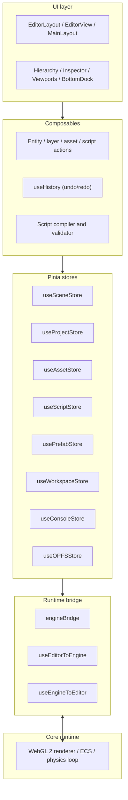
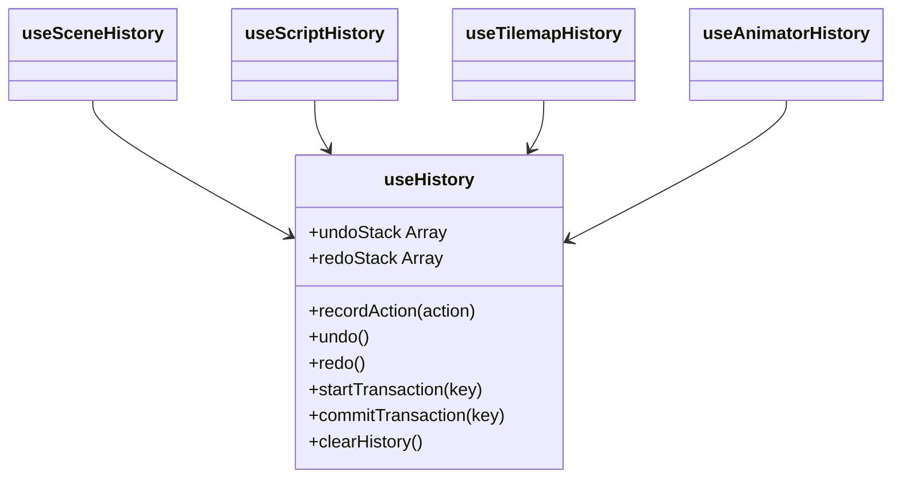

# Editor reference

Developer reference for the editor codebase in `editor/`: architecture, stores, history, script compiler, bridge, schemas, and utilities. For usage, see [editor-guide.md](editor-guide.md). For data shapes, see [schema-contract.md](schema-contract.md).

## 1. Architecture

The editor is a Vue 3 (Composition API) single-page app using Pinia, Tailwind CSS, and Vite.



## 2. Directory structure

```text
editor/src/
├── app/
│   ├── main.js            # Entry point; registers Pinia and the router
│   └── router.js          # Routes: /dashboard, /editor/:idProject, /docs, /settings
├── features/
│   ├── animators/         # Sprite keyframe sequencer and clips
│   ├── assets/            # Asset import, directory tree, OPFS storage
│   ├── builders/          # Shape drawing and tilemap tools
│   ├── consoles/          # Log stream and severity filters
│   ├── dashboards/        # Project launcher, templates, recent projects
│   ├── docs/              # In-app documentation viewer
│   ├── engines/           # EventBus bridge and runtime sync
│   ├── folders/           # Nested asset folders
│   ├── historys/          # Undo/redo engine
│   ├── inspectors/        # Component property bindings
│   ├── nodes/             # Blueprint graph editor and node library
│   ├── opfs/              # Origin Private File System driver
│   ├── prefabs/           # Prefab templates and instances
│   ├── projects/          # Project manifest, persistence, watchers
│   ├── scenes/            # Scene hierarchy, layers, entity schemas
│   ├── scripts/           # Script compilation, normalization, validation
│   ├── settings/          # Project, physics, grid, debug preferences
│   ├── viewports/         # Canvas, gizmos, header tabs
│   └── workspaces/        # Layout manager and document tabs
├── layouts/               # Shell layouts and dock containers
└── utils/                 # Binary project codec, math helpers, UUIDs
```

## 3. Stores

### 3.1 `useSceneStore` (`@scenes/useSceneStore.js`)

Active scenes, layers, entities, and selection.

- **State:** `scenes`, `activeSceneId`, `selectedEntityId`, `selectedLayerId`, `clipboard`
- **Getters:** `activeScene`, `layers`, `entities` (flattened), `selectedEntity`, `worldLayers`, `uiLayers`
- **Actions:**
  - `setActiveScene(sceneId)`: switch scene and notify the bridge.
  - `addEntity(layerId, entityData, parentId)`: create an entity via `entitySchema`.
  - `updateEntity(entityId, partialData)`: merge changes and mark the project dirty.
  - `deleteEntity(entityId)`: delete the entity and its descendants.
  - `syncTransformFromEngine(entityId, transform)`: fast path for gizmo and physics updates from the runtime.

### 3.2 `useProjectStore` (`@projects/useProjectStore.js`)

Project metadata and save state.

- **State:** `currentProject` (`projectSchema`), `isDirty`, `isSyncing`
- **Actions:** `setProject(projectData)`, `updateProjectSettings(settings)`, `markDirty(state)`

### 3.3 `useAssetStore` (`@assets/useAssetStore.js`)

- **State:** `assets` (`assetSchema[]`), `selectedAssetId`
- **Actions:**
  - `addAsset(assetData)`: register an asset and cache its binary in OPFS.
  - `deleteAsset(assetId)`: remove the record and release its handles.
  - `getAssetById(assetId)`: return metadata and the cached blob URL.

### 3.4 `useScriptStore` (`@scripts/useScriptStore.js`)

- **State:** `scripts` (`scriptSchema[]`), `activeScriptId`
- **Actions:** `addScript(scriptData)`, `updateScript(scriptId, graphData)`, `deleteScript(scriptId)` (also unbinds the script from entities)

### 3.5 `usePrefabStore` (`@prefabs/usePrefabStore.js`)

- **State:** `prefabs` (`prefabSchema[]`)
- **Actions:** `addPrefab(prefabData)` (from an entity snapshot), `instantiatePrefab(prefabId, targetLayerId)`

### 3.6 `useWorkspaceStore` (`@workspaces/useWorkspaceStore.js`)

- **State:** `engine` (the running `Game`), `activeTab`, `tabs`
- **Actions:** `setEngine(engineInstance)` (binds the engine and bridge listeners), `openTab(tabDescriptor)`, `closeTab(tabId)` (returns to the Scene tab)

### 3.7 `useConsoleStore` (`@consoles/useConsoleStore.js`)

- **State:** `logs` (`{ id, type, message, timestamp, source }[]`)
- **Actions:** `log(message, type, source)`, `clearLogs()`

### 3.8 `useOPFSStore` (`@opfs/useOPFSStore.js`)

Low-level Origin Private File System access.

- **Actions:** `saveFile(path, blob)`, `readFile(path)`, `deleteFile(path)`

## 4. History

Undo/redo lives in `@historys/composables/`. Domain composables record actions through the shared `useHistory`.



### 4.1 `useHistory.js`

- `recordAction({ type, undo, redo, description, transactionKey })`: push an action onto the undo stack. A new action outside a transaction clears the redo stack.
- `undo()` / `redo()`: move the top action between stacks and run its `undo` or `redo` callback.
- `startTransaction(key)` / `commitTransaction(key)`: merge high-frequency operations (gizmo drags, tilemap strokes) into one undo step.

### 4.2 Domain composables

| Composable | Records |
| :--- | :--- |
| `useSceneHistory` | Entity add, delete, and modify; component add and remove; layer reorder; reparenting |
| `useScriptHistory` | Node add and delete; edge connect and disconnect; port label edits; variable changes |
| `useTilemapHistory` | Brush strokes (as chunk deltas); grid dimension changes |
| `useAnimatorHistory` | Keyframe add and modify; frame auto-fill; clip metadata changes |

## 5. Visual scripting

### 5.1 Compiler pipeline (`@scripts/compile/`)

| Step | Function | Does |
| :--- | :--- | :--- |
| 1 | `validateScript(graph)` | Checks pin types, detects cycles and infinite loops outside loop nodes, flags orphaned variables and unresolved references. |
| 2 | `coerceByPort(sourceType, targetType, value)` | Applies permitted type conversions (for example number to string, `any` to a concrete type). |
| 3 | `normalizeScript(rawGraph)` | Canonicalizes node positions, port IDs, and edge bindings. |
| 4 | `compileScript(validatedGraph)` | Produces the execution chain consumed by the runtime `ScriptRunner`. |

### 5.2 Node blueprint categories

Node definitions live in `@nodes/library/blueprints/`, one file per category (24 files).

| File | Domain | Nodes |
| :--- | :--- | :--- |
| `BlueprintLifecycle.js` | Lifecycle | On Awake, On Start, On Tick, On Destroy |
| `BlueprintEvent.js` | Custom events | Trigger Event, Listen Event, Broadcast Message |
| `BlueprintTransform.js` | Transform | Get Position, Set Position, Move Towards, Rotate |
| `BlueprintPhysics.js` | Physics | Add Force, Set Velocity, Move and Slide, Set Gravity |
| `BlueprintCollider.js` | Collision | On Collision Enter, On Collision Exit, Check Overlap |
| `BlueprintRenderer.js` | Rendering | Set Tint, Set Visibility, Set UV Offset, Set Alpha |
| `BlueprintAnimator.js` | Animation | Play Animation, Pause Animation, Set Animation Speed |
| `BlueprintCamera.js` | Camera | Camera Follow, Set Camera Zoom, Shake Camera |
| `BlueprintScene.js` | Scene | Load Scene, Reload Scene, Get Active Scene |
| `BlueprintEntity.js` | Entity | Spawn Entity, Destroy Entity, Find Entity By Tag |
| `BlueprintMath.js` | Math | Add, Subtract, Multiply, Divide, Clamp, Lerp |
| `BlueprintComparison.js` | Comparison | Equals, Not Equals, Greater Than, Less Than |
| `BlueprintBoolean.js` | Boolean | AND, OR, NOT, XOR |
| `BlueprintString.js` | String | Concat, Substring, String Length, Contains |
| `BlueprintList.js` | List | List Append, List Get Index, List Length, List Remove |
| `BlueprintMap.js` | Map | Map Get, Map Set, Map Has Key, Map Remove |
| `BlueprintLoop.js` | Flow control | For Loop, While Loop, Break Loop, Branch (If / Else) |
| `BlueprintKeyboard.js` | Keyboard | On Key Down, On Key Up, Is Key Pressed |
| `BlueprintMouse.js` | Mouse | On Mouse Click, Get Mouse Position, On Mouse Hover |
| `BlueprintPointer.js` | Touch / pointer | On Pointer Down, On Pointer Up, Get Pointer Vector |
| `BlueprintRandom.js` | Random | Random Number, Random Integer In Range, Random Bool |
| `BlueprintSystem.js` | System | Print to Console, Get Delta Time, Quit Game |
| `BlueprintVariable.js` | Variables | Get Variable, Set Variable |
| `BlueprintTransition.js` | Screen transitions | Fade In, Fade Out, Color Flash |

## 6. Runtime bridge (`@engines/`)

The `engineBridge` singleton connects the editor to the runtime.

- **`engineBridge.setupListeners()`** subscribes to runtime events:
  - `entity:modified`: write physics and gizmo changes back to `useSceneStore`.
  - `editor:tool:pickup`: handle eyedropper and selection picks.
  - `editor:tilemap:update-data`: push tilemap paint data to the runtime chunk cache.
- **`useEditorToEngine.js`** sends editor changes (spawns, transform edits, component edits) to the running engine without restarting the scene.
- **`useEngineToEditor.js`** receives runtime diagnostics, collision notifications, and script output.
- **`prepareEngineData.js`** serializes editor state into the runtime payload, normalizing asset URLs and resolving prefab hierarchies.

Channels and payloads: [schema-contract §10](schema-contract.md#10-eventbus-bridge-contract).

## 7. Schemas and normalization

All persisted data passes through schema factories that validate input and fill defaults.

| Function | File | Validates |
| :--- | :--- | :--- |
| `projectSchema(raw)` | `@projects/projectSchema.js` | Project ID, version, canvas, background, initial scene |
| `sceneSchema(raw, projectId)` | `@scenes/schemas/sceneSchema.js` | Scene ID, layers, project ownership |
| `entitySchema(raw, layerId)` | `@scenes/schemas/entitySchema.js` | Entity ID, `scriptId`, parent, components |
| `layerSchema(raw)` | `@scenes/schemas/layerSchema.js` | Layer ID, `scriptId`, `zIndex`, `orderIndex` |
| `componentSchema(type, raw)` | `@scenes/schemas/componentSchema.js` | Component payloads: `Transform`, `UITransform`, `SpriteRenderer`, `ShapeRenderer`, `Tilemap`, `TextRenderer`, `Physics`, `Collider`, `SpriteAnimator`, `Audio`, `ScriptController` |
| `normalizer(rawProject, rawScenes, rawAssets, ...)` | `@utils/normalizer.js` | Whole-project cleanup on import and load, including v1/v2 migration |

Field definitions: [schema-contract.md](schema-contract.md).

## 8. Utilities and binary format

**`constanta.js`**

| Constant | Value |
| :--- | :--- |
| `APP_STORAGE_DIR` | `'lupis-engine'` |
| `LUPIS_HEADER` | 16 bytes: `4C 55 50 49 53 5F 50 52 4F 4A 45 43 54 31 21 00` (`LUPIS_PROJECT1!\0`) |
| `XOR_KEY` | `0x5A` |

**`projectFormat.js`**

- `encodeLupisProject(zipBlob)`: prepend `LUPIS_HEADER`, XOR the payload with `0x5A`, producing a `.lupisproject` file.
- `decodeLupisProject(file)`: check the header, strip it, reverse the XOR, return the JSZip archive.

The XOR step is obfuscation, not encryption. Do not rely on it to protect project contents.

**`transformMath.js`**

- `computeGlobalTransform(entity, getEntityById)`: compute world-space position, rotation, and scale for a nested entity by walking its parent chain.

**`generateUUID.js`**

- `generateUUID()`: unique IDs for entities, components, nodes, and assets.
