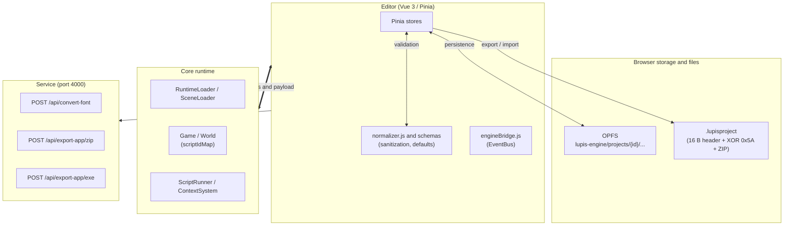
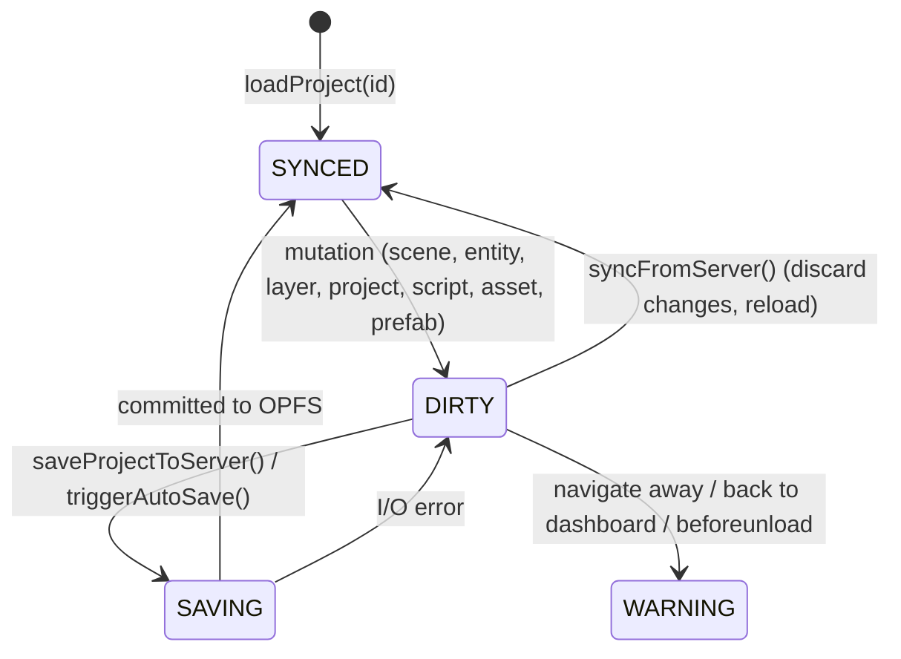

# Schema and data contract (v3)

Canonical specification for the data structures, file formats, bridge protocol, and REST API shared by `editor/`, `core/`, `service/`, and `tests/`. If code or another document disagrees with this file, this file is correct and the other is a bug.

| Attribute | Value |
| :--- | :--- |
| Status | Locked |
| Schema version | `3` (`SCHEMA_VERSION = 3`) |
| Binary magic header | `LUPIS_PROJECT1!\0` (16 bytes) |
| Binary XOR mask | `0x5A` |
| Target runtime | WebGL 2.0, ES modules |
| Editor | Vue 3, Pinia, Vite |
| Backend | Node.js, Express, port 4000 |

## Identity model

Every logic object has two identifiers.

1. **`id`** is a UUID and the technical primary key.
   - Immutable: set once at creation.
   - Used for runtime identity, graph node and edge relations, parent-child references, Vue `:key`, undo/redo history, and asset storage lookup.
2. **`scriptId`** is an alphanumeric slug and the semantic identifier.
   - Mutable, but validated: `^[a-zA-Z0-9_]+$`, case-insensitive.
   - Used by scripts and blueprints to target objects, for O(1) lookup through `scriptIdMap`, and as the label in the Hierarchy and Inspector (shown as **ID**).
3. **`name` is removed** from `Scene`, `Layer`, `Entity`, `Prefab`, `Script`, `Asset`, and `AnimationClip`. It remains only on cosmetic containers:
   - `ProjectSchema.name`: the game's title.
   - `FolderSchema.name`: the folder label in the editor UI.
   - `ScriptVariable.name`: the variable name inside a script (also validated as an alphanumeric slug).
4. **Foreign keys use UUIDs** (`assetId`, `parentId`, `layerId`, `prefabId`, and so on). Renaming a `scriptId` never breaks a parent-child link or texture reference.

### Uniqueness scope

| Object | Identifier | Unique within | Example |
| :--- | :--- | :--- | :--- |
| Entity | `scriptId` | Scene | `"player_ship"`, `"enemy_grunt_1"` |
| Layer | `scriptId` | Scene | `"world_root"`, `"ui_hud"` |
| Scene | `scriptId` | Project | `"level_01"`, `"main_menu"` |
| Asset | `scriptId` | Project | `"atlas_hero"`, `"snd_laser"` |
| Prefab | `scriptId` | Project | `"bullet_laser"`, `"item_coin"` |
| Script | `scriptId` | Project | `"player_movement"`, `"hud_controller"` |
| Animation clip | `scriptId` | Animator component | `"idle"`, `"walk"`, `"attack"` |
| Folder | `name` | Not unique | `"Sprites & FX"` |

## System topology



## 1. Storage and file contract

### 1.1 OPFS layout

Each project is stored under `lupis-engine/projects/<projectId>/`:

```text
lupis-engine/
└── projects/
    └── <projectId>/
        ├── project.json            # projectSchema
        ├── assets/
        │   └── <fileKey>           # raw texture, audio, and font files
        ├── scenes/
        │   └── <sceneId>.json      # entities and layers
        ├── prefabs/
        │   └── <prefabId>.json
        ├── scripts/
        │   └── <scriptId>.json     # blueprint graph (file named by the script's id)
        └── workspaces/             # lightweight registries
            ├── assets.json
            ├── scenes.json
            ├── prefabs.json
            ├── scripts.json
            └── folders.json
```

### 1.2 `.lupisproject` package

1. **Magic header (16 bytes):**
   ```text
   Hex:   4C 55 50 49 53 5F 50 52 4F 4A 45 43 54 31 21 00
   ASCII: "LUPIS_PROJECT1!\0"
   ```
2. **Payload obfuscation.** Every byte after the header is XORed with `0x5A`:

   $$\text{byte}_{\text{obfuscated}} = \text{byte}_{\text{plain}} \oplus \text{0x5A}$$

   This is obfuscation, not encryption.
3. **Payload content.** A JSZip archive of the project directory from its root: `project.json`, `scenes/`, `scripts/`, `prefabs/`, `workspaces/`, `assets/`.

## 2. Project schema (`projectSchema`)

Defined in [`editor/src/features/projects/projectSchema.js`](../editor/src/features/projects/projectSchema.js) and mirrored in [`core/Schema/defaultProject.js`](../core/Schema/defaultProject.js).

```typescript
interface ProjectSchema {
  id: string;                       // project UUID
  name: string;                     // default: "Untitled Project"
  description: string;
  version: string;                  // default: "1.0.0"
  createdAt: string;                // ISO 8601
  thumbnailUrl: string | null;      // cover image URL or Base64
  snapshotUrl: string | null;       // automatic viewport snapshot

  settings: {
    initialSceneId: string | null;  // scene UUID loaded at boot
    tickRate: number;               // physics tick rate (default: 60)

    autoSave: {
      enabled: boolean;             // default: false
      interval: number;             // minutes (default: 10, min: 1)
    };

    debug: {
      active: boolean;              // default: true
      position: "top-left" | "top-right" | "bottom-left" | "bottom-right"; // default: "top-right"
      width: number;                // default: 360
      height: number;               // default: 220
      maxLogs: number;              // log buffer size (default: 50)
    };

    ui: {
      width: number;                // UI canvas width (default: 1920)
      height: number;               // UI canvas height (default: 1080)
      showUIBorder: boolean;        // draw UI bounds guide (default: true)
      active: boolean;              // default: true
      smartGuides: boolean;         // default: true
    };

    camera: {
      x: number;                    // initial center X (default: 960)
      y: number;                    // initial center Y (default: 540)
      zoom: number;                 // default: 1
      lerp: number;                 // follow smoothing (default: 0.1)
    };

    grid: {
      width: number;                // cell width (default: 32)
      height: number;               // cell height (default: 32)
      color: string;                // default: "#ffffff"
      opacity: number;              // default: 0.1
      visible: boolean;             // default: true
      snap: boolean;                // snap transforms to grid (default: true)
    };
  };

  globalVariables: Array<{
    id: string;                     // variable UUID
    name: string;                   // alphanumeric slug (default: "NewGlobalVar")
    type: "String" | "Number" | "Boolean";
    defaultValue: string | number | boolean | null;
  }>;

  tags: string[];                   // default: ["Untagged", "Player", "Enemy"]
  scenes: Array<string | SceneSchema>;   // scene IDs or full payloads
}
```

### 2.1 Sync status and auto-save



| Status | `syncStatus` | Indicator | Meaning |
| :--- | :--- | :--- | :--- |
| Synced | `'synced'` | Green (`bg-emerald-500`) | Memory matches OPFS. |
| Dirty | `'dirty'` | Red (`bg-red-500`) | Unsaved local changes. |
| Saving / loading | none | Yellow, pulsing (`bg-yellow-400 animate-pulse`) | Async I/O in progress. |

## 3. Scene and layer schemas

Defined in [`sceneSchema.js`](../editor/src/features/scenes/schemas/sceneSchema.js) and [`layerSchema.js`](../editor/src/features/scenes/schemas/layerSchema.js).

### 3.1 Scene

```typescript
interface SceneSchema {
  id: string;                       // "scene_" + UUID
  projectId: string | null;
  scriptId: string;                 // e.g. "stage_forest_01"

  settings: {
    backgroundColor: string;        // default: "#222222"
    showRulers: boolean;            // default: true

    physics: {
      gravity: number;              // default: 1200
      drag: number;                 // air resistance (default: 5)
    };

    worldBounds: {
      x1: number;                   // left (default: -960)
      x2: number;                   // right (default: 2880)
      y1: number;                   // top (default: -540)
      y2: number;                   // bottom (default: 1620)
      active: boolean;              // enforce bounds (default: true)
    };
  };

  layersWorld: LayerSchema[];       // world-space layers
  layersUI: LayerSchema[];          // screen-space layers
  entities: EntitySchema[];         // flat list of all entities in the scene
}
```

### 3.2 Layer

```typescript
interface LayerSchema {
  id: string;                       // "layer_" + UUID
  scriptId: string;                 // e.g. "world_root", "ui_hud"
  zIndex: number;                   // draw depth (default: 0)
  orderIndex: number;               // sibling order in the tree (default: 0)
  active: boolean;                  // run logic and collisions (default: true)
  visible: boolean;                 // render (default: true)
  locked: boolean;                  // block viewport selection (default: false)
  opacity: number;                  // [0..1] (default: 1.0)
}
```

## 4. Entity schema (`entitySchema`)

Defined in [`entitySchema.js`](../editor/src/features/scenes/schemas/entitySchema.js) and mirrored in [`core/Core/Entity.js`](../core/Core/Entity.js).

```typescript
interface EntitySchema {
  id: string;                       // UUID, immutable
  scriptId: string;                 // e.g. "player_ship", "boss_dragon"
  type: "entity" | "ui";            // world or screen UI
  tag: string;                      // default: "untagged"

  zIndex: number;                   // draw order within the layer (default: 0)
  orderIndex: number;               // sibling order in the hierarchy (default: 0)

  parentId: string | null;          // parent entity UUID; null for root
  layerId: string;                  // containing layer UUID

  prefabId: string | null;          // source prefab UUID
  overridden: boolean;              // differs from prefab master (default: false)

  active: boolean;                  // run logic (default: true)
  visible: boolean;                 // render (default: true)
  locked: boolean;                  // block viewport selection (default: false)

  _editor: {
    locked: boolean;                // Inspector lock
    expanded: boolean;              // tree node expanded in the Hierarchy
  };

  components: Record<string, ComponentData>;
  _isDirty: boolean;                // internal sync flag
}
```

## 5. ECS component schemas (`componentSchema`)

Defined in [`componentSchema.js`](../editor/src/features/scenes/schemas/componentSchema.js). Every component carries `overridden: boolean`, set when the value differs from the prefab master.

### 5.1 `Transform` and `UITransform`

```typescript
interface TransformComponent {
  x: number;
  y: number;
  rotation: number;                 // default: 0
  scaleX: number;                   // default: 1
  scaleY: number;                   // default: 1
  pivotX: number;                   // [0..1] (default: 0.5)
  pivotY: number;                   // [0..1] (default: 0.5)
  flipX: boolean;                   // default: false
  flipY: boolean;                   // default: false
  width: number;                    // default: 100
  height: number;                   // default: 100
  isRatioLocked: boolean;           // keep aspect ratio on resize (default: false)
  isScaleLocked: boolean;           // lock scale on resize (default: true)
  overridden: boolean;
}

interface UITransformComponent extends TransformComponent {
  anchorX: number;                  // [0..1] (default: 0.5)
  anchorY: number;                  // [0..1] (default: 0.5)
}
```

### 5.2 `SpriteRenderer`

```typescript
interface SpriteRendererComponent {
  assetId: string | null;           // texture asset UUID
  sourceX: number;                  // atlas crop X (default: 0)
  sourceY: number;                  // atlas crop Y (default: 0)
  sourceWidth: number;              // atlas crop width (default: 100)
  sourceHeight: number;             // atlas crop height (default: 100)
  color: string;                    // tint (default: "#FFFFFF")
  opacity: number;                  // [0..1] (default: 1)
  filterMode: "pixelated" | "smooth";   // default: "pixelated"
  useSDF: boolean;                  // sample as signed distance field (default: false)
  overridden: boolean;
}
```

### 5.3 `ShapeRenderer`

```typescript
interface ShapeRendererComponent {
  type: "custom";
  opacity: number;                  // [0..1] (default: 1)
  isFilled: boolean;                // default: true
  fillColor: string;                // default: "#3B82F6"
  isStroked: boolean;               // default: true
  strokeColor: string;              // default: "#1D4ED8"
  strokeWidth: number;              // default: 2
  points: Array<{ x: number; y: number }>;   // vertices, relative to the entity
  overridden: boolean;
}
```

### 5.4 `Tilemap`

```typescript
interface TilemapComponent {
  assetId: string | null;           // tileset atlas asset UUID
  tileWidth: number;                // pixels (default: 32)
  tileHeight: number;               // pixels (default: 32)
  width: number;                    // columns (default: 20)
  height: number;                   // rows (default: 15)
  data: Record<string, number>;     // "col_row" -> tile index
  opacity: number;                  // [0..1] (default: 1)
  overridden: boolean;
}
```

### 5.5 `TextRenderer`

```typescript
interface TextRendererComponent {
  text: string;                     // default: "New Text"
  fontAssetId: string | null;       // MSDF font asset UUID
  fontSize: number;                 // default: 24
  color: string;                    // default: "#FFFFFF"
  align: "left" | "center" | "right";   // default: "left"
  mode: "single" | "multi";         // default: "single"
  lineSpacing: number;              // default: 1.2
  letterSpacing: number;            // default: 0
  autoWrap: boolean;                // default: false
  maxLines: number;                 // 0 = unlimited (default: 0)
  overflow: "wrap" | "ellipsis";    // default: "wrap"
  outlineWidth: number;             // default: 0
  outlineColor: string;             // default: "#000000"
  shadowEnabled: boolean;           // default: false
  shadowColor: string;              // default: "#000000"
  shadowOpacity: number;            // default: 0.5
  shadowOffsetX: number;            // default: 2
  shadowOffsetY: number;            // default: -2
  shadowBlur: number;               // default: 5
  overridden: boolean;
}
```

### 5.6 `Physics`

```typescript
interface PhysicsComponent {
  enabled: boolean;                 // default: true
  type: "dynamic" | "static" | "kinematic";   // default: "dynamic"
  mass: number;                     // default: 1.0
  gravityScale: number;             // default: 1.0
  isFrozen: boolean;                // lock position (default: false)
  drag: number;                     // default: 1.0
  velocityX: number;                // default: 0
  velocityY: number;                // default: 0
  isGrounded: boolean;              // resting on a solid surface (default: false)
  movementState: "idle" | "run" | "jump" | string;   // default: "idle"
  facingDirection: "left" | "right";   // default: "right"
  overridden: boolean;
}
```

### 5.7 `Collider`

Each shape can carry an optional `scriptId` for multi-hitbox targeting (`"head"`, `"body"`, `"shield"`).

```typescript
interface ColliderShapeData {
  id?: string;                      // shape UUID
  scriptId?: string;                // hitbox slug
  type: "solid" | "trigger";
  enabled: boolean;                 // default: true
  autoFit: boolean;                 // match Transform bounds (default: false)
  offsetX: number;                  // default: 0
  offsetY: number;                  // default: 0
  width: number;                    // default: 32
  height: number;                   // default: 32
  rotation: number;                 // default: 0
  pivotX: number;                   // default: 0
  pivotY: number;                   // default: 0
}

interface ColliderComponent {
  data: ColliderShapeData[];
  overridden: boolean;
}
```

### 5.8 `SpriteAnimator` and `AnimationClipSchema`

Clips are identified and triggered by `scriptId`. `name` and `clipName` no longer exist.

```typescript
interface AnimationClipSchema {
  id: string;                       // clip UUID
  scriptId: string;                 // e.g. "walk", "idle", "attack"
  type: "clip" | "category";
  parentId: string | null;          // category grouping
  assetId: string | null;           // texture atlas asset UUID
  fps: number;                      // default: 12
  isLooping: boolean;               // default: true
  frames: Array<{
    sourceX: number;
    sourceY: number;
    sourceWidth: number;
    sourceHeight: number;
    duration?: number;
  }>;
  filterMode: "pixelated" | "smooth";   // default: "pixelated"
  useSDF: boolean;                  // default: false
}

interface SpriteAnimatorComponent {
  currentClip: string | null;       // scriptId of the clip to play
  clips: AnimationClipSchema[];
  active: boolean;                  // default: true
  isPlaying: boolean;               // default: true
  overridden: boolean;
}
```

### 5.9 `Audio`

```typescript
interface AudioComponent {
  assetId: string | null;           // audio asset UUID
  audioType: "background" | "sfx" | "voice"; // channel bus (default: "sfx")
  isMute: boolean;                  // default: false
  volume: number;                   // [0..1] (default: 1.0)
  pitch: number;                    // rate multiplier (default: 1.0)
  loop: boolean;                    // default: false
  autoplay: boolean;                // play on spawn (default: false)
  spatial: boolean;                 // distance-based 2D audio (default: false)
  persist: boolean;                 // survive scene changes (default: false)
  fadeIn: number;                   // seconds (default: 0.0)
  fadeOut: number;                  // seconds (default: 0.0)
  refDistance: number;              // spatial reference distance (default: 100)
  maxDistance: number;              // distance at which sound is inaudible (default: 1000)
  overridden: boolean;
}
```

### 5.10 `ScriptController`

```typescript
interface ScriptControllerComponent {
  data: Array<{
    scriptId: string;               // bound script; holds the script's UUID, not its slug
    enabled: boolean;
    customParameters?: Record<string, any>;   // per-entity parameter overrides
  }>;
  overridden: boolean;
}
```

## 6. Asset and folder schemas

Defined in [`assetSchema.js`](../editor/src/features/assets/assetSchema.js) and [`folderSchema.js`](../editor/src/features/folders/folderSchema.js).

### 6.1 Asset

`scriptId` replaces `name`. The original file name is kept in `fileKey` and `meta.extension`.

```typescript
interface AssetSchema {
  id: string;                       // UUID
  projectId: string | null;
  folderId: string | null;
  scriptId: string;                 // e.g. "tex_player_sheet", "snd_laser"
  type: "texture" | "audio" | "font";
  fileKey: string;                  // storage key in OPFS
  fileUrl?: string;                 // ephemeral Blob URL
  localBlob?: Blob | null;          // in-memory upload buffer
  isSynced: boolean;                // persisted in OPFS (default: true)

  meta: {
    extension: string;              // ".png", ".ogg", ".fnt", ".ttf"
    size: number;                   // bytes
    dimensions?: { w: number; h: number };   // texture only
    duration?: number;              // audio only, seconds
    hasBmFont?: boolean;            // font only
    [key: string]: any;
  };
}
```

### 6.2 Default system asset

| Field | Value |
| :--- | :--- |
| `id` | `"system_default"` |
| `scriptId` | `"system_default"` |
| `type` | `"font"` |
| `fileKey` | `"system_default"` |

Points to the built-in MSDF font at [`core/Assets/Fonts/defaultFont.fnt`](../core/Assets/Fonts/defaultFont.fnt) (`DEFAULT_SYSTEM_FONT_ASSET`).

### 6.3 Folder

Folders keep `name` because they are purely a UI grouping.

```typescript
interface FolderSchema {
  id: string;                       // "folder_" + timestamp + random
  type: "folder";
  name: string;                     // any characters (default: "New Folder")
  section: "assets" | "scripts" | "prefabs" | "scenes";
  projectId: string | null;
  parentId: string | null;          // parent folder
}
```

## 7. Prefab schema (`prefabSchema`)

Defined in [`prefabSchema.js`](../editor/src/features/prefabs/prefabSchema.js). `scriptId` replaces `name` and is the identifier passed to `spawnPrefab`.

```typescript
interface PrefabSchema {
  id: string;                       // UUID
  projectId: string | null;
  folderId: string | null;
  scriptId: string;                 // e.g. "bullet_plasma", "coin_pickup"
  type: "world" | "ui";
  data: EntitySchema;               // root entity template (prefabId = null, parentId = null)
  children: EntitySchema[];         // descendant entity templates
}
```

> **Normalization rule.** When an entity tree becomes a prefab master, every `overridden` flag on the root and its descendants is reset to `false`, and the root's `prefabId` and `parentId` are set to `null`.

## 8. Visual scripting and blueprint contract

Defined in [`editor/src/features/nodes/contract/`](../editor/src/features/nodes/contract/) and [`core/Script/contract/`](../core/Script/contract/).

### 8.1 Script

`scriptId` replaces `name`.

```typescript
interface ScriptSchema {
  id: string;                       // UUID; stored as <id>.json
  projectId: string | null;
  folderId: string | null;
  scriptId: string;                 // e.g. "ai_wander", "player_controller"
  type: "component" | "global" | "scene";
  localVariables: ScriptVariable[];
  nodes: ScriptNode[];
  edges: ScriptEdge[];
}
```

### 8.2 Graph elements

```typescript
interface ScriptVariable {
  id: string;                       // UUID
  name: string;                     // slug, no spaces (e.g. "moveSpeed")
  type: "number" | "string" | "boolean" | "list" | "map";
  isExposed: boolean;               // editable in the entity Inspector (default: false)
  defaultValue: any;
}

interface ScriptPort {
  id: string;                       // must match PORT_ID_REGEX
  dataType: "execution" | "string" | "number" | "boolean" | "any" | "list" | "map";
  color: string;                    // pin color (hex)
  enabled: boolean;                 // default: true
  defaultValue: any;                // used when the port is unconnected
}

interface ScriptNode {
  id: string;                       // node instance UUID
  type: string;                     // canonical type, e.g. "eventGameStart", "mathAdd", "variableGet"
  role: "event" | "action" | "pure";
  dynamicMode: "none" | "list" | "map" | string;   // dynamic pin expansion
  position: { x: number; y: number };
  settings: {
    headerTitle: string;            // label on the canvas
    description: string;
    headerColor: string;
    category: string;
    visibleDataFields: string[];
  };
  inputs: ScriptPort[];
  outputs: ScriptPort[];
  data: {
    values: Record<string, any>;    // literal value per input port
    code: string;                   // JavaScript evaluated by the node
    options?: Record<string, any>;
    valueModes?: Record<string, "input" | "variable">;
    variableBindings?: Record<string, string>;
  };
}

interface ScriptEdge {
  id: string;                       // edge UUID
  source: string;                   // source node UUID
  sourceHandle: string;             // source output port ID
  target: string;                   // target node UUID
  targetHandle: string;             // target input port ID
  modifier?: Record<string, any>;   // value transform applied on the wire
}
```

### 8.3 Port rules

- **ID format:** `/^[A-Za-z][A-Za-z0-9]{0,31}$/` (`PORT_ID_REGEX`).
- **Protected ports** (cannot be removed dynamically): `execIn`, `execOut`, `targetEntity`, `targetLayer`, `onClick`.
- **Colors (`PORT_COLORS`):**

| `dataType` | Color |
| :--- | :--- |
| `execution` | `#FFFFFF` (white) |
| `string` | `#F48FB1` (pink) |
| `number` | `#64B5F6` (blue) |
| `boolean` | `#E57373` (red) |
| `any` | `#B0BEC5` (gray) |
| `list` | `#4DD0E1` (cyan) |
| `map` | `#FF8A65` (coral) |

### 8.4 Consolidated Blueprint Catalog and Context System Contract

The production node library is structured into 10 domain modules containing 128 nodes (registered in [`editor/src/features/nodes/library/blueprints/index.js`](../editor/src/features/nodes/library/blueprints/index.js)):
- `BlueprintFlow` (`flow_logic`, 13 nodes)
- `BlueprintInput` (`input_controls`, 7 nodes)
- `BlueprintEntity` (`game_entity`, 12 nodes)
- `BlueprintPhysics` (`game_physics`, 6 nodes)
- `BlueprintRenderer` (`game_renderer`, 14 nodes)
- `BlueprintAnimation` (`game_animation`, 16 nodes)
- `BlueprintCollections` (`data_collections`, 20 nodes)
- `BlueprintMath` (`math_operations`, 12 nodes)
- `BlueprintLifecycle` (`game_lifecycle`, 11 nodes)
- `BlueprintSystem` (`system_utilities`, 17 nodes)

All nodes evaluate against the 15 runtime domain facades provided by `ContextSystem` (`context.audio`, `context.scenes`, `context.transform`, `context.variables`, etc.). Nodes must never access internal engine state directly (`context.game`) or introduce defensive null checks (`?.` or `??`). See [Visual Scripting Guide](visual-scripting.md) and [Context System Reference](context-system.md).

## 9. Engine initialization payload contract

Built by [`prepareEngineData.js`](../editor/src/features/engines/prepareEngineData.js) and consumed by [`core/Loader/RuntimeLoader.js`](../core/Loader/RuntimeLoader.js). The editor sends it each time it boots or reloads the runtime canvas.

```typescript
interface EngineRuntimePayload {
  project: ProjectSchema;
  assets: AssetSchema[];
  scenes: SceneSchema[];            // full entity hierarchies
  prefabs: PrefabSchema[];
  scripts: ScriptSchema[];
  workspaceConfig: {                // viewport and tool configuration
    activeProjectId: string;
    activeTabId?: string;
    tabs?: any[];
    [key: string]: any;
  };
  onProgress?: (message: string, percent: number) => void;
}
```

## 10. EventBus bridge contract

Implemented in [`engineBridge.js`](../editor/src/features/engines/engineBridge.js) and [`core/Editor/SyncComponent.js`](../core/Editor/SyncComponent.js). The v2 `update-name` events are removed; identity changes use `update-script-id`.

| Channel | Direction | Payload | Purpose |
| :--- | :--- | :--- | :--- |
| `entity:modified` | Core → Editor | `EntitySchema \| EntitySchema[]` | Transform changes from gizmos or physics, written to `useSceneStore`. |
| `editor:tool:pickup` | Core → Editor | `{ tool: string, entityId: string, coords: object }` | Eyedropper or click-selection pick. |
| `editor:tilemap:update-data` | Core → Editor | `{ entityId: string, data: Record<string, number> }` | Tilemap brush changes. |
| `console:log` | Core → Editor | `{ type: string, time: number, source: string, message: string }` | Runtime logs, warnings, errors for the editor console. |
| `editor:scene:reload` | Editor → Core | `SceneSchema \| { sceneId: string }` | Reload the active scene without reloading the page. |
| `editor:selection:set` | Editor → Core | `string[]` (entity UUIDs) | Set the selection and gizmo focus. |
| `editor:selection:clear` | Editor → Core | none | Clear the selection. |
| `editor:project:settings-update` | Editor → Core | `{ settings: object }` | Project settings (grid, debug, camera, ui). |
| `editor:scene:settings-update` | Editor → Core | `{ settings: object }` | Scene settings (gravity, background, world bounds). |
| `editor:store:update` | Editor → Core | `object` | Editor mode state (active tool, visibility). |
| `editor:theme:update` | Editor → Core | `{ isDark: boolean }` | Canvas theme. |
| `editor:entity:create` | Editor → Core | `EntitySchema \| EntitySchema[]` | Create entities at runtime. |
| `editor:entity:delete` | Editor → Core | `string` (entity UUID) | Delete an entity. |
| `editor:entity:update-script-id` | Editor → Core | `{ id: string, scriptId: string }` | Rename an entity's `scriptId`. |
| `editor:entity:move` | Editor → Core | `{ id, parentId, layerId }` | Reparent or move to another layer. |
| `editor:entity:update-component` | Editor → Core | `object` | Update component data. |
| `editor:entity:update-prop` | Editor → Core | `object` | Update root entity properties. |
| `editor:layer:create` | Editor → Core | `LayerSchema` | Add a layer. |
| `editor:layer:delete` | Editor → Core | `string` (layer UUID) | Delete a layer. |
| `editor:layer:update-script-id` | Editor → Core | `{ id: string, scriptId: string }` | Rename a layer's `scriptId`. |
| `editor:layer:update-prop` | Editor → Core | `{ id, prop, value }` | Update a layer property (`zIndex`, `opacity`, `active`). |
| `editor:layer:reorder` | Editor → Core | `{ id, targetId, position }` | Change layer `orderIndex`. |
| `editor:asset:create` | Editor → Core | `AssetSchema` | Register an asset with the loader. |
| `editor:asset:delete` | Editor → Core | `string` (asset UUID) | Evict an asset from the runtime cache. |
| `editor:script:create` | Editor → Core | `ScriptSchema` | Register a script graph. |
| `editor:script:update` | Editor → Core | `{ id, updates }` | Update nodes, edges, or variables. |
| `editor:script:delete` | Editor → Core | `string` (script UUID) | Remove a script. |
| `editor:prefab:create` | Editor → Core | `PrefabSchema` | Register a prefab. |
| `editor:prefab:update` | Editor → Core | `{ id, updates }` | Update a prefab master. |
| `editor:prefab:delete` | Editor → Core | `string` (prefab UUID) | Remove a prefab. |

## 11. Backend REST API (`service/server.js`)

The service listens on port `4000`, or `process.env.PORT`.

### 11.1 `GET /api/health`

Readiness check. Returns `application/json`:

```json
{
  "success": true,
  "message": "Engine micro-backend is active and ready.",
  "timestamp": "2026-10-15T13:37:00.000Z"
}
```

### 11.2 `POST /api/convert-font`

Converts a `.ttf` or `.otf` file to a BMFont multi-channel signed distance field (MSDF) asset.

- **Request:** `multipart/form-data`, field `file` (`.ttf` or `.otf`, max 15 MB).
- **Response:** `application/zip`, attachment `bmfont-<jobId>.zip`.

### 11.3 `POST /api/export-app/zip`

Packages a project as a standalone web bundle.

- **Request:** `multipart/form-data`: `projectZip` (max 200 MB), `projectId`, `updatedAt`.
- **Response:** the zip file, `<projectId>.zip`.

### 11.4 `POST /api/export-app/exe` and `GET /api/download-app/exe/:projectId`

Builds a standalone Windows executable.

- **POST request:** `projectZip`, `projectId`, `appName`, `updatedAt`.
- **POST response:** `{ success: true, message: string, downloadUrl: string }`
- **GET response:** the `.exe` binary stream.

## 12. Migration from v1 and v2

The normalizer upgrades older project files on load.

1. **Entity and layer.** If `scriptId` is missing, it is derived from the old `name`:
   ```javascript
   const scriptId = sanitizeScriptId(data.scriptId || data.name || `ent_${GenerateUUID().slice(0,8)}`);
   ```
2. **Animation clip.** If a clip has `name` or `clipName` but no `scriptId`:
   ```javascript
   clip.scriptId = sanitizeScriptId(clip.scriptId || clip.name || clip.clipName || "clip_default");
   ```
3. **Asset and prefab.** A missing `scriptId` is filled from the sanitized legacy name.
4. **Cleanup.** After normalization, `name` is deleted from the in-memory objects (`delete entity.name`, `delete layer.name`, and so on) so no v2 state remains.
