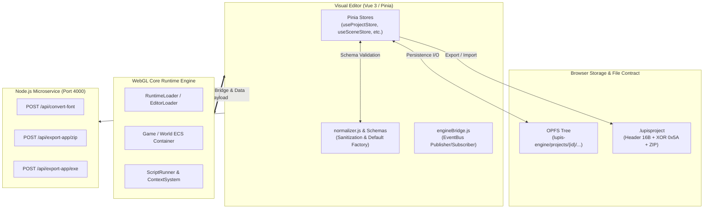
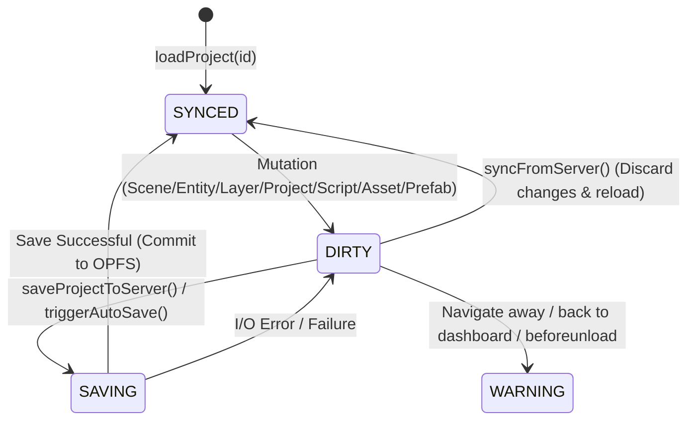
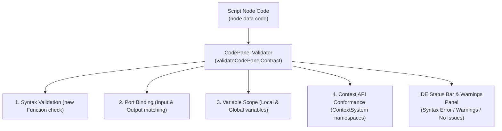

# 🔒 Lupis Engine Schema & Data Contract Lock

This document serves as the **Single Source of Truth (Canonical Specification)** for all data structures, object schemas, file formats, interface bridge protocols, and API communication contracts across the **Lupis Engine** ecosystem.

All subsystems (`editor/`, `core/`, `service/`, and the test suites in `tests/`) are strictly bound to the contracts specified herein.

---

## 📌 Contract Status & Metadata

| Attribute | Official Value | Description |
| :--- | :--- | :--- |
| **Document Status** | `LOCKED & CANONICAL` | Definitive reference for code verification and automated tests. |
| **Schema Version** | `2` (`SCHEMA_VERSION = 2`) | Active schema version for visual scripting & runtime payloads. |
| **Binary Magic Header** | `LUPIS_PROJECT1!\0` | 16-byte magic number for binary project archives. |
| **Binary XOR Mask** | `0x5A` | Protection key for binary `.lupisproject` files. |
| **Target Runtime** | WebGL 2.0 / ES6 Modules | Core graphics execution environment. |
| **Editor Framework** | Vue 3 + Pinia + Vite | Visual studio editor frontend. |
| **Microservice Backend**| Node.js / Express (Port 4000)| MSDF font generator & desktop packager. |

---

## 🧭 System Topology & Contract Boundaries



---

## 1. Storage & File System Contract

### 1.1 OPFS Directory Structure (Origin Private File System)
Inside browser virtual storage, the project workspace is rooted at `lupis-engine/projects/<projectId>/`:

```text
lupis-engine/
└── projects/
    └── <projectId>/
        ├── project.json                 # Primary project metadata (projectSchema)
        ├── assets/                      # Raw binary media blob directory
        │   └── <fileKey>                # Image, audio, or font file
        ├── scenes/
        │   └── <sceneId>.json           # Scene hierarchy, entities & layers
        ├── prefabs/
        │   └── <prefabId>.json          # Prefab blueprint template
        ├── scripts/
        │   └── <scriptId>.json          # Visual scripting node graph
        └── workspaces/                  # Workspace index metadata
            ├── assets.json              # Compact registry of all assets
            ├── scenes.json              # Compact registry of all scenes
            ├── prefabs.json             # Compact registry of all prefabs
            ├── scripts.json             # Compact registry of all scripts
            └── folders.json             # Folder grouping hierarchy
```

### 1.2 Binary Project Package Contract (`.lupisproject`)
The `.lupisproject` export file is a lightweight encrypted binary archive structured as:

1. **Magic Header (16 bytes):**
   ```text
   Hex: [0x4C, 0x55, 0x50, 0x49, 0x53, 0x5F, 0x50, 0x52, 0x4F, 0x4A, 0x45, 0x43, 0x54, 0x31, 0x21, 0x00]
   ASCII: "LUPIS_PROJECT1!\0"
   ```
2. **Obfuscation Payload:**
   Every byte following the 16-byte magic header is encrypted/decrypted via bitwise XOR:
   $$\text{byte}_{\text{obfuscated}} = \text{byte}_{\text{plain}} \oplus 0\text{x}5\text{A}$$
3. **Payload Content:**
   A standard **JSZip** archive containing the entire directory tree from the project root (`project.json`, `scenes/`, `scripts/`, `prefabs/`, `workspaces/`, and `assets/`).

---

## 2. Project Schema (`projectSchema`)

Defined in [`editor/src/features/projects/projectSchema.js`](file:///d:/Project/Lupis%20Engine/editor/src/features/projects/projectSchema.js) and matched with [`core/Schema/defaultProject.js`](file:///d:/Project/Lupis%20Engine/core/Schema/defaultProject.js):

```typescript
interface ProjectSchema {
  id: string;                                   // Unique project UUID
  name: string;                                 // Default: "Untitled Project"
  description: string;                          // Project summary
  version: string;                              // Release version (default: "1.0.0")
  createdAt: string;                            // ISO 8601 Timestamp
  thumbnailUrl: string | null;                  // User custom cover thumbnail URL / Base64
  snapshotUrl: string | null;                   // Auto snapshot of current canvas viewport (Figma-like)

  settings: {
    initialSceneId: string | null;              // UUID of boot scene
    tickRate: number;                           // Target physics tick rate (default: 60)

    autoSave: {
      enabled: boolean;                         // Toggle periodic auto-save (default: false)
      interval: number;                         // Auto-save interval in minutes (default: 10, min: 1)
    };

    debug: {
      active: boolean;                          // Default: true
      position: "top-left" | "top-right" | "bottom-left" | "bottom-right"; // Default: "top-right"
      width: number;                            // Default: 360
      height: number;                           // Default: 220
      maxLogs: number;                          // Log buffer capacity (default: 50)
    };

    ui: {
      width: number;                            // UI canvas resolution width (default: 1920)
      height: number;                           // UI canvas resolution height (default: 1080)
      showUIBorder: boolean;                    // Display UI canvas bounds (default: true)
      active: boolean;                          // Default: true
    };

    camera: {
      x: number;                                // Camera center X (default: 960)
      y: number;                                // Camera center Y (default: 540)
      zoom: number;                             // Initial zoom scale (default: 1)
      lerp: number;                             // Camera interpolation smoothness (default: 0.1)
    };

    grid: {
      width: number;                            // Grid cell width (default: 32)
      height: number;                           // Grid cell height (default: 32)
      color: string;                            // Grid line color (default: "#ffffff")
      opacity: number;                          // Grid opacity (default: 0.1)
      visible: boolean;                         // Show grid lines (default: true)
      snap: boolean;                            // Snap transformations to grid (default: true)
    };
  };

  globalVariables: Array<{
    id: string;                                 // Variable UUID
    name: string;                               // Identifier (default: "NewGlobalVar")
    type: "String" | "Number" | "Boolean";      // Global data type
    defaultValue: string | number | boolean | null;
  }>;

  tags: string[];                               // Default: ["Untagged", "Player", "Enemy"]
  scenes: Array<string | SceneSchema>;          // Scene ID references or full payloads
}
```

---

## 2.1 Sync Status & Auto-Save Contract

The Lupis Engine editor implements a formal **Finite State Machine** to track in-memory data integrity against local storage persistence (OPFS):



### 1. Synchronization Status Definitions
| Status | `syncStatus` Value | Visual Indicator | Semantic Meaning |
| :--- | :--- | :--- | :--- |
| **Synced** | `'synced'` | Green (`bg-emerald-500`) | In-memory data is completely identical to OPFS disk files. |
| **Dirty** | `'dirty'` | Red (`bg-red-500`) | Uncommitted local mutations exist in memory. |
| **Saving / Loading**| - | Pulsing yellow (`bg-yellow-400 animate-pulse`)| Async I/O operation in progress (`workspaceStore.isSaving` / `isLoading`). |

### 2. State Transition Invariants
1. **Boot / Reload Invariant**: Calling `loadProject(projectId)` or `syncFromServer()` deterministically sets `syncStatus = 'synced'`.
2. **Mutation Invariant**: Any modification to:
   - Project: `name`, `description`, `version`, `tags`, or `settings` (including `autoSave`, `grid`, `camera`, `ui`, `debug`)
   - Scene hierarchy: adding, mutating, or removing layers, entities, or components
   - Assets, Prefabs, Folders, Scripts: adding or mutating contents
   deterministically transitions `syncStatus` to `'dirty'`.
3. **Commit Invariant**: Successful execution of `saveProjectToServer()` writes `project.json` and all associated payloads to OPFS, resetting `syncStatus = 'synced'`.
4. **Auto-Save Contract**:
   - When `project.settings.autoSave.enabled === true`, a recurring timer triggers `triggerAutoSave()` every `interval` minutes (minimum 1 minute).
   - Auto-save only executes if the evaluated state is `'dirty'`, and both `isLoading === false` and `isSaving === false`.
   - If the state is already `'synced'`, auto-save executes as a no-op to eliminate redundant disk writes.
5. **Safety Guard Contract**:
   - The "Back to Dashboard" menu action must trigger a confirmation dialog if `syncStatus === 'dirty'` to prevent unintentional data loss.
   - The browser `beforeunload` event intercepts tab closure when `syncStatus === 'dirty'`.

---

## 3. Scene & Layer Schemas (`sceneSchema` & `layerSchema`)

Defined in [`editor/src/features/scenes/schemas/sceneSchema.js`](file:///d:/Project/Lupis%20Engine/editor/src/features/scenes/schemas/sceneSchema.js) and [`layerSchema.js`](file:///d:/Project/Lupis%20Engine/editor/src/features/scenes/schemas/layerSchema.js):

### 3.1 Scene Schema (`sceneSchema`)
```typescript
interface SceneSchema {
  id: string;                                   // Format: "scene_" + UUID
  projectId: string | null;                     // Associated project ID
  scriptId: string;                             // Format: "script_" + UUID
  name: string;                                 // Default: "Untitled Scene"

  settings: {
    backgroundColor: string;                    // Background color hex (default: "#222222")
    showRulers: boolean;                        // Default: true

    physics: {
      gravity: number;                          // 2D world gravity (default: 1200)
      drag: number;                             // Global air resistance (default: 5)
    };

    worldBounds: {
      x1: number;                               // Left boundary (default: -960)
      x2: number;                               // Right boundary (default: 2880)
      y1: number;                               // Top boundary (default: -540)
      y2: number;                               // Bottom boundary (default: 1620)
      active: boolean;                          // World bounds enforcement active (default: true)
    };
  };

  layersWorld: LayerSchema[];                   // Layers for in-game world space entities
  layersUI: LayerSchema[];                      // Layers for screen overlay UI entities
  entities: EntitySchema[];                     // All entities registered in the scene
}
```

### 3.2 Layer Schema (`layerSchema`)
```typescript
interface LayerSchema {
  id: string;                                   // Layer UUID
  scriptId: string;                             // Format: "layer_" + UUID
  name: string;                                 // Default: "New Layer"
  zIndex: number;                               // Render depth order (default: 0)
  orderIndex: number;                           // Tree hierarchy sibling ordering (default: 0)
  active: boolean;                              // Enable logic & collision updates (default: true)
  visible: boolean;                             // Enable rendering (default: true)
  locked: boolean;                              // Lock viewport selection (default: false)
  opacity: number;                              // Layer transparency [0..1] (default: 1.0)
}
```

---

## 4. Entity Schema (`entitySchema`)

Defined in [`editor/src/features/scenes/schemas/entitySchema.js`](file:///d:/Project/Lupis%20Engine/editor/src/features/scenes/schemas/entitySchema.js):

```typescript
interface EntitySchema {
  id: string;                                   // Unique entity UUID
  scriptId: string;                             // Identifier for Blueprint runtime binding
  name: string;                                 // Default: "New Entity"
  type: "entity" | "ui";                        // Entity domain: World vs Screen UI
  tag: string;                                  // Default: "untagged"

  zIndex: number;                               // Draw call depth order (default: 0)
  orderIndex: number;                           // Sibling order in hierarchy (default: 0)

  parentId: string | null;                      // Parent entity UUID (null if root entity)
  layerId: string;                              // Containing layer UUID (default: "layer_root")

  prefabId: string | null;                      // Origin prefab UUID if instantiated from template
  overridden: boolean;                          // Prefab property override flag (default: false)

  active: boolean;                              // Game loop tick update active (default: true)
  visible: boolean;                             // Render camera visibility (default: true)
  locked: boolean;                              // Lock viewport transform handles (default: false)

  _editor: {
    locked: boolean;                            // Inspector locked state
    expanded: boolean;                          // Tree node expanded state in hierarchy
  };

  components: Record<string, ComponentData>;    // ECS component map
  _isDirty: boolean;                            // Internal editor synchronization flag
}
```

---

## 5. ECS Component Schemas (`componentSchema`)

Defined in [`editor/src/features/scenes/schemas/componentSchema.js`](file:///d:/Project/Lupis%20Engine/editor/src/features/scenes/schemas/componentSchema.js). Every component includes an `overridden: boolean` flag when operating inside a prefab-instantiated entity.

### 5.1 `Transform` & `UITransform`
```typescript
interface TransformComponent {
  x: number;                                    // Horizontal position
  y: number;                                    // Vertical position
  rotation: number;                             // Rotation angle (default: 0)
  scaleX: number;                               // Scale multiplier X (default: 1)
  scaleY: number;                               // Scale multiplier Y (default: 1)
  pivotX: number;                               // Pivot origin ratio X [0..1] (default: 0.5)
  pivotY: number;                               // Pivot origin ratio Y [0..1] (default: 0.5)
  flipX: boolean;                               // Horizontal flip (default: false)
  flipY: boolean;                               // Vertical flip (default: false)
  width: number;                                // Width dimension (default: 100)
  height: number;                               // Height dimension (default: 100)
  isRatioLocked: boolean;                       // Lock aspect ratio on resize (default: false)
  isScaleLocked: boolean;                       // Lock scale values on resize (default: true)
  overridden: boolean;
}

interface UITransformComponent extends TransformComponent {
  anchorX: number;                              // UI anchor alignment ratio X [0..1] (default: 0.5)
  anchorY: number;                              // UI anchor alignment ratio Y [0..1] (default: 0.5)
}
```

### 5.2 `SpriteRenderer`
```typescript
interface SpriteRendererComponent {
  assetId: string | null;                       // Image texture asset UUID
  sourceX: number;                              // Atlas UV crop X (default: 0)
  sourceY: number;                              // Atlas UV crop Y (default: 0)
  sourceWidth: number;                          // Atlas UV crop width (default: 100)
  sourceHeight: number;                         // Atlas UV crop height (default: 100)
  color: string;                                // Hex color tint (default: "#FFFFFF")
  opacity: number;                              // Opacity ratio [0..1] (default: 1)
  filterMode: "pixelated" | "smooth";           // WebGL texture filtering (default: "pixelated")
  useSDF: boolean;                              // Signed Distance Field sampling (default: false)
  overridden: boolean;
}
```

### 5.3 `ShapeRenderer`
```typescript
interface ShapeRendererComponent {
  type: "custom";
  opacity: number;                              // General opacity [0..1] (default: 1)
  isFilled: boolean;                            // Fill geometry interior (default: true)
  color: string;                                // Fill hex color (default: "#ff1e00")
  fillOpacity: number;                          // Fill opacity (default: 1)
  outlineWidth: number;                         // Stroke outline width (default: 0)
  outlineColor: string;                         // Stroke outline hex color (default: "#0066FF")
  outlineOpacity: number;                       // Stroke outline opacity (default: 1)
  elements: Array<{                             // Point and polygon geometry vertices
    id: string;
    type: "point" | "polygon";
    x?: number;
    y?: number;
    size?: number;
    points?: string[];
    enabled: boolean;
  }>;
  enablePolygonCollision: boolean;              // Auto-generate polygon collider (default: false)
  enableSegmentCollision: boolean;              // Auto-generate segment collider (default: false)
  enableCircleCollision: boolean;               // Auto-generate circle collider (default: false)
  overridden: boolean;
}
```

### 5.4 `Tilemap`
```typescript
interface TilemapComponent {
  width: number;                                // Tile cell width (default: 16)
  height: number;                               // Tile cell height (default: 16)
  assetId: string | null;                       // Tileset texture asset UUID
  opacity: number;                              // Transparency (default: 1)
  isSolid: boolean;                             // Block physics collision on all tiles (default: false)
  filterMode: "pixelated" | "smooth";           // Default: "pixelated"
  data: Record<string, number>;                 // Tile dictionary mapping "x,y" coordinates to tileIndex
  overridden: boolean;
}
```

### 5.5 `TextRenderer`
```typescript
interface TextRendererComponent {
  value: string;                                // Text content (default: "New Text")
  mode: "static" | "dynamic";                   // Rendering mode (default: "static")
  assetId: string | null;                       // MSDF font asset UUID
  fontSize: number;                             // Font point size (default: 24)
  color: string;                                // Text hex color (default: "#FFFFFF")
  opacity: number;                              // Default: 1
  align: "left" | "center" | "right";           // Horizontal text alignment (default: "left")
  maxWidth: number;                             // Wrap boundary width (default: 0 / unlimited)
  maxLine: number;                              // Maximum line count (default: 0 / unlimited)
  lineSpacing: number;                          // Line height spacing factor (default: 1.2)
  letterSpacing: number;                        // Character spacing offset (default: 0)
  overflow: "wrap" | "truncate" | "visible";    // Overflow layout behavior (default: "wrap")
  autoFit: boolean;                             // Auto-adjust bounding box dimensions (default: true)
  outlineWidth: number;                         // Text stroke outline width (default: 0)
  outlineColor: string;                         // Text stroke outline hex color (default: "#000000")
  shadowEnabled: boolean;                       // Drop shadow toggle (default: false)
  shadowColor: string;                          // Shadow hex color (default: "#000000")
  shadowOpacity: number;                        // Shadow opacity (default: 0.5)
  shadowOffsetX: number;                        // Shadow offset X (default: 2)
  shadowOffsetY: number;                        // Shadow offset Y (default: -2)
  shadowBlur: number;                           // Shadow blur radius (default: 5)
  overridden: boolean;
}
```

### 5.6 `Physics`
```typescript
interface PhysicsComponent {
  enabled: boolean;                             // Physics simulation active (default: true)
  type: "dynamic" | "static" | "kinematic";     // Body physics type (default: "dynamic")
  mass: number;                                 // Body mass (default: 1.0)
  gravityScale: number;                         // Gravity multiplier factor (default: 1.0)
  isFrozen: boolean;                            // Freeze position changes (default: false)
  drag: number;                                 // Drag coefficient (default: 1.0)
  velocityX: number;                            // Current linear velocity X (default: 0)
  velocityY: number;                            // Current linear velocity Y (default: 0)
  isGrounded: boolean;                          // Contacting ground surface (default: false)
  movementState: "idle" | "run" | "jump" | string; // Default: "idle"
  facingDirection: "left" | "right";            // Default: "right"
  overridden: boolean;
}
```

### 5.7 `Collider`
```typescript
interface ColliderComponent {
  data: Array<{
    type: "solid" | "trigger";                  // Solid physics body vs sensor trigger
    enabled: boolean;                           // Default: true
    autoFit: boolean;                           // Auto-match entity Transform bounds (default: false)
    offsetX: number;                            // Offset center X (default: 0)
    offsetY: number;                            // Offset center Y (default: 0)
    width: number;                              // Hitbox width (default: 32)
    height: number;                             // Hitbox height (default: 32)
    rotation: number;                           // Hitbox rotation (default: 0)
    pivotX: number;                             // Hitbox pivot X (default: 0)
    pivotY: number;                             // Hitbox pivot Y (default: 0)
  }>;
  overridden: boolean;
}
```

### 5.8 `SpriteAnimator`
```typescript
interface SpriteAnimatorComponent {
  currentClip: string | null;                   // Active animation clip identifier or scriptId
  clips: Record<string, {                       // Dictionary / list of animation clips
    name: string;
    frames: Array<{
      sourceX: number;
      sourceY: number;
      sourceWidth: number;
      sourceHeight: number;
      duration: number;
    }>;
    loop: boolean;
    fps: number;
  }> | Array<any>;
  active: boolean;                              // Default: true
  isPlaying: boolean;                           // Playback running state (default: true)
  overridden: boolean;
}
```

### 5.9 `Audio`
```typescript
interface AudioComponent {
  assetId: string | null;                       // Sound media asset UUID
  isMute: boolean;                              // Default: false
  volume: number;                               // Audio gain [0..1] (default: 1.0)
  pitch: number;                                // Playback rate / pitch multiplier (default: 1.0)
  loop: boolean;                                // Loop playback (default: false)
  autoplay: boolean;                            // Play automatically on spawn (default: false)
  spatial: boolean;                             // 2D positional distance audio (default: false)
  persist: boolean;                             // Persist playback across scene changes (default: false)
  fadeIn: number;                               // Fade-in duration in seconds (default: 0.0)
  fadeOut: number;                              // Fade-out duration in seconds (default: 0.0)
  refDistance: number;                          // Positional reference distance (default: 100)
  maxDistance: number;                          // Maximum audible cutoff distance (default: 1000)
  overridden: boolean;
}
```

### 5.10 `ScriptController`
```typescript
interface ScriptControllerComponent {
  data: Array<{                                 // Visual blueprint bindings
    scriptId: string;                           // Attached script UUID
    enabled: boolean;                           // Activation status
    customParameters?: Record<string, any>;     // Per-entity variable overrides
  }>;
  overridden: boolean;
}
```

---

## 6. Asset & Folder Schemas (`assetSchema` & `folderSchema`)

Defined in [`editor/src/features/assets/assetSchema.js`](file:///d:/Project/Lupis%20Engine/editor/src/features/assets/assetSchema.js) and [`editor/src/features/folders/folderSchema.js`](file:///d:/Project/Lupis%20Engine/editor/src/features/folders/folderSchema.js):

### 6.1 Asset Schema (`assetSchema`)
```typescript
interface AssetSchema {
  id: string;                                   // Unique asset UUID
  projectId: string | null;                     // Associated project ID
  folderId: string | null;                      // Associated folder grouping UUID
  name: string;                                 // Display asset label
  type: "texture" | "audio" | "font";           // Media type
  fileKey: string;                              // Binary file key in OPFS / storage
  fileUrl?: string;                             // Ephemeral Blob URL or service URL
  localBlob?: Blob | null;                      // In-memory upload buffer
  isSynced: boolean;                            // Persistence status in OPFS (default: true)

  meta: {
    extension: string;                          // E.g. ".png", ".ogg", ".fnt", ".ttf"
    size: number;                               // File size in bytes
    dimensions?: {                              // "texture" type specific
      w: number;
      h: number;
    };
    duration?: number;                          // "audio" type specific (in seconds)
    textureUrl?: string;                        // "font" type specific (PNG atlas path)
    [key: string]: any;
  };
}
```

### 6.2 Default System Assets
- **Default System Font (`DEFAULT_SYSTEM_FONT_ASSET`):**
  - `id`: `"system_default"`
  - `name`: `"System Default Font"`
  - `type`: `"font"`
  - `fileKey`: `"system_default"`
  - References built-in engine MSDF typography at [`core/Assets/Fonts/defaultFont.fnt`](file:///d:/Project/Lupis%20Engine/core/Assets/Fonts/defaultFont.fnt).

### 6.3 Folder Schema (`folderSchema`)
```typescript
interface FolderSchema {
  id: string;                                   // Format: "folder_" + timestamp + random
  type: "folder";
  name: string;                                 // Default: "New Folder"
  section: "assets" | "scripts" | "prefabs" | "scenes"; // Workspace section domain
  projectId: string | null;                     // Associated project ID
  parentId: string | null;                      // Nested parent folder ID
}
```

---

## 7. Prefab Schema (`prefabSchema`)

Defined in [`editor/src/features/prefabs/prefabSchema.js`](file:///d:/Project/Lupis%20Engine/editor/src/features/prefabs/prefabSchema.js):

```typescript
interface PrefabSchema {
  id: string;                                   // Unique prefab UUID
  projectId: string | null;
  folderId: string | null;
  name: string;                                 // Default: "New Prefab"
  type: "world" | "ui";                         // Hierarchy category domain
  data: EntitySchema;                           // Root entity template (prefabId=null, parentId=null)
  children: EntitySchema[];                     // Descendant entities list
}
```

> [!IMPORTANT]
> **Prefab Normalization Rules:**
> When an entity tree is converted into a prefab, all `overridden` flags on components across root and child entities are reset to `false`. Both `prefabId` and `parentId` on the template root entity are strictly normalized to `null`.

---

## 8. Visual Scripting & Blueprint Contract

Defined across [`editor/src/features/nodes/contract/`](file:///d:/Project/Lupis%20Engine/editor/src/features/nodes/contract/) and [`core/Script/contract/`](file:///d:/Project/Lupis%20Engine/core/Script/contract/):

### 8.1 Script Graph Schema (`scriptSchema`)
```typescript
interface ScriptSchema {
  id: string;                                   // Unique script UUID
  projectId: string | null;
  folderId: string | null;
  name: string;                                 // Default: "Untitled Script"
  type: "component" | "global" | "scene";       // Script role in hierarchy
  localVariables: ScriptVariable[];             // Local script variables
  nodes: ScriptNode[];                          // Logic nodes list
  edges: ScriptEdge[];                          // Wire / pin connection list
}
```

### 8.2 Blueprint Graph Element Structures
```typescript
interface ScriptVariable {
  id: string;                                   // Variable UUID
  name: string;                                 // Default: "NewVariable"
  type: "number" | "string" | "boolean" | "list" | "map";
  isExposed: boolean;                           // Expose in entity inspector (default: false)
  defaultValue: any;                            // Initial value
}

interface ScriptPort {
  id: string;                                   // Port unique ID (validates against PORT_ID_REGEX)
  dataType: "execution" | "string" | "number" | "boolean" | "any" | "list" | "map";
  color: string;                                // Pin color indicator hex
  enabled: boolean;                             // Default: true
  defaultValue: any;                            // Fallback value when port is unconnected
}

interface ScriptNode {
  id: string;                                   // Unique node UUID
  type: string;                                 // Canonical node type (e.g. "eventGameStart", "mathAdd", "variableGet")
  role: "event" | "action" | "pure";            // Execution role
  dynamicMode: "none" | "list" | "map" | string;// Dynamic pin expansion mode
  position: {
    x: number;
    y: number;
  };
  settings: {
    headerTitle: string;
    description: string;
    headerColor: string;
    category: string;
    visibleDataFields: string[];
  };
  inputs: ScriptPort[];
  outputs: ScriptPort[];
  data: {
    values: Record<string, any>;                // Literal values per input port
    code: string;                               // JavaScript code evaluating the node
    options?: Record<string, any>;
    valueModes?: Record<string, "input" | "variable">;
    variableBindings?: Record<string, string>;
  };
}

interface ScriptEdge {
  id: string;                                   // Connection wire UUID
  source: string;                               // Origin node UUID
  sourceHandle: string;                         // Origin output port ID
  target: string;                               // Destination node UUID
  targetHandle: string;                         // Destination input port ID
  modifier?: Record<string, any>;               // On-the-wire value transformation
}
```

### 8.3 Port Validation Rules & ID Standards
- **ID Validation Regex:** `/^[A-Za-z][A-Za-z0-9]{0,31}$/` (`PORT_ID_REGEX`).
- **Protected Ports (Must Never Be Dynamically Deleted):**
  `execIn`, `execOut`, `targetEntity`, `targetLayer`, `onClick`.
- **Official Canonical Port IDs:**
  - Control Flow: `execIn`, `execOut`, `onTrue`, `onFalse`, `loopBody`, `completed`, `onComplete`, `onElse`, `onDefault`.
  - Lifecycle Events: `onStart`, `onUpdate`, `onReady`, `onEnter`, `onExit`, `onHit`.
  - User Input: `onClick`, `onDrag`, `onHover`, `onDown`, `onHold`, `onUp`.
  - Object References: `targetEntity`, `sourceEntity`, `selfEntity`, `otherEntity`, `parentEntity`, `childEntity`, `targetLayer`, `prefabName`.
  - Transform & Physics Values: `position`, `rotation`, `scale`, `velocity`, `force`, `x`, `y`, `z`, `velocityX`, `velocityY`.
- **Port Color Palette (`PORT_COLORS`):**
  - `execution`: `#FFFFFF` (White)
  - `string`: `#F48FB1` (Pink)
  - `number`: `#64B5F6` (Blue)
  - `boolean`: `#E57373` (Red)
  - `any`: `#B0BEC5` (Slate Gray)
  - `list`: `#4DD0E1` (Cyan)
  - `map`: `#FF8A65` (Coral Orange)

### 8.4 Runtime Namespace Execution Contract (`ContextSystem`)
Blueprint logic executes under the isolation of `ContextSystem`, providing canonical namespaces and methods:

```typescript
// 14 Canonical Namespaces (CONTEXT_NAMESPACES)
const CONTEXT_NAMESPACES = [
  'entity', 'layer', 'prefab', 'collider', 'input',
  'ui', 'signal', 'lifecycle', 'transition', 'camera',
  'scene', 'state', 'console', 'assert'
];

// Assertion Methods (CONTEXT_ASSERT_METHODS)
const CONTEXT_ASSERT_METHODS = [
  'isTrue', 'isFalse', 'exists', 'hasComponent',
  'isNumber', 'isString', 'isBoolean', 'isObject',
  'isArray', 'inRange', 'fail'
];

// Console Telemetry Methods (CONTEXT_CONSOLE_METHODS)
const CONTEXT_CONSOLE_METHODS = ['log', 'warn', 'error'];

// Root Context Methods (CONTEXT_ROOT_METHODS)
const CONTEXT_ROOT_METHODS = [
  'onTick', 'triggerFlow', 'onGameStart', 'onSceneStart',
  'onGamePause', 'onGameResume', 'onGameRestart', 'isPaused',
  'notify', 'getLocal', 'setLocal', 'getGlobal', 'setGlobal'
];

// Root Context Properties (CONTEXT_ROOT_PROPERTIES)
const CONTEXT_ROOT_PROPERTIES = ['owner', 'node', 'dt', 'deltaTime', 'state'];
```

### 8.5 CodePanel Contract & Node Logic Evaluation
Defined in [`core/Script/contract/codePanelContract.js`](file:///d:/Project/Lupis%20Engine/core/Script/contract/codePanelContract.js) and [`editor/src/features/nodes/contract/codePanelContract.js`](file:///d:/Project/Lupis%20Engine/editor/src/features/nodes/contract/codePanelContract.js):

Every snippet of JavaScript within a Blueprint node (`node.data.code`) is subject to strict evaluation invariants:

#### 1. Canonical Execution Signature (`CODE_PANEL_PARAM_NAMES`)
All visual node logic is evaluated dynamically by `ScriptRunner` using a standard 4-parameter function signature:
```javascript
new Function('inputs', 'outputs', 'context', 'node', rawCode + '\nreturn outputs;');
```
- `inputs`: Read-only dictionary of incoming pin values (`inputs['portName']` or `inputs.portName`).
- `outputs`: Mutable output dictionary for computed data and execution branches (`outputs['portName'] = val` or `outputs.portName = val`).
- `context`: Gateway to runtime engine services (`ContextSystem` namespaces such as `entity`, `layer`, `ui`, `camera`, `scene`, and methods `getLocal`, `setLocal`, `getGlobal`, `setGlobal`, `onTick`, `triggerFlow`).
- `node`: Active node metadata plain object (read-only).

#### 2. CodePanel Validation Invariants (`validateCodePanelContract`)
The editor runs real-time static analysis on the contents of `CodePanel.vue`:



1. **JavaScript Syntax Integrity**:
   - The code must be syntactically valid JavaScript. If a parse error occurs, the validator reports `hasSyntaxError: true`, the error details, and presents the **Syntax Error** badge.
2. **Input Port Binding**:
   - Any input accessed via code (`inputs['foo']` or `inputs.foo`) must be declared in `node.inputs` (matched by `id` or `label`).
   - All non-execution data input ports declared on the node should be consumed within the logic.
3. **Output Port Binding**:
   - Any output assigned via code (`outputs['bar'] = val` or `outputs.bar = val`) must be declared in `node.outputs` (matched by `id` or `label`).
   - All declared output ports (including execution branches `outputs.execOut = true`) should receive assignments.
4. **Variable Scope Resolution**:
   - Local variables accessed via `context.getLocal('x')` or `context.setLocal('x', ...)` must exist in `script.localVariables`.
   - Global variables accessed via `context.getGlobal('y')` or `context.setGlobal('y', ...)` must exist in `project.globalVariables`.
5. **Runtime API Conformance (`context`)**:
   - Properties accessed on `context` (`context.<property>`) are validated against `VALID_CONTEXT_PROPERTIES` (canonical namespaces, root methods, and root properties). Unregistered access produces a contract warning.

#### 3. Standard Node Code Boilerplate (`generateDefaultNodeCode`)
When authoring custom nodes or resetting node code, the editor generates standard boilerplate matching declared ports:
1. Read data inputs: `const <id> = inputs['<label || id>'];`
2. Computation block: `// 2. Execute node computation`
3. Initialize data outputs: `outputs['<label || id>'] = null;`
4. Trigger flow (if execution output pin is present): `outputs.execOut = true;`

---

## 9. Engine Initialization Payload Contract (`prepareEngineData`)

Defined in [`editor/src/features/engines/prepareEngineData.js`](file:///d:/Project/Lupis%20Engine/editor/src/features/engines/prepareEngineData.js) and consumed by [`core/Loader/RuntimeLoader.js`](file:///d:/Project/Lupis%20Engine/core/Loader/RuntimeLoader.js):

When the editor boots or reloads the WebGL Core Canvas, the following unified payload is transmitted:

```typescript
interface EngineRuntimePayload {
  project: ProjectSchema;                       // Active project metadata
  assets: AssetSchema[];                        // List of all media assets
  scenes: SceneSchema[];                        // List of all scenes with complete entity hierarchies
  prefabs: PrefabSchema[];                      // Template prefab library
  scripts: ScriptSchema[];                      // Visual blueprint script library
  workspaceConfig: {                            // Viewport and editor tool configurations
    activeProjectId: string;
    activeTabId?: string;
    tabs?: any[];
    [key: string]: any;
  };
  onProgress?: (message: string, percent: number) => void;
}
```

> [!NOTE]
> If project data is empty or fails to load from OPFS, the engine automatically falls back to the canonical [`DEFAULT_PROJECT_PAYLOAD`](file:///d:/Project/Lupis%20Engine/core/Schema/defaultProject.js).

---

## 10. EventBus Bridge Contract (Engine-Editor Communication)

Managed via [`editor/src/features/engines/engineBridge.js`](file:///d:/Project/Lupis%20Engine/editor/src/features/engines/engineBridge.js) and [`core/Editor/SyncComponent.js`](file:///d:/Project/Lupis%20Engine/core/Editor/SyncComponent.js):

| Event Bus Channel | Flow Direction | Payload Format | Operation Description |
| :--- | :--- | :--- | :--- |
| `entity:modified` | Core $\rightarrow$ Editor | `EntitySchema \| EntitySchema[]` | Dispatches Transform mutations from gizmo dragging or physics simulation to Pinia `useSceneStore`. |
| `editor:tool:pickup` | Core $\rightarrow$ Editor | `{ tool: string, entityId: string, coords: object }` | Notifies canvas eyedropper or entity selection pick events. |
| `editor:tilemap:update-data` | Core $\rightarrow$ Editor | `{ entityId: string, data: Record<string, number> }` | Synchronizes interactive tilemap brush paint mutations. |
| `console:log` | Core $\rightarrow$ Editor | `{ type: string, time: number, source: string, message: string }` | Relays execution logs, runtime warnings, and exceptions to the editor console dock. |
| `editor:scene:reload` | Editor $\rightarrow$ Core | `SceneSchema \| { sceneId: string }` | Reloads active scene without reloading the browser tab. |
| `editor:selection:set` | Editor $\rightarrow$ Core | `string[]` (Array of entity UUIDs) | Updates active selection bounding box / gizmo focus. |
| `editor:selection:clear` | Editor $\rightarrow$ Core | `void` (No payload) | Clears all canvas selections. |
| `editor:project:settings-update` | Editor $\rightarrow$ Core | `{ settings: object }` | Synchronizes project settings mutations (grid, debug, etc.). |
| `editor:scene:settings-update` | Editor $\rightarrow$ Core | `{ settings: object }` | Synchronizes scene settings (gravity, background color, bounds). |
| `editor:store:update` | Editor $\rightarrow$ Core | `object` | Synchronizes active editor mode states (active tools, visibility). |
| `editor:theme:update` | Editor $\rightarrow$ Core | `{ isDark: boolean }` | Harmonizes WebGL canvas background theme. |

---

## 11. Backend Microservice REST API Contract (`service/server.js`)

The microservice runs locally on port `4000` (or configured via `process.env.PORT`).

### 11.1 `GET /api/health`
- **Purpose:** Verifies service readiness.
- **Response Content-Type:** `application/json`
- **Success Schema:**
  ```json
  {
    "success": true,
    "message": "Engine micro-backend is active and ready.",
    "timestamp": "2026-10-15T13:37:00.000Z"
  }
  ```

### 11.2 `POST /api/convert-font`
- **Purpose:** Converts TrueType/OpenType (`.ttf`/`.otf`) font files into Multi-channel Signed Distance Field (MSDF) BMFont assets.
- **Request Content-Type:** `multipart/form-data`
- **Input Payload:**
  - `file`: Binary font file `.ttf` or `.otf` (Maximum 15 MB).
- **Response Content-Type:** `application/zip` (Attachment: `bmfont-<jobId>.zip`)
- **ZIP Content:**
  - `font.fnt`: BMFont text/XML glyph metrics specification.
  - `font.png`: 2048x2048 pixel MSDF texture atlas.
- **Error Response:** `400 / 500` with JSON `{ success: false, error: string }`.

### 11.3 `POST /api/export-app/zip`
- **Purpose:** Packages a game project into a standalone web game distribution bundle.
- **Request Content-Type:** `multipart/form-data`
- **Input Payload:**
  - `projectZip`: Project ZIP archive (Maximum 200 MB).
  - `projectId`: Project UUID string.
  - `updatedAt`: ISO 8601 Timestamp.
- **Response Content-Type:** `application/zip` (Direct download of `<projectId>.zip`).

### 11.4 `POST /api/export-app/exe` & `GET /api/download-app/exe/:projectId`
- **Purpose:** Compiles a game project into a standalone Windows desktop executable using Electron Packager.
- **Input Payload (POST):**
  - `projectZip`: Project ZIP archive.
  - `projectId`: Project UUID string.
  - `appName`: Target executable name.
  - `updatedAt`: ISO 8601 Timestamp.
- **POST Response:** `{ success: true, message: string, downloadUrl: string }`.
- **GET Response:** Binary stream of `.exe` standalone installer or executable.

---

## 12. Schema Evolution Rules & Compatibility Guidelines

To ensure project backward compatibility and automated test suite stability (E2E / Integration / System):

1. **Additive-Only Evolution:**
   - New properties added to any schema **must** provide sensible fallback defaults via nullish coalescing (`??`) or schema factory defaults.
   - Deleting or renaming existing properties within minor or patch releases is strictly prohibited.
2. **Centralized Sanitization via Normalizer:**
   - All raw data originating from OPFS, uploaded files, or clipboard paste operations must pass through [`normalizer()`](file:///d:/Project/Lupis%20Engine/editor/src/utils/normalizer.js).
   - Authoring ad-hoc sanitization routines outside canonical schema definitions is prohibited.
3. **Schema Versioning & Migration:**
   - Any structural breaking change requires incrementing `SCHEMA_VERSION` (currently `2`).
   - A backward migration adapter must be implemented to convert legacy project files on load.
4. **Internal Invariant Assumptions:**
   - Following the `normalizer()` pass, internal application logic may confidently rely on complete schema adherence without defensive null-checks.

---

> This canonical contract document is verified and maintained for the Lupis Engine Suite.
