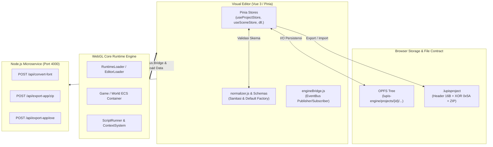

# 🔒 Kunci Skema & Kontrak Data Lupis Engine (Schema & Contract Lock)

Dokumen ini adalah **sumber kebenaran tunggal (Single Source of Truth / Canonical Specification)** untuk seluruh struktur data, skema objek, format berkas, protokol bridge antarmuka, dan kontrak komunikasi API di dalam ekosistem **Lupis Engine**.

Semua subsistem (`editor/`, `core/`, `service/`, dan suite pengujian `tests/`) terikat secara ketat pada kontrak yang dijabarkan dalam spesifikasi ini.

---

## 📌 Status & Metadata Kontrak

| Atribut | Nilai Resmi | Deskripsi |
| :--- | :--- | :--- |
| **Status Dokumen** | `LOCKED & CANONICAL` | Menjadi acuan mutlak pengujian dan verifikasi kode. |
| **Schema Version** | `2` (`SCHEMA_VERSION = 2`) | Versi skema visual scripting & runtime payload aktif. |
| **Binary Magic Header** | `LUPIS_PROJECT1!\0` | 16-byte magic number arsip biner proyek. |
| **Binary XOR Mask** | `0x5A` | Kunci proteksi biner `.lupisproject`. |
| **Target Runtime** | WebGL 2.0 / ES6 Modules | Lingkungan eksekusi grafis inti. |
| **Editor Framework** | Vue 3 + Pinia + Vite | Lingkungan studio visual editor. |
| **Microservice Backend**| Node.js / Express (Port 4000)| Generator font MSDF & desktop packager. |

---

## 🧭 Peta Aliran Kontrak (System Topology & Contract Boundaries)



---

## 1. Kontrak Penyimpanan & Format Berkas (Storage & File System Contract)

### 1.1 Struktur Direktori OPFS (Origin Private File System)
Di dalam browser virtual storage, direktori kerja berakar pada `lupis-engine/projects/<projectId>/`:

```text
lupis-engine/
└── projects/
    └── <projectId>/
        ├── project.json                 # Metadata utama proyek (projectSchema)
        ├── assets/                      # Direktori penyimpanan blob biner mentah
        │   └── <fileKey>                # File gambar, audio, atau font
        ├── scenes/
        │   └── <sceneId>.json           # Detail hierarki, entitas & layer scene
        ├── prefabs/
        │   └── <prefabId>.json          # Blueprint prefab template
        ├── scripts/
        │   └── <scriptId>.json          # Visual scripting node graph
        └── workspaces/                  # Indeks metadata workspace
            ├── assets.json              # Daftar ringkas seluruh asset
            ├── scenes.json              # Daftar ringkas seluruh scene
            ├── prefabs.json             # Daftar ringkas seluruh prefab
            ├── scripts.json             # Daftar ringkas seluruh script
            └── folders.json             # Struktur folder pengelompokan
```

### 1.2 Kontrak Paket Biner Proyek (`.lupisproject`)
File ekspor `.lupisproject` adalah arsip biner terenkripsi ringan dengan spesifikasi:

1. **Magic Header (16 bytes):**
   ```text
   Hex: [0x4C, 0x55, 0x50, 0x49, 0x53, 0x5F, 0x50, 0x52, 0x4F, 0x4A, 0x45, 0x43, 0x54, 0x31, 0x21, 0x00]
   ASCII: "LUPIS_PROJECT1!\0"
   ```
2. **Obfuscation Payload:**
   Setiap byte setelah header 16-byte dienkripsi/dekripsi menggunakan operasi XOR:
   $$\text{byte}_{\text{obfuscated}} = \text{byte}_{\text{plain}} \oplus 0\text{x}5\text{A}$$
3. **Payload Content:**
   Arsip standar **JSZip** yang berisi seluruh struktur file pada root proyek (berkas `project.json`, direktori `scenes/`, `scripts/`, `prefabs/`, `workspaces/`, dan `assets/`).

---

## 2. Kunci Skema Proyek (`projectSchema`)

Didefinisikan di [`editor/src/features/projects/projectSchema.js`](file:///d:/Project/Lupis%20Engine/editor/src/features/projects/projectSchema.js) dan dipadankan dengan [`core/Schema/defaultProject.js`](file:///d:/Project/Lupis%20Engine/core/Schema/defaultProject.js):

```typescript
interface ProjectSchema {
  id: string;                                   // UUID unik proyek
  name: string;                                 // Default: "Untitled Project"
  description: string;                          // Ringkasan proyek
  status: "DRAFT" | "PUBLISHED";                // Status siklus hidup proyek
  createdAt: string;                            // ISO 8601 Timestamp
  thumbnailUrl: string | null;                  // URL / Base64 cover thumbnail

  settings: {
    initialSceneId: string | null;              // UUID scene pertama saat boot
    tickRate: number;                           // Target physics tick rate (default: 60)

    debug: {
      active: boolean;                          // Default: true
      position: "top-left" | "top-right" | "bottom-left" | "bottom-right"; // Default: "top-right"
      width: number;                            // Default: 360
      height: number;                           // Default: 220
      maxLogs: number;                          // Kapasitas buffer log (default: 50)
    };

    ui: {
      width: number;                            // Lebar resolusi kanvas UI (default: 1920)
      height: number;                           // Tinggi resolusi kanvas UI (default: 1080)
      showUIBorder: boolean;                    // Tampilkan batas canvas UI (default: true)
      active: boolean;                          // Default: true
    };

    camera: {
      x: number;                                // Titik pusat kamera X (default: 960)
      y: number;                                // Titik pusat kamera Y (default: 540)
      zoom: number;                             // Skala zoom awal (default: 1)
      lerp: number;                             // Kehalusan interpolasi kamera (default: 0.1)
    };

    grid: {
      width: number;                            // Lebar grid sel (default: 32)
      height: number;                           // Tinggi grid sel (default: 32)
      color: string;                            // Warna garis grid (default: "#ffffff")
      opacity: number;                          // Opasitas grid (default: 0.1)
      visible: boolean;                         // Tampilkan grid (default: true)
      snap: boolean;                            // Snap transformasi ke grid (default: true)
    };
  };

  globalVariables: Array<{
    id: string;                                 // UUID variabel
    name: string;                               // Identifier (default: "NewGlobalVar")
    type: "String" | "Number" | "Boolean";      // Tipe data global
    defaultValue: string | number | boolean | null;
  }>;

  tags: string[];                               // Default: ["Untagged", "Player", "Enemy"]
  scenes: Array<string | SceneSchema>;          // Referensi ID atau payload scene
}
```

---

## 3. Kunci Skema Scene & Layer (`sceneSchema` & `layerSchema`)

Didefinisikan di [`editor/src/features/scenes/schemas/sceneSchema.js`](file:///d:/Project/Lupis%20Engine/editor/src/features/scenes/schemas/sceneSchema.js) dan [`layerSchema.js`](file:///d:/Project/Lupis%20Engine/editor/src/features/scenes/schemas/layerSchema.js):

### 3.1 Skema Scene (`sceneSchema`)
```typescript
interface SceneSchema {
  id: string;                                   // Format: "scene_" + UUID
  projectId: string | null;                     // Relasi ke project owner
  scriptId: string;                             // Format: "script_" + UUID
  name: string;                                 // Default: "Untitled Scene"

  settings: {
    backgroundColor: string;                    // Hex background (default: "#222222")
    showRulers: boolean;                        // Default: true

    physics: {
      gravity: number;                          // Gravitasi dunia 2D (default: 1200)
      drag: number;                             // Hambatan udara dunia (default: 5)
    };

    worldBounds: {
      x1: number;                               // Batas kiri (default: -960)
      x2: number;                               // Batas kanan (default: 2880)
      y1: number;                               // Batas atas (default: -540)
      y2: number;                               // Batas bawah (default: 1620)
      active: boolean;                          // Apakah batas dunia aktif (default: true)
    };
  };

  layersWorld: LayerSchema[];                   // Layer untuk objek in-game world space
  layersUI: LayerSchema[];                      // Layer untuk objek overlay screen UI space
  entities: EntitySchema[];                     // Seluruh entitas terdaftar dalam scene
}
```

### 3.2 Skema Layer (`layerSchema`)
```typescript
interface LayerSchema {
  id: string;                                   // UUID layer
  scriptId: string;                             // Format: "layer_" + UUID
  name: string;                                 // Default: "New Layer"
  zIndex: number;                               // Tingkat kedalaman rendering (default: 0)
  orderIndex: number;                           // Urutan susunan pada pohon hierarki (default: 0)
  active: boolean;                              // Mengaktifkan logika & collision (default: true)
  visible: boolean;                             // Mengaktifkan rendering (default: true)
  locked: boolean;                              // Mengunci seleksi di viewport (default: false)
  opacity: number;                              // Nilai transparansi layer (default: 1.0)
}
```

---

## 4. Kunci Skema Entitas (`entitySchema`)

Didefinisikan di [`editor/src/features/scenes/schemas/entitySchema.js`](file:///d:/Project/Lupis%20Engine/editor/src/features/scenes/schemas/entitySchema.js):

```typescript
interface EntitySchema {
  id: string;                                   // UUID unik entitas
  scriptId: string;                             // Identifier untuk Blueprint runtime
  name: string;                                 // Default: "New Entity"
  type: "entity" | "ui";                        // Domain entitas: World vs Screen UI
  tag: string;                                  // Default: "untagged"

  zIndex: number;                               // Tingkat kedalaman draw call (default: 0)
  orderIndex: number;                           // Urutan hierarki sibling (default: 0)

  parentId: string | null;                      // ID entitas induk (null jika root)
  layerId: string;                              // ID layer penampung (default: "layer_root")

  prefabId: string | null;                      // ID prefab asal jika merupakan turunan template
  overridden: boolean;                          // Status override properti prefab (default: false)

  active: boolean;                              // Pembaruan siklus game loop (default: true)
  visible: boolean;                             // Visibilitas pada kamera (default: true)
  locked: boolean;                              // Kunci manipulasi viewport (default: false)

  _editor: {
    locked: boolean;                            // Status kunci di editor inspector
    expanded: boolean;                          // Status ekspansi node di panel hierarki
  };

  components: Record<string, ComponentData>;    // Peta komponen ECS
  _isDirty: boolean;                            // Flag internal sinkronisasi editor
}
```

---

## 5. Kunci Skema Komponen ECS (`componentSchema`)

Didefinisikan di [`editor/src/features/scenes/schemas/componentSchema.js`](file:///d:/Project/Lupis%20Engine/editor/src/features/scenes/schemas/componentSchema.js). Setiap komponen menyertakan flag `overridden: boolean` saat beroperasi di dalam entitas turunan prefab.

### 5.1 `Transform` & `UITransform`
```typescript
interface TransformComponent {
  x: number;                                    // Posisi horizontal
  y: number;                                    // Posisi vertikal
  rotation: number;                             // Rotasi dalam derajat/radian (default: 0)
  scaleX: number;                               // Skala sumbu X (default: 1)
  scaleY: number;                               // Skala sumbu Y (default: 1)
  pivotX: number;                               // Titik tumpu X [0..1] (default: 0.5)
  pivotY: number;                               // Titik tumpu Y [0..1] (default: 0.5)
  flipX: boolean;                               // Balik horizontal (default: false)
  flipY: boolean;                               // Balik vertikal (default: false)
  width: number;                                // Dimensi lebar (default: 100)
  height: number;                               // Dimensi tinggi (default: 100)
  isRatioLocked: boolean;                       // Kunci rasio aspek saat resize (default: false)
  isScaleLocked: boolean;                       // Kunci skala saat resize (default: true)
  overridden: boolean;
}

interface UITransformComponent extends TransformComponent {
  anchorX: number;                              // Jangkar penataan UI X [0..1] (default: 0.5)
  anchorY: number;                              // Jangkar penataan UI Y [0..1] (default: 0.5)
}
```

### 5.2 `SpriteRenderer`
```typescript
interface SpriteRendererComponent {
  assetId: string | null;                       // UUID asset tekstur gambar
  sourceX: number;                              // Pemotongan atlas UV X (default: 0)
  sourceY: number;                              // Pemotongan atlas UV Y (default: 0)
  sourceWidth: number;                          // Lebar cuplikan tekstur (default: 100)
  sourceHeight: number;                         // Tinggi cuplikan tekstur (default: 100)
  color: string;                                // Hex tint warna (default: "#FFFFFF")
  opacity: number;                              // Transparansi [0..1] (default: 1)
  filterMode: "pixelated" | "smooth";           // Mode filtering WebGL (default: "pixelated")
  useSDF: boolean;                              // Signed Distance Field sampling (default: false)
  overridden: boolean;
}
```

### 5.3 `ShapeRenderer`
```typescript
interface ShapeRendererComponent {
  type: "custom";
  opacity: number;                              // Transparansi umum (default: 1)
  isFilled: boolean;                            // Isi bentuk geometri (default: true)
  color: string;                                // Hex warna isi (default: "#ff1e00")
  fillOpacity: number;                          // Opasitas isi (default: 1)
  outlineWidth: number;                         // Lebar garis tepi (default: 0)
  outlineColor: string;                         // Hex warna garis tepi (default: "#0066FF")
  outlineOpacity: number;                       // Opasitas garis tepi (default: 1)
  elements: Array<{                             // Simpul geometri titik dan poligon
    id: string;
    type: "point" | "polygon";
    x?: number;
    y?: number;
    size?: number;
    points?: string[];
    enabled: boolean;
  }>;
  enablePolygonCollision: boolean;              // Generate collider otomatis (default: false)
  enableSegmentCollision: boolean;              // Default: false
  enableCircleCollision: boolean;               // Default: false
  overridden: boolean;
}
```

### 5.4 `Tilemap`
```typescript
interface TilemapComponent {
  width: number;                                // Lebar ubin / grid (default: 16)
  height: number;                               // Tinggi ubin / grid (default: 16)
  assetId: string | null;                       // UUID asset tileset tekstur
  opacity: number;                              // Default: 1
  isSolid: boolean;                             // Apakah seluruh ubin memblokir fisik (default: false)
  filterMode: "pixelated" | "smooth";           // Default: "pixelated"
  data: Record<string, number>;                 // Dictionary ubin dengan key "x,y" dan value tileIndex
  overridden: boolean;
}
```

### 5.5 `TextRenderer`
```typescript
interface TextRendererComponent {
  value: string;                                // Konten teks (default: "New Text")
  mode: "static" | "dynamic";                   // Default: "static"
  assetId: string | null;                       // UUID font MSDF asset
  fontSize: number;                             // Ukuran font pt (default: 24)
  color: string;                                // Hex warna teks (default: "#FFFFFF")
  opacity: number;                              // Default: 1
  align: "left" | "center" | "right";           // Penjajaran horizontal (default: "left")
  maxWidth: number;                             // Lebar batas wrap (default: 0 / tanpa batas)
  maxLine: number;                              // Jumlah baris maksimum (default: 0)
  lineSpacing: number;                          // Spasi antar baris (default: 1.2)
  letterSpacing: number;                        // Spasi antar karakter (default: 0)
  overflow: "wrap" | "truncate" | "visible";    // Perilaku overflow (default: "wrap")
  autoFit: boolean;                             // Penyesuaian otomatis bounding box (default: true)
  smoothing: number;                            // Halusan shader MSDF (default: 0.5)
  bias: number;                                 // Bias ketebalan font shader MSDF (default: 0)
  outlineWidth: number;                         // Default: 0
  outlineColor: string;                         // Default: "#000000"
  shadowEnabled: boolean;                       // Bayangan teks (default: false)
  shadowColor: string;                          // Default: "#000000"
  shadowOpacity: number;                        // Default: 0.5
  shadowOffsetX: number;                        // Default: 2
  shadowOffsetY: number;                        // Default: -2
  shadowBlur: number;                           // Default: 5
  overridden: boolean;
}
```

### 5.6 `Physics`
```typescript
interface PhysicsComponent {
  enabled: boolean;                             // Simulasi aktif (default: true)
  type: "dynamic" | "static" | "kinematic";     // Tipe badan fisik (default: "dynamic")
  mass: number;                                 // Massa objek (default: 1.0)
  gravityScale: number;                         // Skala pengaruh gravitasi dunia (default: 1.0)
  isFrozen: boolean;                            // Bekukan pergerakan posisi (default: false)
  drag: number;                                 // Hambatan gesek internal (default: 1.0)
  velocityX: number;                            // Kecepatan gerak X saat ini (default: 0)
  velocityY: number;                            // Kecepatan gerak Y saat ini (default: 0)
  isGrounded: boolean;                          // Status menyentuh permukaan pijakan (default: false)
  movementState: "idle" | "run" | "jump" | string; // Default: "idle"
  facingDirection: "left" | "right";            // Default: "right"
  overridden: boolean;
}
```

### 5.7 `Collider`
```typescript
interface ColliderComponent {
  data: Array<{
    type: "solid" | "trigger";                  // Fisik padat vs pemicu sensor
    enabled: boolean;                           // Default: true
    autoFit: boolean;                           // Sesuaikan otomatis dengan Transform (default: false)
    offsetX: number;                            // Pergeseran pusat X (default: 0)
    offsetY: number;                            // Pergeseran pusat Y (default: 0)
    width: number;                              // Lebar hitbox (default: 32)
    height: number;                             // Tinggi hitbox (default: 32)
    rotation: number;                           // Rotasi hitbox (default: 0)
    pivotX: number;                             // Titik tumpu X (default: 0)
    pivotY: number;                             // Titik tumpu Y (default: 0)
  }>;
  overridden: boolean;
}
```

### 5.8 `SpriteAnimator`
```typescript
interface SpriteAnimatorComponent {
  currentClip: string | null;                   // Nama/ID klip animasi yang sedang aktif
  clips: Record<string, {                       // Dictionary kumpulan klip animasi
    name: string;
    frames: Array<{
      sourceX: number;
      sourceY: number;
      sourceWidth: number;
      sourceHeight: number;
      duration: number;
    }>;
    loop: boolean;
    fps: number;
  }>;
  active: boolean;                              // Default: true
  isPlaying: boolean;                           // Status pemutaran saat ini (default: true)
  overridden: boolean;
}
```

### 5.9 `Audio`
```typescript
interface AudioComponent {
  assetId: string | null;                       // UUID asset suara
  isMute: boolean;                              // Default: false
  volume: number;                               // Volume suara [0..1] (default: 1.0)
  pitch: number;                                // Kecepatan/frekuensi pitch (default: 1.0)
  loop: boolean;                                // Putar berulang (default: false)
  autoplay: boolean;                            // Putar saat inisialisasi entitas (default: false)
  spatial: boolean;                             // Audio 2D posisional jarak (default: false)
  persist: boolean;                             // Tetap berbunyi lintas scene (default: false)
  fadeIn: number;                               // Durasi fade-in detik (default: 0.0)
  fadeOut: number;                              // Durasi fade-out detik (default: 0.0)
  refDistance: number;                          // Jarak referensi audio posisional (default: 100)
  maxDistance: number;                          // Jarak batas maksimal terdengar (default: 1000)
  overridden: boolean;
}
```

### 5.10 `ScriptController`
```typescript
interface ScriptControllerComponent {
  data: Array<{                                 // Binding script blueprint ke entitas
    scriptId: string;                           // UUID script yang terpasang
    enabled: boolean;                           // Status aktivasi script
    customParameters?: Record<string, any>;     // Variabel override per-entitas
  }>;
  overridden: boolean;
}
```

---

## 6. Kunci Skema Asset & Folder (`assetSchema` & `folderSchema`)

Didefinisikan di [`editor/src/features/assets/assetSchema.js`](file:///d:/Project/Lupis%20Engine/editor/src/features/assets/assetSchema.js) dan [`editor/src/features/folders/folderSchema.js`](file:///d:/Project/Lupis%20Engine/editor/src/features/folders/folderSchema.js):

### 6.1 Skema Asset (`assetSchema`)
```typescript
interface AssetSchema {
  id: string;                                   // UUID unik asset
  projectId: string | null;                     // Relasi owner proyek
  folderId: string | null;                      // Relasi folder pengelompokan
  name: string;                                 // Nama tampilan asset
  type: "texture" | "audio" | "font";           // Tipe media
  fileKey: string;                              // Kunci file biner pada OPFS / CDN
  fileUrl?: string;                             // URL sementara (Blob URL atau URL layanan)
  localBlob?: Blob | null;                      // Memory buffer saat diunggah
  isSynced: boolean;                            // Status persistensi OPFS (default: true)

  meta: {
    extension: string;                          // Misal: ".png", ".ogg", ".fnt", ".ttf"
    size: number;                               // Ukuran berkas dalam bytes
    dimensions?: {                              // Khusus tipe "texture"
      w: number;
      h: number;
    };
    duration?: number;                          // Khusus tipe "audio" (dalam detik)
    textureUrl?: string;                        // Khusus tipe "font" (relasi atlas PNG MSDF)
    [key: string]: any;
  };
}
```

### 6.2 Asset Sistem Default
- **Font Sistem Bawaan (`DEFAULT_SYSTEM_FONT_ASSET`):**
  - `id`: `"system_default"`
  - `name`: `"System Default Font"`
  - `type`: `"font"`
  - `fileKey`: `"system_default"`
  - Mengarah ke font MSDF bawaan engine di [`core/Assets/Fonts/defaultFont.fnt`](file:///d:/Project/Lupis%20Engine/core/Assets/Fonts/defaultFont.fnt).

### 6.3 Skema Folder (`folderSchema`)
```typescript
interface FolderSchema {
  id: string;                                   // Format: "folder_" + timestamp + random
  type: "folder";
  name: string;                                 // Default: "New Folder"
  section: "assets" | "scripts" | "prefabs" | "scenes"; // Domain workspace folder
  projectId: string | null;                     // Relasi owner proyek
  parentId: string | null;                      // Penataan folder bertingkat (nested)
}
```

---

## 7. Kunci Skema Prefab (`prefabSchema`)

Didefinisikan di [`editor/src/features/prefabs/prefabSchema.js`](file:///d:/Project/Lupis%20Engine/editor/src/features/prefabs/prefabSchema.js):

```typescript
interface PrefabSchema {
  id: string;                                   // UUID unik prefab
  projectId: string | null;
  folderId: string | null;
  name: string;                                 // Default: "New Prefab"
  type: "world" | "ui";                         // Kategori hierarki
  data: EntitySchema;                           // Root entity template (prefabId=null, parentId=null)
  children: EntitySchema[];                     // Daftar entitas turunan (anak)
}
```

> [!IMPORTANT]
> **Aturan Normalisasi Prefab:**
> Saat sebuah entitas diubah menjadi prefab, seluruh properti `overridden` pada komponen root dan entitas anak di-reset ke nilai `false`. Properti `prefabId` dan `parentId` pada root entitas template selalu bernilai `null`.

---

## 8. Kunci Kontrak Visual Scripting & Blueprint

Didefinisikan di [`editor/src/features/nodes/contract/`](file:///d:/Project/Lupis%20Engine/editor/src/features/nodes/contract/) dan [`core/Script/contract/`](file:///d:/Project/Lupis%20Engine/core/Script/contract/):

### 8.1 Skema Script Graph (`scriptSchema`)
```typescript
interface ScriptSchema {
  id: string;                                   // UUID unik script
  projectId: string | null;
  folderId: string | null;
  name: string;                                 // Default: "Untitled Script"
  type: "component" | "global" | "scene";       // Peran script dalam hierarki
  localVariables: ScriptVariable[];             // Variabel lokal skrip
  nodes: ScriptNode[];                          // Daftar simpul logika
  edges: ScriptEdge[];                          // Daftar relasi kawat/pin
}
```

### 8.2 Struktur Elemen Simpul Blueprint
```typescript
interface ScriptVariable {
  id: string;                                   // UUID variabel
  name: string;                                 // Default: "NewVariable"
  type: "number" | "string" | "boolean" | "list" | "map";
  isExposed: boolean;                           // Tampilkan di inspector entitas (default: false)
  defaultValue: any;                            // Nilai inisialisasi awal
}

interface ScriptPort {
  id: string;                                   // Identifier unik port (mengikuti PORT_ID_REGEX)
  dataType: "execution" | "string" | "number" | "boolean" | "any" | "list" | "map";
  color: string;                                // Hex kode warna indikator pin
  enabled: boolean;                             // Default: true
  defaultValue: any;                            // Nilai fallback jika pin input tidak terhubung
}

interface ScriptNode {
  id: string;                                   // UUID unik node
  type: string;                                 // Tipe simpul (misal: "math.add", "entity.move")
  role: "event" | "action" | "pure";            // Peran eksekusi logika
  dynamicMode: "none" | "list" | "map" | string;// Penambahan pin dinamis
  position: {
    x: number;
    y: number;
  };
  settings: {
    headerTitle: string;
    description: string;
    headerColor: string;
    category: string;
    visibleDataFields: string[];
  };
  inputs: ScriptPort[];
  outputs: ScriptPort[];
  data: {
    values: Record<string, any>;                // Nilai literal per input port
    code: string;                               // Potongan JavaScript evaluasi node
    options?: Record<string, any>;
    valueModes?: Record<string, "input" | "variable">;
    variableBindings?: Record<string, string>;
  };
}

interface ScriptEdge {
  id: string;                                   // UUID kawat koneksi
  source: string;                               // Node ID asal
  sourceHandle: string;                         // Port ID output asal
  target: string;                               // Node ID tujuan
  targetHandle: string;                         // Port ID input tujuan
  modifier?: Record<string, any>;               // Modifikasi nilai on-the-wire
}
```

### 8.3 Aturan Validasi Port & Standar ID
- **Validasi ID Regex:** `/^[A-Za-z][A-Za-z0-9]{0,31}$/` (`PORT_ID_REGEX`).
- **Protected Ports (Dilarang Dihapus Secara Dinamis):**
  `execIn`, `execOut`, `targetEntity`, `targetLayer`, `onClick`.
- **Daftar Port Kanonikal Resmi:**
  - Aliran Kontrol: `execIn`, `execOut`, `onTrue`, `onFalse`, `loopBody`, `completed`, `onComplete`, `onElse`, `onDefault`.
  - Siklus Hidup: `onStart`, `onUpdate`, `onReady`, `onEnter`, `onExit`, `onHit`.
  - Input: `onClick`, `onDrag`, `onHover`, `onDown`, `onHold`, `onUp`.
  - Referensi Objek: `targetEntity`, `sourceEntity`, `selfEntity`, `otherEntity`, `parentEntity`, `childEntity`, `targetLayer`, `prefabName`.
  - Nilai Transform & Fisik: `position`, `rotation`, `scale`, `velocity`, `force`, `x`, `y`, `z`, `velocityX`, `velocityY`.
- **Pewarnaan Port (`PORT_COLORS`):**
  - `execution`: `#FFFFFF` (Putih)
  - `string`: `#F48FB1` (Merah Muda)
  - `number`: `#64B5F6` (Biru)
  - `boolean`: `#E57373` (Merah)
  - `any`: `#B0BEC5` (Abu-abu Slate)
  - `list`: `#4DD0E1` (Cyan)
  - `map`: `#FF8A65` (Jingga Koral)

### 8.4 Kontrak Ruang Nama Eksekusi Runtime (`ContextSystem`)
Skrip blueprint berjalan di bawah isolasi `ContextSystem` yang menyediakan namespace dan metode berikut:

```typescript
// 15 Namespace Resmi (CONTEXT_NAMESPACES)
const CONTEXT_NAMESPACES = [
  'entity', 'layer', 'prefab', 'collider', 'input',
  'ui', 'signal', 'lifecycle', 'transition', 'camera',
  'scene', 'state', 'console', 'assert'
];

// Metode Asersi (CONTEXT_ASSERT_METHODS)
const CONTEXT_ASSERT_METHODS = [
  'isTrue', 'isFalse', 'exists', 'hasComponent',
  'isNumber', 'isString', 'isBoolean', 'isObject',
  'isArray', 'inRange', 'fail'
];

// Metode Telemetri Konsol (CONTEXT_CONSOLE_METHODS)
const CONTEXT_CONSOLE_METHODS = ['log', 'warn', 'error'];
```

---

## 9. Kontrak Payload Inisialisasi Engine (`prepareEngineData`)

Didefinisikan di [`editor/src/features/engines/prepareEngineData.js`](file:///d:/Project/Lupis%20Engine/editor/src/features/engines/prepareEngineData.js) dan dikonsumsi oleh [`core/Loader/RuntimeLoader.js`](file:///d:/Project/Lupis%20Engine/core/Loader/RuntimeLoader.js):

Ketika editor menginisialisasi atau memuat ulang WebGL Core Canvas, objek JSON berikut diteruskan:

```typescript
interface EngineRuntimePayload {
  project: ProjectSchema;                       // Metadata proyek aktif
  assets: AssetSchema[];                        // Daftar seluruh media asset
  scenes: SceneSchema[];                        // Daftar seluruh scene (lengkap dengan entitas)
  prefabs: PrefabSchema[];                      // Pustaka prefab template
  scripts: ScriptSchema[];                      // Pustaka script visual blueprint
  workspaceConfig: {                            // Konfigurasi viewport & alat editor
    activeProjectId: string;
    activeTabId?: string;
    tabs?: any[];
    [key: string]: any;
  };
  onProgress?: (message: string, percent: number) => void;
}
```

> [!NOTE]
> Jika data proyek kosong atau gagal dimuat dari OPFS, engine secara otomatis jatuh tempo pada objek cadangan kanonikal [`DEFAULT_PROJECT_PAYLOAD`](file:///d:/Project/Lupis%20Engine/core/Schema/defaultProject.js).

---

## 10. Kontrak Komunikasi Jembatan (Engine-Editor EventBus Bridge)

Dikelola melalui [`editor/src/features/engines/engineBridge.js`](file:///d:/Project/Lupis%20Engine/editor/src/features/engines/engineBridge.js) dan [`core/Editor/SyncComponent.js`](file:///d:/Project/Lupis%20Engine/core/Editor/SyncComponent.js):

| Saluran Event Bus | Arah Aliran | Format Payload | Deskripsi Operasi |
| :--- | :--- | :--- | :--- |
| `entity:modified` | Core $\rightarrow$ Editor | `EntitySchema \| EntitySchema[]` | Mengabarkan mutasi Transform dari pergerakan gizmo atau fisika kanvas ke Pinia `useSceneStore`. |
| `editor:tool:pickup` | Core $\rightarrow$ Editor | `{ tool: string, entityId: string, coords: object }` | Mengabarkan klik eyedropper atau seleksi kanvas WebGL. |
| `editor:tilemap:update-data` | Core $\rightarrow$ Editor | `{ entityId: string, data: Record<string, number> }` | Sinkronisasi modifikasi kuas tilemap interaktif. |
| `console:log` | Core $\rightarrow$ Editor | `{ type: string, time: number, source: string, message: string }` | Menyalurkan log eksekusi, runtime warning, dan error ke console dock. |
| `editor:scene:reload` | Editor $\rightarrow$ Core | `SceneSchema \| { sceneId: string }` | Memuat ulang scene aktif tanpa refresh halaman browser. |
| `editor:selection:set` | Editor $\rightarrow$ Core | `string[]` (array entity UUID) | Memperbarui seleksi kotak pembatas (bounding box/gizmo). |
| `editor:selection:clear` | Editor $\rightarrow$ Core | `void` (tanpa payload) | Membatalkan seluruh seleksi objek di kanvas. |
| `editor:project:settings-update` | Editor $\rightarrow$ Core | `{ settings: object }` | Sinkronisasi perubahan pengaturan proyek (grid, debug, dll). |
| `editor:scene:settings-update` | Editor $\rightarrow$ Core | `{ settings: object }` | Sinkronisasi perubahan gravitasi, background color, dll. |
| `editor:store:update` | Editor $\rightarrow$ Core | `object` | Sinkronisasi status mode editor (alat aktif, visibilitas). |
| `editor:theme:update` | Editor $\rightarrow$ Core | `{ isDark: boolean }` | Menyesuaikan tema latar kanvas WebGL. |

---

## 11. Kontrak REST API Microservice Backend (`service/server.js`)

Layanan micro-backend berjalan secara lokal pada port `4000` (atau port lingkungan `process.env.PORT`).

### 11.1 `GET /api/health`
- **Tujuan:** Verifikasi kesiapan layanan.
- **Header Respons:** `application/json`
- **Skema Respons Sukses:**
  ```json
  {
    "success": true,
    "message": "Engine micro-backend is active and ready.",
    "timestamp": "2026-10-15T13:37:00.000Z"
  }
  ```

### 11.2 `POST /api/convert-font`
- **Tujuan:** Mengonversi berkas font TrueType/OpenType (`.ttf`/`.otf`) menjadi Multi-channel Signed Distance Field (MSDF) BMFont.
- **Content-Type:** `multipart/form-data`
- **Payload Input:**
  - `file`: Berkas biner `.ttf` atau `.otf` (Maksimum 15 MB).
- **Header Respons:** `application/zip` (Lampiran biner: `bmfont-<jobId>.zip`)
- **Isi Arsip ZIP:**
  - `font.fnt`: Berkas definisi metrik karakter BMFont format teks/XML.
  - `font.png`: Tekstur atlas MSDF 2048x2048 piksel.
- **Respons Error:** `400 / 500` dengan JSON `{ success: false, error: string }`.

### 11.3 `POST /api/export-app/zip`
- **Tujuan:** Memaketkan proyek menjadi berkas arsip Web Game bundle mandiri yang siap di-host.
- **Content-Type:** `multipart/form-data`
- **Payload Input:**
  - `projectZip`: Berkas arsip ZIP proyek (Maksimum 200 MB).
  - `projectId`: UUID proyek (String).
  - `updatedAt`: ISO 8601 Timestamp (String).
- **Header Respons:** `application/zip` (Unduhan langsung `<projectId>.zip`).

### 11.4 `POST /api/export-app/exe` & `GET /api/download-app/exe/:projectId`
- **Tujuan:** Memaketkan game menjadi aplikasi desktop executable Windows via Electron Packager.
- **Payload Input (POST):**
  - `projectZip`: Berkas arsip ZIP proyek.
  - `projectId`: UUID string.
  - `appName`: Nama berkas aplikasi target.
  - `updatedAt`: ISO 8601 Timestamp.
- **Respons POST:** `{ success: true, message: string, downloadUrl: string }`.
- **Respons GET:** Stream biner file `.exe` instaler / standalone executable.

---

## 12. Aturan Mutasi Skema & Pedoman Kompatibilitas (Schema Evolution Rules)

Untuk menjaga stabilitas proyek pengguna dan integritas pengujian otomatis (E2E / Integration Tests):

1. **Prinsip Aditif (Additive Only Changes):**
   - Properti baru pada skema **wajib** menyertakan nilai bawaan (default value) melalui operator nullish coalescing (`??`) atau default parameter.
   - Dilarang keras menghapus atau mengganti nama properti yang sudah ada pada level minor/patch engine.
2. **Sanitasi Terpusat Melalui Normalizer:**
   - Semua data mentah dari OPFS, berkas eksternal, atau clipboard wajib melalui fungsi [`normalizer()`](file:///d:/Project/Lupis%20Engine/editor/src/utils/normalizer.js).
   - Dilarang membuat fungsi sanitasi ad-hoc di luar modul skema resmi.
3. **Pemberitahuan Peningkatan Skema (Schema Migration Procedure):**
   - Jika terjadi perubahan struktur data mendasar yang memerlukan migrasi skema, `SCHEMA_VERSION` (saat ini bernilai `2`) wajib dinaikkan.
   - Script migrasi mundur wajib disediakan untuk mengonversi berkas proyek lama ke versi terbaru saat proyek dibuka di Editor.
4. **Asumsi Data Internal:**
   - Setelah melalui layer `normalizer()`, seluruh kode internal berhak berasumsi bahwa struktur data objek adalah valid sesuai skema tanpa memerlukan pengecekan defensif ganda (`if (obj && obj.sub && ...)`).

---

> Dokumen ini dikunci dan diverifikasi oleh Antigravity Pairing Assistant untuk Lupis Engine Suite.
