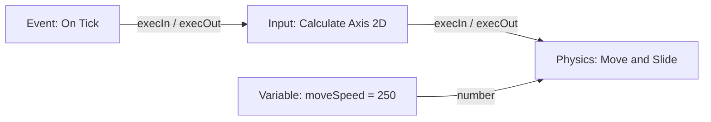
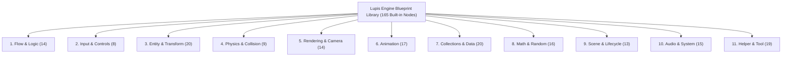
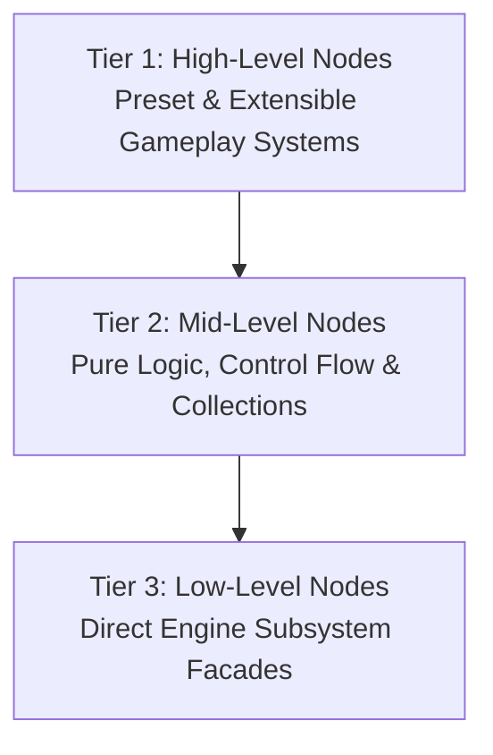
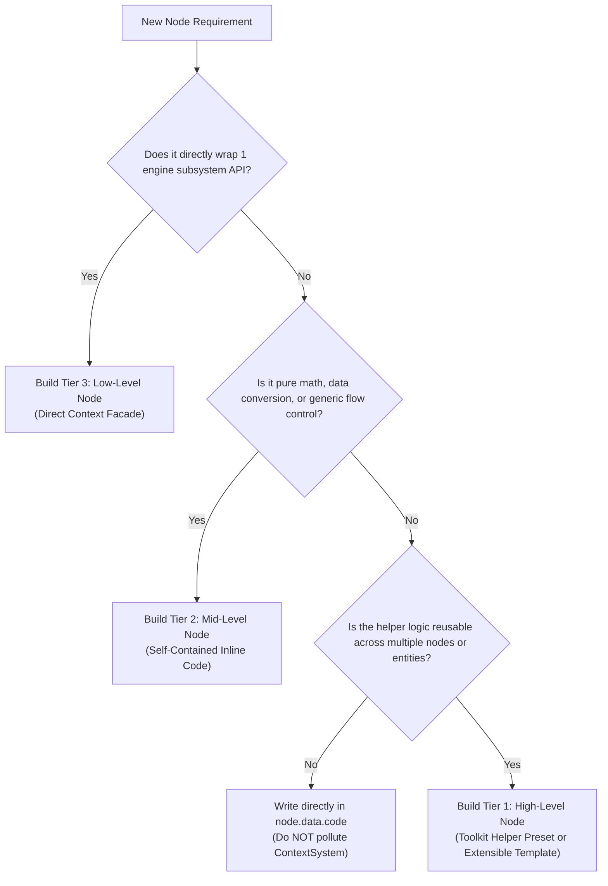
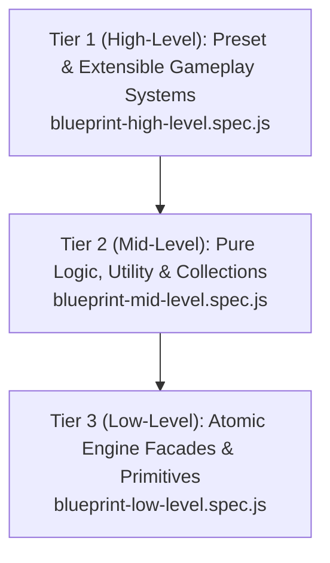

# Visual Scripting & Blueprint Reference

Lupis Engine scripts game logic as node graphs ("Blueprints"). Graphs are created and visually connected in the Node Graph Editor, validated and compiled by the compiler pipeline, and executed at runtime by the WebGL engine's `ScriptRunner`.

---

## 1. Graph Model & Architecture

A script graph is a directed acyclic or cyclical network of nodes connected by edges between typed ports.



### 1.1 Node Roles

Every node belongs to one of three roles:

| Role | Execution Pins | Purpose | Examples |
| :--- | :---: | :--- | :--- |
| `event` | Output only | Entry points triggered by runtime events or callbacks. | `On Tick`, `On Game Start`, `On Key Event`, `On Click / Tap` |
| `action` | Input & Output | Performs state mutations or triggers engine systems along the flow. | `Move and Slide`, `Spawn Prefab`, `Set Transform`, `Play Audio` |
| `pure` | None (Data only) | Computes or queries values on demand without mutating state. | `Add (+)`, `Compare`, `Distance 2D`, `Get Transform`, `List Length` |

### 1.2 Data Port Types & Color Coding

| Port Type | Color Hex | Sample Default | Permitted Coercions |
| :--- | :--- | :--- | :--- |
| `execution` | `#FFFFFF` | N/A | Flow execution only (white wires) |
| `number` | `#64B5F6` | `0` | Coerces to `string`, `boolean` |
| `string` | `#F48FB1` | `""` | Coerces to `number` (parsed), `boolean` |
| `boolean` | `#E57373` | `false` | Coerces to `number` (0 or 1), `string` |
| `list` | `#81C784` | `[]` | Coerces to `any` |
| `map` | `#FF8A65` | `{}` | Coerces to `any` |
| `any` | `#B0BEC5` | `null` | Connects to any data type |

---

## 2. The 11 Blueprint Modules (165 Built-in Nodes)

The visual scripting library is organized into **11 core category modules** (plus `BlueprintCustom`) located in `editor/src/features/nodes/library/blueprints/`, offering **165 built-in atomic and composite nodes**. For the complete specification of every node, port, option, and default code, see [Blueprint Nodes Reference](blueprint-nodes.md).



### Module Breakdown

| Module | Category ID | Color | Icon | Nodes Count | Reference |
| :--- | :--- | :--- | :--- | :---: | :--- |
| **Flow & Logic** | `flow_logic` | `#3F51B5` | `GitBranch` | **14** | [§2.1 Flow & Logic](blueprint-nodes.md#21-flow-logic) |
| **Input & Controls** | `input_controls` | `#4CAF50` | `Gamepad2` | **8** | [§2.2 Input & Controls](blueprint-nodes.md#22-input-controls) |
| **Entity & Transform** | `game_entity` | `#64B5F6` | `Box` | **20** | [§2.3 Entity & Transform](blueprint-nodes.md#23-game-entity) |
| **Physics & Collision** | `game_physics` | `#8BC34A` | `Activity` | **9** | [§2.4 Physics & Collision](blueprint-nodes.md#24-game-physics) |
| **Rendering & Camera** | `game_renderer` | `#00ACC1` | `Palette` | **14** | [§2.5 Rendering & Camera](blueprint-nodes.md#25-game-renderer) |
| **Animation** | `game_animation` | `#E91E63` | `Film` | **17** | [§2.6 Animation](blueprint-nodes.md#26-game-animation) |
| **Collections & Data** | `data_collections` | `#FF8A65` | `Database` | **20** | [§2.7 Collections & Data](blueprint-nodes.md#27-data-collections) |
| **Math & Random** | `math_operations` | `#009688` | `Calculator` | **16** | [§2.8 Math & Random](blueprint-nodes.md#28-math-operations) |
| **Scene & Lifecycle** | `game_lifecycle` | `#9C27B0` | `PlayCircle` | **13** | [§2.9 Scene & Lifecycle](blueprint-nodes.md#29-game-lifecycle) |
| **Audio & System** | `system_utilities` | `#06B6D4` | `Sliders` | **15** | [§2.10 Audio & System](blueprint-nodes.md#210-system-utilities) |
| **Helper & Tool** | `helper_tool` | `#AB47BC` | `Wrench` | **19** | [§2.11 Helper & Tool](blueprint-nodes.md#211-helper-tool) |
| **Custom** | `custom` | `#8B5CF6` | `Cpu` | **1** *(template)* | [§2.12 Custom](blueprint-nodes.md#212-custom) |

---

## 3. The 3-Tier Node Hierarchy & Authoring Contract

To balance **out-of-the-box convenience for beginners** and **unlimited extensibility for advanced engineers**, Lupis Engine structures all visual script nodes and custom behaviors into a **3-Tier Node Hierarchy**:



### 3.1 Tier Classification Matrix

| Tier | Name | Target Persona | Code Location | CodePanel View | State & Complexity | Example Nodes |
| :--- | :--- | :--- | :--- | :--- | :--- | :--- |
| **Tier 1** | **High-Level Nodes**<br>*(Presets & Extensible Templates)* | Gameplay Designer / Solo Dev | `core/Toolkit/` + Blueprint Code | Dispatcher or Modular Pipeline | Stateful, multi-frame, full domain orchestration & event hooks | `platformerController`, `topDownController`, `collectableItem`, `platformerCombat`, `volumeSliderManager` |
| **Tier 2** | **Mid-Level Nodes**<br>*(Pure Logic & Utility)* | All Developers | Inline `node.data.code` | Full Transparent Code | Pure, stateless, flow/math/collections | `logicBranch` (If/Else), `logicLoop`, `mathDistance2d`, `listShuffle`, `getFromPath` |
| **Tier 3** | **Low-Level Nodes**<br>*(Atomic Primitives)* | Advanced Programmer / System Architect | Inline `node.data.code` | Direct Context Facade Calls | Single instruction, 1:1 Engine API mapping | `entityDestroy`, `entitySpawn`, `getTransform`, `setLayer`, `moveAndSlide`, `solidCollision` |

---

### 3.2 Tier Invariants & Authoring Guidelines

#### Tier 1: High-Level Nodes (Preset & Extensible Gameplay Systems)
* **Goal**: Provide rich, complete gameplay systems—both as instant plug-and-play presets and configurable semi-open templates.
* **Authoring Rule**:
  1. The multi-frame state machine and helper logic **must live in `core/Toolkit/<Domain>/<Domain>Helper.js`**.
  2. **Preset Pattern (Plug & Play)**: For all-in-one nodes (`platformerController`, `volumeSliderManager`), the blueprint `data.code` acts as a clean dispatcher:
     ```javascript
     const helper = context.toolkit && context.toolkit.platformer;
     if (helper) {
       helper.processController(context.state, inputs, outputs, context);
     }
     return;
     ```
  3. **Extensible Template Pattern**: For customizable gameplay nodes (`collectableItem`, `platformerCombat`, `enemyChaser`), the helper exposes modular sub-functions (`helper.applyBobbing()`, `helper.checkOverlap()`, `helper.playAnimationAndDestroy()`), and the **Code Panel** displays a clean, commented modular pipeline:
     ```javascript
     const helper = context.toolkit.collectable;
     
     // 1. Optional visual idle bobbing
     if (inputs.autoBobbing) {
       helper.applyBobbing(context.owner, context.dt);
     }
     
     // 2. Detection hook
     const collector = helper.checkOverlap(context.owner, inputs.collectorTag);
     if (collector && inputs.canCollect !== false) {
       outputs.collectorEntity = collector.scriptId || collector.id;
       outputs.onCollected = true;
       context.triggerFlow('onCollected');
       
       // 3. Despawn lifecycle strategy
       if (inputs.despawnAction === 'destroy') {
         helper.playAnimationAndDestroy(context.owner, inputs.collectClip);
       } else if (inputs.despawnAction === 'deactivate') {
         helper.deactivateAndScheduleRespawn(context.owner, inputs.respawnTime);
       }
     }
     outputs.execOut = true;
     return;
     ```
  4. **Mandatory Event Hooks**: Must provide execution output pins (`onCollected`, `onHit`, `onAnimationEnd`, etc.) so users can wire custom behaviors without touching code.
  5. **Inversion of Control**: Must support non-destructive parameters (`despawnAction: 'none'`, `canCollect: false`) so external graph nodes can control lifecycle.

#### Tier 2: Mid-Level Nodes (Logic & Utility)
* **Goal**: Provide standard control flow, arithmetic, data transforms, and collection operations.
* **Authoring Rule**:
  1. Must be **100% self-contained** inside `node.data.code`.
  2. Must **never mutate engine subsystem entities** directly.
  3. Pure math nodes must have zero execution pins (pure data).
  4. Flow nodes (`branch`, `loop`, `delay`) route execution wires via `context.triggerFlow(portName)` or outputs assignments.

#### Tier 3: Low-Level Nodes (Atomic & Primitive)
* **Goal**: Direct 1:1 exposure of Context System APIs (`context.entity`, `context.audio`, `context.collider`, etc.).
* **Authoring Rule**:
  1. Must perform **one single atomic action**.
  2. Must strictly enforce fail-fast validation using `context.assert.*`. Never rely on defensive optional chaining (`?.`) or silent ignores.
  3. Must terminate with `outputs.execOut = true; return;`.

---

### 3.3 Decision Tree: "Which Tier Should I Build?"



---

### 3.4 The 3-Tier Testing Pyramid Architecture

The Playwright runtime test suite (`tests/e2e/specs/blueprint/`) maps directly 1:1 to the **3-Tier Hierarchy**:



| Layer / Tier | Authoring Tier | Spec File | Verification Scope | Example Test Scenarios |
| :--- | :--- | :--- | :--- | :--- |
| **High Level** | **Tier 1 (High-Level)** | `blueprint-high-level.spec.js` | Full composite gameplay systems, multi-frame state machines, controllers, and hook-driven extensible templates with customizable lifecycle policies. | • `platformerController` horizontal run & jump state<br>• `topDownController` 8-direction velocity & facing<br>• `volumeSliderManager` multi-channel audio setup<br>• `collectableItem` detection, hooks & IoC override<br>• `platformerCombat` hurtbox & health pipeline<br>• `enemyChaser` target acquisition & patrol |
| **Mid Level** | **Tier 2 (Mid-Level)** | `blueprint-mid-level.spec.js` | Pure stateless evaluations, control flow routing, arithmetic, string templating, collection queries/mutations, nested object path access, and loops. | • `mathAdd` dynamic multi-port summation<br>• `mathDistance2d` Euclidean vector distance<br>• `logicCompare` + `logicBranch` conditional routing<br>• `stringFormat` positional token interpolation<br>• `listGet` & `mapGet` collection retrieval<br>• `getFromPath` & `setFromPath` nested property traversal<br>• `logicLoop` range index accumulation |
| **Low Level** | **Tier 3 (Low-Level)** | `blueprint-low-level.spec.js` | Direct 1:1 Context facade operations, entity lifecycle commands, transform spatial mutations, scene graph layer sorting, kinematic physics velocity, and solid collision response. | • `entitySpawn` prefab instantiation<br>• `entityDestroy` removal with cascading child cleanup<br>• `entityClone` entity duplication<br>• `getTransform` / `setTransform` position & rotation<br>• `setLayer` Z-index sorting<br>• `moveAndSlide` kinematic velocity integration<br>• `solidCollision` obstacle containment |

Each test compiles a visual graph within an isolated scenario, boots the WebGL preview popup, and verifies real runtime behavior through deterministic notification logs. See [`tests/BLUEPRINT-TESTING.md`](../tests/BLUEPRINT-TESTING.md) for detailed guidelines.

---

## 4. Visual Scripting Contracts & Port Rules

To guarantee runtime safety, deterministic compilation, and zero downstream errors, all nodes across all 3 tiers must adhere to these strict contracts:

1. **T-001 Alphanumeric Port IDs**:
   All port IDs must strictly match `/^[A-Za-z][A-Za-z0-9]{0,31}$/`. Spaces, dashes (`-`), dots (`.`), and underscores (`_`) are strictly forbidden.
2. **Canonical Port Dictionary**:
   Ports must use standardized names (e.g., `execIn`, `execOut`, `targetEntity`, `value`, `amount`, `result`). Deprecated aliases (`in`, `out`, `val`, `res`, `targetId`) are disallowed.
3. **Zero Port Labels**:
   Ports do not store a `label` property; the engine UI renders ports directly by their canonical `id`.
4. **Single-Assignment & Direct Inputs Access**:
   - Access inputs: `const target = inputs.targetEntity;` (not `inputs['targetEntity']`).
   - Write outputs: `outputs.result = true;` (direct assignment).
5. **Mandatory Return Termination**:
   Every node code snippet must terminate with an explicit `return;`.
6. **Zero Defensive Null-Checking**:
   Nodes must never use `?.` or `??` for invariant validation. Instead, use `context.assert.*` which halts node execution cleanly on contract violation.
7. **Execution Context Sandbox**:
   Node code is strictly prohibited from accessing `context.game`. All communication must use `context.<domain>` or `context.toolkit.<domain>`.
8. **Context Generality & Reusability Gate**:
   - Never introduce node-specific functions into the Context System.
   - If an algorithm, state calculation, or mechanic is only needed by one specific node and lacks broad reusability, it **must be written directly in `node.data.code`**.
   - `ContextSystem` must remain strictly general, domain-focused, and completely decoupled from any single node's identity.

For detailed documentation on the runtime context API available to nodes, see [Context System API Reference](context-system.md).
