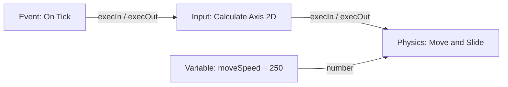
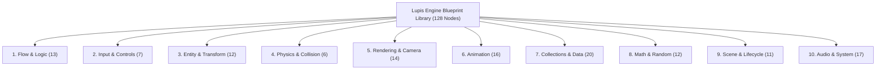

# Visual Scripting & Blueprint Reference

Lupis Engine scripts game logic as node graphs ("Blueprints"). Graphs are created and visually connected in the Node Graph Editor, validated and compiled by the compiler pipeline, and executed at runtime by the WebGL engine's `ScriptRunner`.

---

## 1. Graph Model & Architecture

A script graph is a directed acyclic or cyclical network of nodes connected by edges between typed ports.

### 1.1 Node Roles

Every node belongs to one of three roles:

| Role | Execution Pins | Purpose | Examples |
| :--- | :---: | :--- | :--- |
| `event` | Output only | Entry points triggered by runtime events or callbacks. | `On Tick`, `On Game Start`, `On Key Event`, `On Click / Tap` |
| `action` | Input & Output | Performs state mutations or triggers engine systems along the flow. | `Move and Slide`, `Spawn Prefab`, `Set Transform`, `Play Audio` |
| `pure` | None (Data only) | Computes or queries values on demand without mutating state. | `Add (+)`, `Compare`, `Distance 2D`, `Get Transform`, `List Length` |

### 1.2 Data Port Types & Color Coding

| Port Type | Color Hex | Sample Default | Permitted Coercions |
| :--- | :--- | :--- | :--- |
| `execution` | `#FFFFFF` | N/A | Flow execution only (white wires) |
| `number` | `#64B5F6` | `0` | Coerces to `string`, `boolean` |
| `string` | `#F48FB1` | `""` | Coerces to `number` (parsed), `boolean` |
| `boolean` | `#E57373` | `false` | Coerces to `number` (0 or 1), `string` |
| `list` | `#81C784` | `[]` | Coerces to `any` |
| `map` | `#FF8A65` | `{}` | Coerces to `any` |
| `any` | `#B0BEC5` | `null` | Connects to any data type |

---

## 2. The 10 Consolidated Blueprint Modules (128 Nodes)

The visual scripting library is consolidated into **10 core modules** located in `editor/src/features/nodes/library/blueprints/`, offering **128 atomic and composite nodes**:

### Module Breakdown

| Module | Category ID | Color | Icon | Nodes Count | Included Node Types |
| :--- | :--- | :--- | :--- | :---: | :--- |
| **Flow & Logic** | `flow_logic` | `#3F51B5` | `GitBranch` | **13** | `logicBranch` (If/Else), `logicSwitch`, `logicCompare`, `logicAnd`, `logicOr`, `logicNot`, `logicLoop` (For), `logicForEach`, `logicWhile`, `logicFlowMerge`, `logicDelay`, `logicCooldown`, `logicTypewriter`. |
| **Input & Controls** | `input_controls` | `#4CAF50` | `Gamepad2` | **7** | `eventOnKey`, `getKeyState`, `calculateAxis2d`, `simulateKey`, `eventPointerTap` (Unified Click/Tap), `eventPointerDrag` (Unified Drag/Swipe), `mouseEntityInteract`. |
| **Entity & Transform** | `game_entity` | `#64B5F6` | `Box` | **12** | `entitySpawn`, `entityDestroy` (with `destroyParent` toggle), `entityClone`, `entityGetChildren`, `entityGetParent`, `getObject`, `setObject`, `findClosestByTag`, `getTransform`, `setTransform`, `getLayer`, `setLayer`. |
| **Physics & Collision** | `game_physics` | `#8BC34A` | `Activity` | **6** | `moveAndSlide`, `solidCollision`, `triggerZone`, `getPhysics`, `setPhysics`, `setFaceDirection`. |
| **Rendering & Camera** | `game_renderer` | `#00ACC1` | `Palette` | **14** | `getSprite`, `setSprite`, `getText`, `setText`, `getShape`, `setShape`, `getTilemap`, `setTilemap`, `batchSet`, `actionFadeScreen`, `actionCameraFollow`, `actionCameraStopFollow`, `actionCameraSetTransform`, `queryCameraInfo`. |
| **Animation** | `game_animation` | `#E91E63` | `Film` | **16** | 10 Tweens (`logicTweenValue`, `tweenMoveTo`, `tweenScaleTo`, `tweenRotateTo`, `tweenResizeTo`, `tweenFadeTo`, `tweenCropTo`, `tweenFillAmount`, `actionShakeTransform`, `uiButtonScaleEffect`) + 6 Animator Clips (`playAnimation`, `pauseAnimation`, `getAnimator`, `setAnimator`, `getClipProp`, `setClipProp`). |
| **Collections & Data** | `data_collections` | `#FF8A65` | `Database` | **20** | 10 List Nodes (`listGet`, `listSet`, `listPush`, `listInsert`, `listRemoveAt`, `listLength`, `listContains`, `listIndexOf`, `listConcat`, `listShuffle`) + 8 Map Nodes (`mapGet`, `mapSet`, `mapRemove`, `mapHas`, `mapMerge`, `mapKeys`, `mapValues`, `mapSize`) + 2 Nested Path Accessors (`getFromPath`, `setFromPath`). |
| **Math & Random** | `math_operations` | `#009688` | `Calculator` | **12** | 8 Math Operations (`mathAdd`, `mathSubtract`, `mathMultiply`, `mathDivide`, `mathNegate`, `mathRound`, `mathDistance2d`, `mathDirection2d`) + 4 Random Operations (`randomSmart`, `randomChance`, `randomFromList`, `randomColor`). |
| **Scene & Lifecycle** | `game_lifecycle` | `#9C27B0` | `PlayCircle` | **11** | 6 Lifecycle Events (`eventTick`, `eventGameStart`, `eventGamePause`, `eventGameResume`, `eventGameRestart`, `eventGameQuit`) + 1 Universal Game State Action (`actionSetGameState`) + 4 Scene Nodes (`eventSceneStart`, `changeScene`, `restartScene`, `getCurrentScene`). |
| **Audio & System** | `system_utilities` | `#06B6D4` | `Sliders` | **17** | 5 Audio Nodes (`playAudio`, `stopAudio`, `setAudioVolume`, `getAudioVolume`, `setAudioMute`) + 2 Variables (`variableGet`, `variableSet`) + 4 Strings (`stringFormat`, `stringJoin`, `stringLength`, `anyToString`) + 2 Signals (`actionEmitSignal`, `eventOnSignal`) + 2 Notifications + 2 Visual Novel Story Helpers (`vnDialogueRunner`, `vnChoicePresenter`). |

---

## 3. Dual-Tier Architecture: Visual Nodes & The Code Panel

Lupis Engine bridges the gap between novice creators and advanced game engineers through a **two-tiered development pipeline**:

### 3.1 Tier 1: Visual Scripting for ~80% of 2D Game Genres
The 128 nodes empower designers and beginner developers to build full game loops across major 2D genres without touching a line of code:
- **2D Platformers**: `calculateAxis2d` $\rightarrow$ `moveAndSlide` $\rightarrow$ `solidCollision` $\rightarrow$ `playAnimation`.
- **Top-Down RPGs**: `triggerZone` $\rightarrow$ `vnDialogueRunner` $\rightarrow$ `setTransform` $\rightarrow$ `listPush`.
- **Visual Novels / Story Games**: `vnDialogueRunner` $\rightarrow$ `vnChoicePresenter` $\rightarrow$ `actionFadeScreen`.
- **Arcade / Bullet Hell**: `entitySpawn` $\rightarrow$ `mathDirection2d` $\rightarrow$ `setPhysics` $\rightarrow$ `actionShakeTransform`.
- **Hyper-casual / Clickers**: `eventPointerTap` $\rightarrow$ `uiButtonScaleEffect` $\rightarrow$ `mathAdd` $\rightarrow$ `setText`.

### 3.2 High-Level "God Nodes" vs. Spaghetti Graphs
Rather than forcing users to wire 20+ atomic math/loop pins for complex recurring mechanics, Lupis Engine introduces **High-Level Composite ("God") Nodes**:
- **`vnDialogueRunner`**: Handles character portraits, speaker names, typewriter text interpolation, sound triggers, and variable bindings in a single configured node.
- **`actionSetGameState`**: Manages pause, resume, restart, and quit actions via a simple drop-down mode selector.
- **`uiButtonScaleEffect`**: Handles hover, press, raycast testing, and spring-like lerp scale animation within one node.

### 3.3 Tier 2: The Code Panel for Advanced Game Systems
For the remaining 20% of specialized, algorithmic game features:
- **A\* Pathfinding & Grid Search**
- **Procedural Level / Dungeon Generation**
- **Complex Inventory / Crafting Trees**
- **Custom Shader & Post-Processing Effects**

Developers can select any node in the graph, switch to the **Code Panel**, and write raw JavaScript/TypeScript directly using the standard [Context System API](context-system.md).

---

## 4. Visual Scripting Contracts & Port Rules

To guarantee runtime safety and zero downstream errors, all nodes follow these strict standards:

1. **T-001 Alphanumeric Port IDs**:
   All port IDs must strictly match `/^[A-Za-z][A-Za-z0-9]{0,31}$/`. Spaces, dashes (`-`), dots (`.`), and underscores (`_`) are strictly forbidden.
2. **Canonical Port Dictionary**:
   Ports must use standardized names (e.g., `execIn`, `execOut`, `targetEntity`, `value`, `amount`, `result`). Deprecated aliases (`in`, `out`, `val`, `res`, `targetId`) are disallowed.
3. **Zero Port Labels**:
   Ports do not store a `label` property; the engine UI renders ports directly by their canonical `id`.
4. **Single-Assignment & Direct Inputs Access**:
   - Access inputs: `const target = inputs.targetEntity;` (not `inputs['targetEntity']`).
   - Write outputs: `outputs.result = true;` (direct assignment).
5. **Mandatory Return Termination**:
   Every node code snippet must terminate with an explicit `return;`.
6. **Zero Defensive Null-Checking**:
   Nodes must never use `?.` or `??` for invariant validation. Instead, use `context.assert.*` which halts node execution cleanly on contract violation.

For detailed documentation on the runtime context API available to nodes, see [Context System API Reference](context-system.md).
