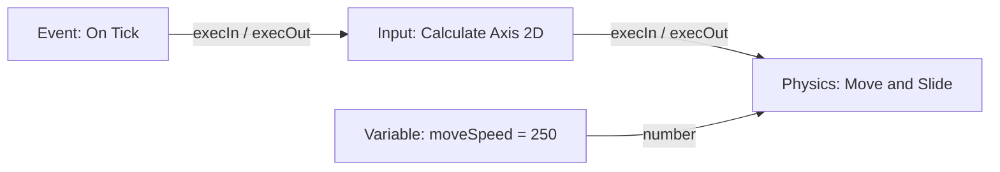
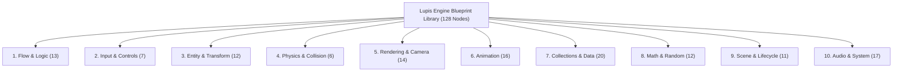
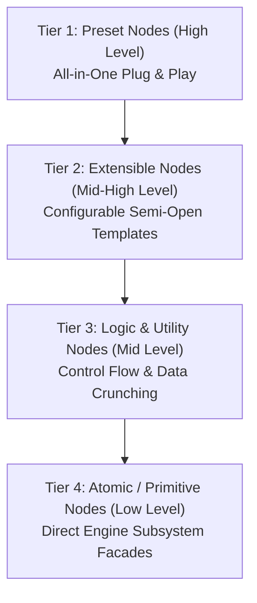
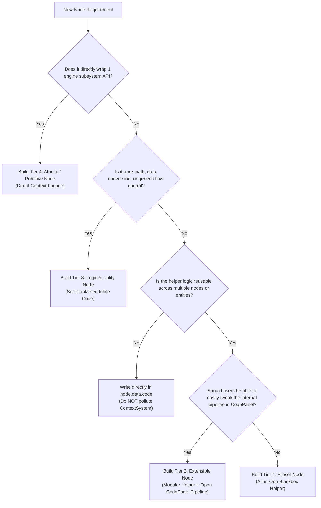

# Visual Scripting & Blueprint Reference

Lupis Engine scripts game logic as node graphs ("Blueprints"). Graphs are created and visually connected in the Node Graph Editor, validated and compiled by the compiler pipeline, and executed at runtime by the WebGL engine's `ScriptRunner`.

---

## 1. Graph Model & Architecture

A script graph is a directed acyclic or cyclical network of nodes connected by edges between typed ports.



### 1.1 Node Roles

Every node belongs to one of three roles:

| Role | Execution Pins | Purpose | Examples |
| :--- | :---: | :--- | :--- |
| `event` | Output only | Entry points triggered by runtime events or callbacks. | `On Tick`, `On Game Start`, `On Key Event`, `On Click / Tap` |
| `action` | Input & Output | Performs state mutations or triggers engine systems along the flow. | `Move and Slide`, `Spawn Prefab`, `Set Transform`, `Play Audio` |
| `pure` | None (Data only) | Computes or queries values on demand without mutating state. | `Add (+)`, `Compare`, `Distance 2D`, `Get Transform`, `List Length` |

### 1.2 Data Port Types & Color Coding

| Port Type | Color Hex | Sample Default | Permitted Coercions |
| :--- | :--- | :--- | :--- |
| `execution` | `#FFFFFF` | N/A | Flow execution only (white wires) |
| `number` | `#64B5F6` | `0` | Coerces to `string`, `boolean` |
| `string` | `#F48FB1` | `""` | Coerces to `number` (parsed), `boolean` |
| `boolean` | `#E57373` | `false` | Coerces to `number` (0 or 1), `string` |
| `list` | `#81C784` | `[]` | Coerces to `any` |
| `map` | `#FF8A65` | `{}` | Coerces to `any` |
| `any` | `#B0BEC5` | `null` | Connects to any data type |

---

## 2. The 10 Consolidated Blueprint Modules (128 Nodes)

The visual scripting library is consolidated into **10 core modules** located in `editor/src/features/nodes/library/blueprints/`, offering **128 atomic and composite nodes**:



### Module Breakdown

| Module | Category ID | Color | Icon | Nodes Count | Included Node Types |
| :--- | :--- | :--- | :--- | :---: | :--- |
| **Flow & Logic** | `flow_logic` | `#3F51B5` | `GitBranch` | **13** | `logicBranch` (If/Else), `logicSwitch`, `logicCompare`, `logicAnd`, `logicOr`, `logicNot`, `logicLoop` (For), `logicForEach`, `logicWhile`, `logicFlowMerge`, `logicDelay`, `logicCooldown`, `logicTypewriter`. |
| **Input & Controls** | `input_controls` | `#4CAF50` | `Gamepad2` | **7** | `eventOnKey`, `getKeyState`, `calculateAxis2d`, `simulateKey`, `eventPointerTap` (Unified Click/Tap), `eventPointerDrag` (Unified Drag/Swipe), `mouseEntityInteract`. |
| **Entity & Transform** | `game_entity` | `#64B5F6` | `Box` | **14** | `entitySpawn`, `entityDestroy` (with `destroyParent` toggle), `entityDestroyByTag`, `layerDestroy`, `entityClone`, `entityGetChildren`, `entityGetParent`, `getObject`, `setObject`, `findClosestByTag`, `getTransform`, `setTransform`, `getLayer`, `setLayer`. |
| **Physics & Collision** | `game_physics` | `#8BC34A` | `Activity` | **6** | `moveAndSlide`, `solidCollision`, `triggerZone`, `getPhysics`, `setPhysics`, `setFaceDirection`. |
| **Rendering & Camera** | `game_renderer` | `#00ACC1` | `Palette` | **14** | `getSprite`, `setSprite`, `getText`, `setText`, `getShape`, `setShape`, `getTilemap`, `setTilemap`, `batchSet`, `actionFadeScreen`, `actionCameraFollow`, `actionCameraStopFollow`, `actionCameraSetTransform`, `queryCameraInfo`. |
| **Animation** | `game_animation` | `#E91E63` | `Film` | **16** | 10 Tweens (`logicTweenValue`, `tweenMoveTo`, `tweenScaleTo`, `tweenRotateTo`, `tweenResizeTo`, `tweenFadeTo`, `tweenCropTo`, `tweenFillAmount`, `actionShakeTransform`, `uiButtonScaleEffect`) + 6 Animator Clips (`playAnimation`, `pauseAnimation`, `getAnimator`, `setAnimator`, `getClipProp`, `setClipProp`). |
| **Collections & Data** | `data_collections` | `#FF8A65` | `Database` | **20** | 10 List Nodes (`listGet`, `listSet`, `listPush`, `listInsert`, `listRemoveAt`, `listLength`, `listContains`, `listIndexOf`, `listConcat`, `listShuffle`) + 8 Map Nodes (`mapGet`, `mapSet`, `mapRemove`, `mapHas`, `mapMerge`, `mapKeys`, `mapValues`, `mapSize`) + 2 Nested Path Accessors (`getFromPath`, `setFromPath`). |
| **Math & Random** | `math_operations` | `#009688` | `Calculator` | **12** | 8 Math Operations (`mathAdd`, `mathSubtract`, `mathMultiply`, `mathDivide`, `mathNegate`, `mathRound`, `mathDistance2d`, `mathDirection2d`) + 4 Random Operations (`randomSmart`, `randomChance`, `randomFromList`, `randomColor`). |
| **Scene & Lifecycle** | `game_lifecycle` | `#9C27B0` | `PlayCircle` | **12** | 6 Lifecycle Events (`eventTick`, `eventGameStart`, `eventGamePause`, `eventGameResume`, `eventGameRestart`, `eventGameQuit`) + 2 Game State Actions (`actionSetGameState`, `changeScreen`) + 4 Scene Nodes (`eventSceneStart`, `changeScene`, `restartScene`, `getCurrentScene`). |
| **Audio & System** | `system_utilities` | `#06B6D4` | `Sliders` | **15** | 5 Audio Nodes (`playAudio`, `stopAudio`, `setAudioVolume`, `getAudioVolume`, `setAudioMute`) + 2 Variables (`variableGet`, `variableSet`) + 4 Strings (`stringFormat`, `stringJoin`, `stringLength`, `anyToString`) + 2 Signals (`actionEmitSignal`, `eventOnSignal`) + 2 Notifications. |
| **Helper & Tool** | `helper_tool` | `#AB47BC` | `Wrench` | **5** | `volumeSliderManager` (Unified 4-Channel Automatic Slider), `switchButtonShape` (Shape-based Toggle Switch with Sliding Knob, `isOn` boolean output & `onOn`/`onOff` execution outputs), `switchButtonImage` (Image-based Toggle Switch with 1-4 Assets Support, `isOn` boolean output & `onOn`/`onOff` execution outputs), `vnDialogueRunner` (Dialogue Runner), `vnChoicePresenter` (Choice Presenter). |

---

## 3. The 4-Tier Node Hierarchy & Authoring Contract

To balance **out-of-the-box convenience for beginners** and **unlimited extensibility for advanced engineers**, Lupis Engine structures all visual script nodes and custom behaviors into a **4-Tier Node Hierarchy**:



### 3.1 Tier Classification Matrix

| Tier | Name | Target Persona | Code Location | CodePanel View | State & Complexity | Example Nodes |
| :--- | :--- | :--- | :--- | :--- | :--- | :--- |
| **Tier 1** | **Preset Nodes**<br>*(High Level)* | Beginner / Solo Dev | `core/Toolkit/` Helper | Minimal Dispatcher (3–5 lines) | Stateful, multi-frame, full domain orchestration | `platformerController`, `vnDialogueRunner`, `volumeSliderManager` |
| **Tier 2** | **Extensible Nodes**<br>*(Mid-High Level)* | Gameplay Designer / Scripter | `core/Toolkit/` (Modular) + Blueprint Code | Semi-Open Modular Pipeline | Stateful, hook-driven, parameter-rich | `collectableItem`, `platformerCombat`, `enemyPatrol` |
| **Tier 3** | **Logic & Utility Nodes**<br>*(Mid Level)* | All Developers | Inline `node.data.code` | Full Transparent Code | Pure, stateless, flow/math only | `logicBranch` (If/Else), `logicDelay`, `mathDistance2d`, `listShuffle` |
| **Tier 4** | **Atomic / Primitive Nodes**<br>*(Low Level)* | Advanced Programmer / System Architect | Inline `node.data.code` | Direct Context Facade Calls | Single instruction, 1:1 Engine API mapping | `entityDestroy`, `playAudio`, `getTransform`, `setSprite` |

---

### 3.2 Tier Invariants & Authoring Guidelines

#### Tier 1: Preset Nodes (High-Level Plug & Play)
* **Goal**: Provide instant, zero-wire functionality for recurring game systems.
* **Authoring Rule**:
  1. The entire multi-frame state machine and logic **must live in `core/Toolkit/<Domain>/<Domain>Helper.js`**.
  2. The blueprint `data.code` must only act as a dispatch bridge:
     ```javascript
     const helper = context.toolkit && context.toolkit.platformer;
     if (helper) {
       helper.processController(context.state, inputs, outputs, context);
     }
     return;
     ```
  3. All persistent transient states must be attached to the target entity (`target._controller`) or node state (`context.state`).

#### Tier 2: Extensible Nodes (Mid-High Level Templates)
* **Goal**: Deliver high-level functionality while giving users complete freedom to inspect, customize, or override the behavior.
* **Authoring Rule**:
  1. The underlying helper in `core/Toolkit/` **must expose granular, modular sub-functions** (e.g. `helper.applyBobbing()`, `helper.checkOverlap()`, `helper.playAnimationAndDestroy()`).
  2. The code shown in the **Code Panel** must not be an opaque one-liner; it should present a clean, commented modular pipeline that users can edit or extend:
     ```javascript
     const helper = context.toolkit.collectable;
     
     // 1. Optional visual idle bobbing
     if (inputs.autoBobbing) {
       helper.applyBobbing(context.owner, context.dt);
     }
     
     // 2. Detection hook
     const collector = helper.checkOverlap(context.owner, inputs.collectorTag);
     if (collector && inputs.canCollect !== false) {
       outputs.collectorEntity = collector.scriptId || collector.id;
       outputs.onCollected = true;
       context.triggerFlow('onCollected');
       
       // 3. Despawn lifecycle strategy
       if (inputs.despawnAction === 'destroy') {
         helper.playAnimationAndDestroy(context.owner, inputs.collectClip);
       } else if (inputs.despawnAction === 'deactivate') {
         helper.deactivateAndScheduleRespawn(context.owner, inputs.respawnTime);
       }
     }
     outputs.execOut = true;
     return;
     ```
  3. **Mandatory Event Hooks**: Must provide execution output pins (e.g., `onCollected`, `onHit`, `onAnimationEnd`, `onRespawn`) so users can wire custom behaviors without touching code.
  4. **Inversion of Control**: Must support non-destructive options like `despawnAction: 'none'` or `canCollect: false` so external graph nodes can control lifecycle.

#### Tier 3: Logic & Utility Nodes (Mid Level)
* **Goal**: Provide standard control flow, arithmetic, data transforms, and timers.
* **Authoring Rule**:
  1. Must be **100% self-contained** inside `node.data.code`.
  2. Must **never mutate engine subsystem entities** directly.
  3. Pure math nodes must have zero execution pins (pure data).
  4. Flow nodes (`branch`, `loop`, `delay`) route execution wires via `context.triggerFlow(portName)` or outputs assignments.

#### Tier 4: Atomic & Primitive Nodes (Low Level)
* **Goal**: Direct 1:1 exposure of Context System APIs (`context.entity`, `context.audio`, `context.collider`, etc.).
* **Authoring Rule**:
  1. Must perform **one single atomic action**.
  2. Must strictly enforce fail-fast validation using `context.assert.*`. Never rely on defensive optional chaining (`?.`) or silent ignores.
  3. Must terminate with `outputs.execOut = true; return;`.

---

### 3.3 Decision Tree: "Which Tier Should I Build?"



---

## 4. Visual Scripting Contracts & Port Rules

To guarantee runtime safety, deterministic compilation, and zero downstream errors, all nodes across all 4 tiers must adhere to these strict contracts:

1. **T-001 Alphanumeric Port IDs**:
   All port IDs must strictly match `/^[A-Za-z][A-Za-z0-9]{0,31}$/`. Spaces, dashes (`-`), dots (`.`), and underscores (`_`) are strictly forbidden.
2. **Canonical Port Dictionary**:
   Ports must use standardized names (e.g., `execIn`, `execOut`, `targetEntity`, `value`, `amount`, `result`). Deprecated aliases (`in`, `out`, `val`, `res`, `targetId`) are disallowed.
3. **Zero Port Labels**:
   Ports do not store a `label` property; the engine UI renders ports directly by their canonical `id`.
4. **Single-Assignment & Direct Inputs Access**:
   - Access inputs: `const target = inputs.targetEntity;` (not `inputs['targetEntity']`).
   - Write outputs: `outputs.result = true;` (direct assignment).
5. **Mandatory Return Termination**:
   Every node code snippet must terminate with an explicit `return;`.
6. **Zero Defensive Null-Checking**:
   Nodes must never use `?.` or `??` for invariant validation. Instead, use `context.assert.*` which halts node execution cleanly on contract violation.
7. **Execution Context Sandbox**:
   Node code is strictly prohibited from accessing `context.game`. All communication must use `context.<domain>` or `context.toolkit.<domain>`.
8. **Context Generality & Reusability Gate**:
   - Never introduce node-specific functions into the Context System.
   - If an algorithm, state calculation, or mechanic is only needed by one specific node and lacks broad reusability, it **must be written directly in `node.data.code`**.
   - `ContextSystem` must remain strictly general, domain-focused, and completely decoupled from any single node's identity.

For detailed documentation on the runtime context API available to nodes, see [Context System API Reference](context-system.md).
