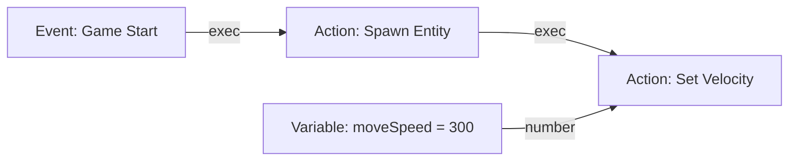

# Visual scripting

Lupis Engine scripts game logic as node graphs ("blueprints"). A graph is edited in the editor, validated and compiled there, and executed by the runtime.

## Graph model

A graph is a set of nodes connected by edges between pins.

- **Execution pins** (white) define the order in which nodes run.
- **Data pins** (colored) carry typed values.
- Each node has a role: `event` (starts a flow), `action` (does work, has execution pins), or `pure` (computes a value on demand, no execution pins).

### Pin types

| Type | Color |
| :--- | :--- |
| `execution` | `#FFFFFF` |
| `number` | `#64B5F6` |
| `string` | `#F48FB1` |
| `boolean` | `#E57373` |
| `list` | `#4DD0E1` |
| `map` | `#FF8A65` |
| `any` | `#B0BEC5` |

The editor allows automatic conversion between some types (for example number to string). Invalid connections are rejected during validation.

## Node categories

Nodes are defined in `editor/src/features/nodes/library/blueprints/`, one file per category.

| Group | Blueprint files |
| :--- | :--- |
| Lifecycle and events | `Lifecycle`, `Event`, `System` |
| Entity and scene | `Entity`, `Scene`, `Transform`, `Camera` |
| Physics and collision | `Physics`, `Collider` |
| Rendering and animation | `Renderer`, `Animator`, `Transition` |
| Input | `Keyboard`, `Mouse`, `Pointer` |
| Math and logic | `Math`, `Comparison`, `Boolean`, `Random` |
| Data | `Variable`, `String`, `List`, `Map` |
| Flow control | `Loop` (For, While, Break, Branch) |

The full node list per file is in [editor-reference.md §5.2](editor-reference.md#52-node-blueprint-categories).

## Execution

When a scene runs:

1. `ScriptLoader` compiles each graph's JSON into an executable chain.
2. `ScriptRunner` runs the chain when its event fires (for example each `update(dt)`).
3. `ContextSystem` resolves variables by scope:

| Scope | Lifetime | Storage |
| :--- | :--- | :--- |
| Local | One running script instance | Script `localVariables` |
| Entity | The host entity | `customParameters` on the entity's `ScriptController` binding |
| Global | Across scenes | `VariableManager`, declared in project `globalVariables` |

Scripts are attached to entities through the `ScriptController` component and addressed by `scriptId`.

## Custom nodes

A node must satisfy the node contract in `editor/src/features/nodes/contract/` and `core/Script/contract/`. The structure of `ScriptNode`, `ScriptPort`, and `ScriptEdge` is specified in [schema-contract §8](schema-contract.md#8-visual-scripting-and-blueprint-contract). Port IDs must match `PORT_ID_REGEX` (`/^[A-Za-z][A-Za-z0-9]{0,31}$/`).

## Debugging

In the editor, the active execution path is highlighted on the graph during preview, and pin values can be inspected in the Node Inspector. Breakpoints can be set on execution pins.
