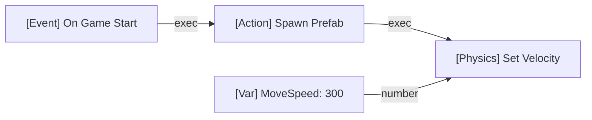

# ⚡ Visual Scripting & Blueprint Guide

Lupis Engine features a node-graph visual scripting system inspired by Unreal Engine Blueprints and Godot VisualScript. It enables game creators to implement game logic, physics behaviors, UI interactions, and state machines without writing code.

---

## 1. Core Concepts

A Blueprint graph consists of:
- **Nodes**: Logical operations (events, actions, math, branching).
- **Execution Pins (White)**: Dictate step-by-step control flow (`exec-in` and `exec-out`).
- **Data Pins (Colored)**: Carry strongly-typed values (`number`, `string`, `boolean`, `vector`, `entity`, `object`).



---

## 2. Standard Node Categories

Lupis Engine includes an extensive library of verified visual nodes:

| Category | Typical Nodes |
| :--- | :--- |
| **Lifecycle & Events** | `OnStart`, `OnUpdate`, `OnDestroy`, `OnTriggerEnter`, `OnTriggerExit`, `OnCustomEvent` |
| **Entity & Hierarchy** | `FindEntity`, `GetEntityProperty`, `SetEntityProperty`, `SpawnPrefab`, `DestroyEntity` |
| **Transform & Camera** | `Translate`, `Rotate`, `SetScale`, `CameraFollow`, `SetCameraZoom`, `ScreenToWorld` |
| **Physics & Motion** | `AddForce`, `SetVelocity`, `GetVelocity`, `MoveAndSlide`, `Raycast` |
| **Math & Logic** | `Add`, `Subtract`, `Multiply`, `Divide`, `Clamp`, `Lerp`, `Branch (If)`, `Compare` |
| **Input** | `IsKeyPressed`, `OnKeyDown`, `GetMousePosition`, `OnPointerDown` |
| **Audio** | `PlaySound`, `StopSound`, `PlayMusic`, `SetVolume` |
| **Variables & State** | `GetVariable`, `SetVariable`, `IncrementVariable`, `ToggleBoolean` |
| **Flow Control** | `Branch`, `Sequence`, `ForLoop`, `WhileLoop`, `Delay` |

---

## 3. Script Execution Runtime (`ContextSystem.js`)

When a game scene runs:
1. `ScriptLoader` compiles the node graph JSON into an executable topological graph.
2. `ScriptRunner` executes node blocks based on event triggers (e.g. `update(dt)`).
3. The `ContextSystem` manages scope:
   - **Local Variables**: Unique to the running script instance.
   - **Entity Variables**: Tied to the host Entity.
   - **Global Variables**: Shared across scenes via `VariableManager`.

---

## 4. Contract Schema: Creating Custom Nodes

Custom nodes must adhere to the node contract in `core/Script/contract/`:

```javascript
export const MyCustomNodeContract = {
    id: "custom.math.doubler",
    title: "Double Value",
    category: "Math/Custom",
    color: "#4CAF50",
    inputs: [
        { name: "value", type: "number", defaultValue: 0 }
    ],
    outputs: [
        { name: "result", type: "number" }
    ],
    execute(context, inputs) {
        return {
            result: inputs.value * 2
        };
    }
};
```

---

## 5. Debugging & Stepping

In the Visual Editor:
- You can place breakpoints on execution pins.
- Active execution flows highlight in real-time on the Node Graph canvas during live preview.
- Inspect pin values in the **Node Inspector** side panel.
